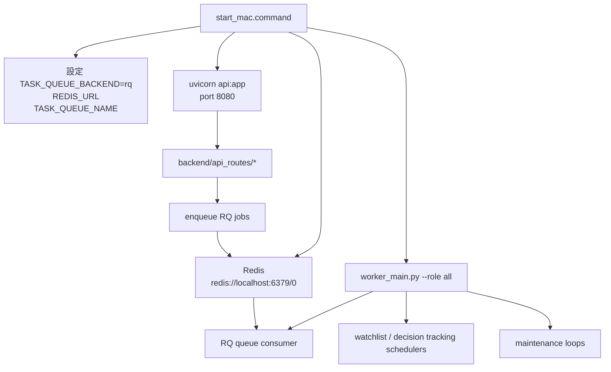
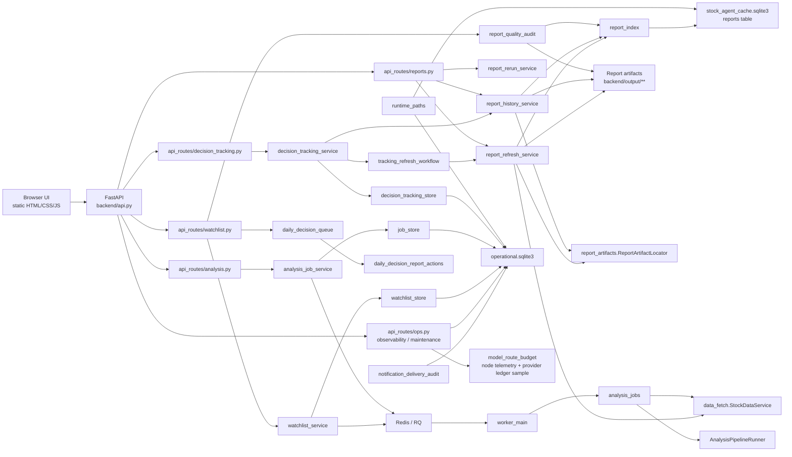
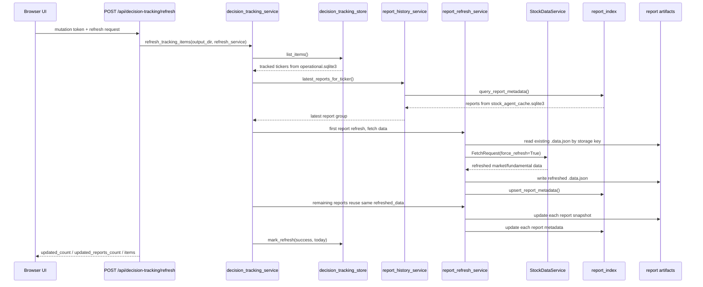
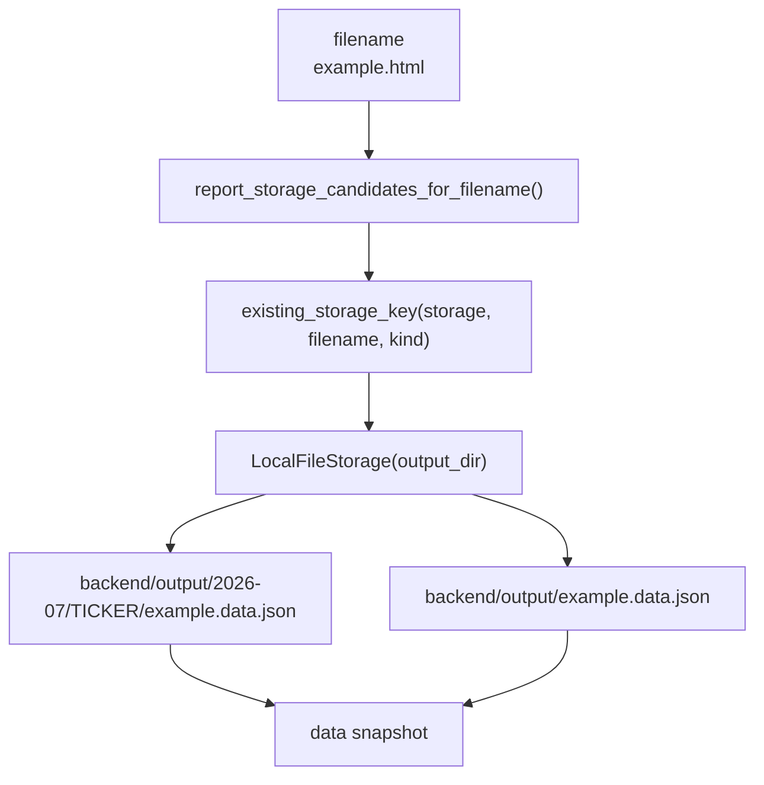

# 系統架構關聯圖

2026-10-18（緯穎／裕民正文已正式接入）：新增精確主檔／原件身分與財務期間資格，緯穎Q2與Q1-Q2分開、版權限制及行情股本口徑警語保留；裕民Q3會議不是Q3財務，角色選頁保留情境風險、排除未核驗圖表推算。564相關回歸在最終季度／單位邊界補強前通過，最後20專項通過，不加總。start_mac獨立session正式API14854／worker14848、health／ready200；真正resident來源POST各200／3.027與4.409秒、補6／29頁，原HTML／MD／分析品質／quoteTTM保持且分析stale。859報告／1109jobs／5147 artifacts與checkpoint保持，僅兩data及精確checksum sidecar改變，198scheduler/job值保持。兩個正常股票快照200、核心正文verified／法說0HTTP；冷核心21.515／17.545秒，不宣稱速度改善。同窗排除兩新事件重算112/140→114/142=80.28%，19/21類>80、兩年度類無native樣本，完整目標未達。[接入與界線](evidence/source-acquisition/20261018/datacenter-shipping-integration/README.md)、[正式保全](evidence/source-acquisition/20261018/datacenter-shipping-release/README.md)。

2026-10-18 06:27（服務恢復）：續作發現API／worker／Redis與原PTY均不存在，非主機重開機；原日誌最後約05:20正常紀錄，終止根因未確認。1113後端與env／launcher hash和已部署版相同，保存RDB備份及資料基準後從start_mac正式入口以獨立session恢復launcher11390／API11425／worker11421、health／ready200；無新增排程或開機自啟。859報告／1109jobs／5147 artifacts與checkpoint／原分析品質保持，無active jobs。新24h窗口18/21類>80，法說112/140=80.00%未超過80；兩年度類無native樣本、有效cache15:32–15:37到期。緯穎與裕民最新報告均真缺正文，資格化待續，完整目標未達。[恢復與限制](evidence/source-acquisition/20261018/runtime-recovery-0627/README.md)。

2026-10-18（新版MOPS年度入口已實查，未接provider）：舊t100sb15為200錯誤頁；循官方前端route／query參數，實際POST redirectToOld並在既有admission單次GET，取得14家電器電纜業2025非主管員工人數／薪資總額／平均／中位數，echo市場／產業／年度與31欄核對。1623不在結果；官方主檔上市2026-01-22，官方表註明前一年底未掛牌可自願申報，故缺值不可填0或判抓取錯誤。t100sb11續追ESG公開API，已核對兩家2025期間／修訂ID：大東電平台版19.8MB仍超16MiB，台航原件hash與官網相同且同被parser_warning拒收；沒有新的可用正文。研究不算canonical成功，正式程式／重啟0；仍19/21類>80，完整目標未達。[參數、收據及範圍](evidence/source-acquisition/20261018/annual-mops-modern-entry/README.md)。

2026-10-18（年度免費替代原件研究，未接入）：找到大東電官網直連2025公開Drive原件，但metadata約54.7MB大於既有16MiB輸入界線，未下載全文；循台航官方JS／navbar取得2025永續PDF4.29MB及原件收據，但嚴格worker拒收xref物件編號修正警告，僅診斷並重新拋出，未關掉警告或接受正文。管理措施／起薪／加薪率不替代年度事故與平均年薪；正式程式、重啟、來源成功補登均0。新SLA仍19/21類>80、兩年度類無native樣本，四個shared cache仍有效，完整目標未達。[官方連結、原件及限制](evidence/source-acquisition/20261018/annual-official-alternatives/README.md)。

2026-10-18（舊年度快取讀取修復已發布）：workflow_cache的fresh／fallback投影只降級誤標complete的官方年度觀察，保留數值／時間／憑據與原輸入，partial不升級。9個先行失敗修復後105相關隔離檢查通過；1623實際快取模擬core error回放complete→partial／0HTTP，非resident自然分支。正式API60337／worker60334、health／ready200、6282正常快照200／10.449秒；857報告／1109jobs／5135 artifacts與checkpoint／兩件重試及199scheduler/job值保持，舊報告未批改。仍19/21類>80，兩年度類別無native樣本，完整目標未達。[證據與限制](evidence/source-acquisition/20261018/annual-cache-label-release/README.md)。

2026-10-18（年度完整度標示修正已發布）：唯讀盤點1960家人力資料（1816完整／144部分）及1960家職安列（1954完整／5部分／1拒收257%），不把cache重播當native成功。3個先行失敗重現後，單檔修正兩component均完整才可外層complete，94隔離回歸通過。正式API58438／worker58436、health／ready200；857報告／1109jobs／5135 artifacts及checkpoint與兩件重試保持、199scheduler/job值保持。新interpreter正常1623來源重播0HTTP／partial；既有核心快取及報告未批改，仍待針對修復，非resident branch驗收。仍19/21類>80、兩類無native樣本，完整目標未達。[證據與限制](evidence/source-acquisition/20261018/annual-completeness-release/README.md)。

2026-10-18（正文探索與原件有效期分離已發布）：新增6282／9945／2441免費MOPS入口及已核驗整頁角色內容，685相關回歸通過；正式驗證先重現6282核心metadata遮蔽正文，再重現短提示先於metadata到期，保留失敗證據。最終v2探索提示六小時、原件有效期獨立且到期必重核驗；125相關及20邊界檢查通過（不加總）。start_mac正式API57537／worker57535、health／ready200；857索引／1109jobs／5135 artifacts盤點及checkpoint、原分析品質／兩件重試保持，199scheduler/job值保持。三家正常快照200／1.292、0.423、0.417秒，核心均1正文、原件及角色投影verified；非新LLM報告。法說114/142=80.28%，19/21類>80；年度人力／職安仍無native樣本，原快取今天15:32–15:37自然到期，未清快取造樣本，完整目標未達。[正式證據與限制](evidence/source-acquisition/20261018/body-discovery-release/README.md)。

2026-10-18（有當年無結果收據的前一年備援已發布）：新增mops_previous_year.py及光罩2338精確profile；只對已資格化issuer於當年完整2593byte模板明確無結果後查前一年一次／370日內，四份主檔／當年absence／舊年索引／材料收據最後均重讀，舊同年policy未放寬。536項隔離回歸通過；實補2025Q3歷史23頁／4HTTP／event459785，只算1canonical取得，原HTML／MD／品質／quoteTTM及目標jobs保持並標需重分析。原件Proprietary與商業重用未驗證、單季／累計及模板日期警語保留，非2026當期成果。idle唯一warm shutdown後start_mac正式API42512／worker42510、health／ready200；855索引／1109jobs（6重試）／5123 artifact盤點與checkpoint識別長度保持，388原RQ keys與199scheduler/job保持。正常正式快照200／15.751秒、原件verified／有效快取0HTTP不增數。法說108/136=79.41%，18/21類>80、兩類無native樣本，未達目標；[發布及保全](evidence/source-acquisition/20261018/prior-year-source-release/README.md)、[入口、失敗及測試](evidence/source-acquisition/20261018/mops-prior-year-second-look/README.md)。

2026-10-18（國喬已正式發布）：1312精確主檔及動態MOPS入口，封面民國日期與場次／檔名對應、財務H1／6M與比較年號核對；FY全年、Q3(E)預估和員工季度分開，不補推圖表數字。519項隔離回歸通過；新interpreter一次實補29頁／2HTTP／event459737，原本文／品質／quoteTTM及目標jobs保持並標需重分析。idle唯一warm shutdown後start_mac正式API39434／worker39432、health／ready200；855索引／1109jobs（6重試）／5123 artifact盤點與checkpoint識別長度保持，388原RQ keys指紋及199 scheduler/job保持。正式正常快照200／9.383秒，原件核驗通過、有效快取0HTTP不增計數。法說107/135=79.26%，18/21類>80、兩類無native樣本，目標未達；另查恩德／光罩為當年查無資料，前一年探測逾時／冷卻未接入；[發布與保全](evidence/source-acquisition/20261018/gppc-source-release/README.md)、[來源實查](evidence/source-acquisition/20261018/mops-traditional-entries/README.md)。

2026-10-18（華通／鴻準／台郡已正式發布）：共用MOPS新增三家公司精確profile及動態原件／期間核對；鴻準會議Q3與財務Q2／H1分開，標題頁視覺缺口保留，台郡Quarterly／YTD及Rafael範圍不混用。最終509項隔離回歸通過；新interpreter回補鴻準32頁／台郡8頁，各2HTTP、events459604／459605，原本文／品質／quoteTTM與目標jobs保持並標需重分析。待當批工作自然完成、idle後唯一warm shutdown，start_mac正式API36283／worker36281、health／ready200；855索引／1109jobs（6重試）／5123 artifact盤點與checkpoint識別長度保持，199RQ scheduler/job內容相同。三個正式正常快照均200、原件驗證通過、有效快取0HTTP不增計數；法說106/134=79.10%，18/21類>80、兩類無native樣本，仍未達目標；[正式發布與保全](evidence/source-acquisition/20261018/pcb-source-release/README.md)、[實作與補件](evidence/source-acquisition/20261017/mops-pcb-entries/README.md)。

2026-10-18凌晨（華通待正式重載）：新增2313動態MOPS精確profile及封面月份／H1標題／未覆核聲明核對，quote別名僅補實際COMPEQ MANUFACTURING。492項回歸（別名修正前載入）及最終12項專項通過，不合稱單次504。華通新interpreter正常補14頁／2HTTP／event459602，非resident部署；遠東銀首次共用鎖0HTTP拒收保留，待華通完成後resident順序回補23頁／200。兩報告HTML／MD／品質／quoteTTM及目標jobs保全。背景1wip／8queued保持，未重載；法說104/132=78.79%，18/21類>80、兩類無native樣本。新增鴻準／台郡候選原件待資格化；[入口、實作與限制](evidence/source-acquisition/20261017/mops-manufacturing-entries/README.md)。

2026-10-17（PDF退出觀測已正式發布）：新增MOPS驗證有限診斷並重現Darwin memory_accounting_unavailable；僅對20ms內已確認exit0且kernel保守上界有效的競態復原，512MiB及原件閘門保持。637項隔離檢查通過，100次修後離線無拒收但未自然命中新分支，不宣稱線上統計改善。start_mac正式API29857／worker29855、health／ready200；853索引／1109jobs（9重試）／5111 artifact盤點及checkpoint識別長度保持，199RQ scheduler/job內容相同。正常2353快照200／17.456秒、原件驗證complete／3HTTP，TTL自然到期重取非新增公司覆蓋。法說102/130=78.46%，18/21類>80、兩類無native樣本，目標未達；[發布與保全](evidence/source-acquisition/20261017/pdf-exit-accounting-release/README.md)、[重現與限制](evidence/source-acquisition/20261017/mops-verification-diagnostics/README.md)。

2026-10-17（宏碁／廣達已發布）：MOPS新增2353／2382精確profile與季度／公司／原件核對；仁寶空文字頁待核未接。最終400完整回歸、新功能13通過；初次宏碁1次original_unverified拒收未重現、原因待查，不冒稱修復。宏碁新程序實際補10頁／2native HTTP／event459497，保留HTML／MD／品質／quoteTTM。正式start_mac重載API3721／worker3710、health／ready200；11重試及852索引／1109jobs／5105 artifact盤點／checkpoint識別長度指紋保持，199RQ scheduler/job相同。廣達正式快照200／16.924秒，材料快取且物理HTTP1，不增成功率。仍法說101/129=78.29%，目標未達；[發布與保全](evidence/source-acquisition/20261017/electronics-source-release/README.md)、[實查與測試限制](evidence/source-acquisition/20261017/mops-electronics-entries/README.md)。

2026-10-17（已正式重載）：先益／亞泥／統一／台塑共用MOPS新入口、TPEx adapter、提示詞期間／嵌入缺口及精確字型別名已由start_mac.command載入，API96431／worker96418、health／ready200。warm shutdown唯一命令於idle送出，11重試、852索引／1109 jobs／5104 artifacts及checkpoint識別長度指紋保持，199 RQ scheduler/job內容相同。台塑先前實際補件5頁／2 native HTTP／event459449；正式快照200／33.540秒走新profile有效快取0HTTP，不加成功。仍法說100/128=78.125%、18/21類>80，兩類無native樣本；[正式發布及保全](evidence/source-acquisition/20261017/qualified-source-release/README.md)、[字型與新入口實查](evidence/source-acquisition/20261017/mops-industrial-entries/README.md)。

2026-10-17（H1新入口，待重載）：MOPS新增1102／1216精確profile與原件身分／事件月日／H1辨識；台泥parser_warning拒收不放寬。381相關回歸＋提示詞68項通過（重疊不加總），補回H1警語與嵌入缺口等投影，實際原件Agent3/5/12共6投影核對。新interpreter正常刷新亞泥29頁／統一15頁，event459447／459448、各2 native HTTP，HTML／MD／品質／quoteTTM／目標jobs保持、分析stale。尚待常駐重載（RQ10 queued／1 wip），法說99/127=77.95%，目標未達；[實查、實作、補件及界線](evidence/source-acquisition/20261017/mops-next-entries/README.md)。

2026-10-17（四件真缺口）：161最新報告結構盤點後，對已有collector但尚缺正文的1503／2059／6189／2002各一次正式指定來源刷新，4 HTTP200／8 native HTTP，補10／32／11／35頁；原件重播4件通過、HTML／MD／品質／quote-TTM／目標jobs保持，analysis_text_stale=1。豐藝為官網所列2025/11歷史簡報，不冒稱2026；全內容仍partial。法說93/121→97/125=77.60%，仍18/21類>80、兩類無native樣本；[盤點、原件及保全](evidence/source-acquisition/20261017/conference-gap-inventory/README.md)。

2026-10-17（先益待重載）：共用MOPS簡報新增3531.TWO，核對完整TPEx893家名冊；新mops_otc_master adapter沿用同URL快取／admission／host guard、拒絕跨市場及非主檔路由。14頁原生文字complete、Q2／10/16場次／10/08檔名分離，4嵌入物件缺口保留；401項隔離回歸通過，正常來源新interpreter快取重播0.822秒／0HTTP，不增成功率。正式尚待重載，1執行工作保持；[實作、資格與限制](evidence/source-acquisition/20261017/shianyih-mops-integration/README.md)。

2026-10-17（正式重載）：WebPro確切月份／觀測status、MOPS身分上下文、2023限定GET及1104動態profile共7修改＋1新檔已透過start_mac.command載入，API78090／worker78088，health／ready200。15延後重試、849索引／1109 jobs／5086 artifact盤點與checkpoint識別長度指紋保持；199個RQ scheduler/job內容保留。正式1104快照200／20.722秒，法說為有效快取0HTTP、不增成功計數。仍18/21類>80、法說93/121、兩類無native樣本；[發布、正式驗證及保全](evidence/source-acquisition/20261017/source-integration-release/README.md)。

2026-10-17（環泥續接）：MOPS共用簡報profile新增1104.TW，動態官方年度索引／精確主檔核對／季度及font-cmap證據保留；345項隔離回歸通過。官方英文PDF12頁完整原生文字，正常來源請求重播成功但屬快取0 HTTP、未增成功數；先益3531.TWO另取得14頁PPTX，尚未接入。常駐服務尚待安全重載；法說93/121、兩類無native樣本，18/21類>80，目標未達。[入口、實作與驗收界線](evidence/source-acquisition/20261017/free-entry-continuation/README.md)。

2026-10-17（後續）：2023.TW MOPS NAS GET傳輸與原件重播整合完成，431項隔離回歸通過；一次實際補件取得27頁完整原生文字（event459375），前次逾時459374保留。新版本僅限已核驗2023英文PDF，舊POST憑據保持；尚未正式重載，背景仍有執行工作。最新窗口18/21類>80，法說92/120、兩類無native樣本；[實作、真實補件及發布限制](evidence/source-acquisition/20261017/mops-static-get/README.md)。

2026-10-17：MOPS簡報profile新增3703／2023兩個確切報價簡稱，report_source_refresh與StockDataService依現行profile保留／檢查身分，並先分類下載失敗再做原件重播。316項隔離回歸通過；2023實際補件仍因下載逾時拒收且保全。新查得同官方檔名NAS GET路徑，5.342秒完整取得14.07MB英文PDF，與既有核驗原件SHA一致、27頁原生文字通過；GET傳輸憑據整合尚未完成，也尚未正式重載（背景22個工作）。[實查、失敗與下一步](evidence/source-acquisition/20261017/mops-profile-identity/README.md)。

2026-10-17：新增 `data_fetch/webpro_month_recovery.py`，供年度MOPS回空後以WebPro已核場次查詢確切月份、取得公告與材料連結；`mops_conference_cache`補回實際status／outcome／record_count，保留原件與觀測時間。173項隔離回歸通過，台中銀月份helper原生1 HTTP核回兩個連結；完整年度回空分支目前只有offline原件重播，尚未由正式啟動器重載驗收（背景仍有26個工作）。[實查、保全及發布界線](evidence/source-acquisition/20261017/webpro-month-recovery/README.md)。

2026-10-17：新增儒鴻1476官方動態法說索引／同場PDF入口，已由 `start_mac.command` 正式重載（API53402、worker53400）；142項相關隔離回歸及169項既有財報回歸通過。一次正式指定來源HTTP刷新5.152秒／3請求取得2026Q2共19頁原生完整文字，整體仍partial、非逐字稿或完整財報；事件457938只計1成功。原報告HTML／Markdown、品質gates、其他841報告索引與1081 jobs保留，目標資料更新並標示需重分析。21類中17類>80，法說62/88、財報37/54仍不足；員工／職安無新的實抓樣本。[接入、保全與驗收](evidence/source-acquisition/20261017/eclat-conference-integration/README.md)。

2026-10-17 12:09：新增 `data_fetch/market_sources/tpex_historical_quarterly_summary.py`，作為 `.TWO` 年度財報與 MOPS 最新季報皆失敗後的官方摘要備援。只保存「本期年初至季末累計／去年同期」摘要，獨立於年度序列與完整 MOPS 季報；原始索引與 XLS 收據重播核驗，提示詞排除收據內部路徑。兩組隔離回歸分別通過 336、348 項（範圍有重疊）。正式 `start_mac.command` 已載入，`/healthz` 與 `/readyz` 通過；3324.TWO 實際直連取得 2026 Q2，索引和 XLS 均 HTTP 200、共 2 次請求，摘要為 1–6 月累計。來源直連未經 `StockDataService`，未寫入 SLA；24 小時取得率仍為財報21/34（61.8%）、法說26/46（56.5%）、近期事件88/114（77.2%），其餘17/20類高於80%。

2026-10-17 08:43：2646.TW 個別年度財報來源由正常 `StockDataService.fetch_source_async` source-only 路徑再取 2021–2025 五份 MOPS A 報表，6 HTTP／3.822 秒／event456325；`ordinary_individual.v1` 原件重播通過。response digest 與先前 event456288 完全相同，屬重複驗證、不增加公司或期別覆蓋。最新報告／job 未改、未重分析、模型0、重試0；API／worker 當時未運行，因此不是 live HTTP endpoint 部署證據。隔離回歸55項通過。近24小時財報17/29＝58.62%（包含此筆重複資料觀測）、法說26/44＝59.09%，近期事件84/112＝75.00%；仍僅17/20類嚴格>80，目標未達。[本次原件、事件與界線](evidence/source-acquisition/20261017/2646-ordinary-individual-live-canary-v2/README.md)。

2026-10-17：檢查櫃買產業價值鏈「近期活動與訊息」作為免費法說替代入口；5314、1104、1476、3017 四個當前缺口樣本均收到 HTTP 200，但頁面明示未納入平台，未整合為一般來源。見[原始查驗與 SHA](evidence/source-acquisition/20261017/tpex-industry-chain-coverage-check/README.md)。

2026-10-16 21:47：正式 source-only 實測恢復 2838.TW／2367.TW 五年官方財報，並取得 3443.TW GUC 官方季度簡報；全部報告均標記需重新分析，0 模型呼叫。20 類仍17類>80：法說26/56、財報16/28、近期89/120。[來源事件、原件雜湊與驗收](evidence/source-acquisition/20261016/remaining-source-expansion/live-source-only-canaries-2147/README.md)。

2026-10-16 19:40：PCSC／2646 共25檔持續取得能力已由正式入口重載，API11819／health／ready正常；838 passed、1 skipped、1既有失敗deselected。13 pending、133 checkpoints、4936舊artifact／824舊index保留，背景續跑逐項歸屬。兩入口各一次正常source-only實測：PCSC取得22頁簡報（角色限9頁，仍partial），2646取得2021–2025五份個體財報及索引原件。事件456287／456288，原報告／job輸入保持。原20類仍17類>80，法說25/55、財報14/26、近期89/120；[正式證據與未來能力限制](evidence/source-acquisition/20261016/remaining-source-expansion/pcsc-financial-integration/README.md)。

2026-10-16 18:36：公告正文connect上限在原4秒單請求／20秒總額度內修正，單一backend已官方重載API94561。69相關＋12執行器隔離檢查通過；16原task、舊checkpoint、4,924artifact與舊ledger保全，非原子及budget因果限制另列。中鋼2002唯一正常source-only實測6.274秒、8 native HTTP取得7篇完整新正文，含先前缺篇1,321字，event456284／usage756824；原報告與job保持，非補寫或重分析。指定篇1.05秒，尚未證明2–4秒connect因果收益。原20類仍17類>80：法說24/54、財報13/25、近期89/120=74.17%（同窗排除本次88/119）。[修正、正式驗證與限制](evidence/source-acquisition/20261016/remaining-source-expansion/announcement-connect-budget/README.md)。

2026-10-16 17:51：普通公告入場擴充正式API驗證完成，6449／2206各一次POST200取得1／3篇完整新正文，7次native HTTP、來源事件455913／455914。原件／TTL、五新聞桶及保存cutoff投影、來源usage外鍵與原分析／品質判斷保全均通過。原觀察器把normalized與raw紀錄直接比較的exit 2保留，獨立唯讀核對exit 0，未重送。原20類仍17類>80，法說27/54＝50%、財報15/25＝60%、近期83/124＝66.94%（同窗排除本次兩筆81/122）。這批12檔已部署並可供未來來源取得使用，補件沒有自動重做原分析；[正式刷新與驗收](evidence/source-acquisition/20261016/remaining-source-expansion/combined-integration/README.md)。

2026-10-16 17:36：公告擴充、創意動態季度入口及台達電索引修正共12個backend檔已正式重載，264項隔離回歸通過。創意先前單次正常來源取得20頁完整原件、event455911，仍保留partial投影限制。新launcher82105／API82248／worker82246／Redis82244，health／ready正常；來源保存120日、report/jobs90日，21項storage/config通過。9件重試排程語義內容、83checkpoints／604writes、4,924artifacts及舊ledger保持；Redis DUMP表示雜湊差異與7過期guard刪除有逐項歸屬，統計新增對應正常月營收455912。17:36原20類仍17類>80%（法說27/54、財報15/25、近期81/122），待6449／2206實際公告補件；見[部署、保全與驗收](evidence/source-acquisition/20261016/remaining-source-expansion/combined-integration/README.md)。

2026-10-16 16:11：公告擴充新程序唯一正常來源實測成功，川湖2059取得2篇完整新正文、3 native HTTP、含核對約2.63秒，event455909；原件及原報告三檔保持核對通過。這是預部署真實外呼，長跑API45142尚未載入兩檔新程式；共享單次intent已建立，禁止再送舊canary。16:11原20類仍17類>80：法說26/53、財報15/25、近期81/122（同窗排除本次80/121）。11件waiting_retry及背景刷新保留；舊部署輸入因2367/3653合法刷新漂移，原測試bytes已另存不可變副本、helper未改。創意3443季度入口僅暫存候選，獨立身分gate問題修正中，未整合。見[未來能力、真實實測與未完成事項](evidence/source-acquisition/20261016/remaining-source-expansion/continuation-results.md)。

2026-10-16 15:39（待部署）：普通上市公司公告指定刷新由固定11家改為raw索引／exact正文身分核對，現有153份身分入場11→118，非118家取得成功。兩backend已完成296相關、11獨立檢查；正式重載／來源canary仍0，API45142未變。prepare先被30日清理攔下，兩項既有報告／工作保存設定已精確改90日、私有備份、13設定檢查及21 storage通過，artifact/jobs清理預演0；執行中設定尚未重載驗證。之後遇正常watchlist執行／重試，保留11件進度未重啟。原20類17類>80，法說23/48、財報17/24、近期81/126，未達目標；[持續能力、已驗證與待部署事項](evidence/source-acquisition/20261016/remaining-source-expansion/admission-release/README.md)。

2026-10-16 14:53：一般刷新新增同報告 TWSE 完整公告保留，在綁定的明確暫時失敗時重播原件、保留原取得時間與失敗 audit；新版本優先、既有近期窗口保持，不計新取得成功。2 個 backend 檔已唯一正式重載，API45142／health／ready正常；64 focused、107相關回歸、21 storage通過，獨立10重疊不加總，兩項P2已關閉。153 latest／821 index／4918現存artifacts及jobs/events／兩checkpoint保持、清理0，來源／模型0；本輪沒有刷新報告，線上失敗觸發尚未觀察，行為由隔離原件重播驗證。原20類仍17類>80：法說28/49、財報25/38、近期88/134。見[持續刷新能力、正式部署與限制](evidence/source-acquisition/20261016/remaining-content-recovery/news-retention-release/README.md)。

2026-10-16 14:14：台中銀2812已接既有完整原件公告刷新，唯一backend改動為精確issuer登錄；133相關＋21 storage通過，7獨立執行器檢查另列。正式API34844／health／ready正常，153 latest／821 index／4918現存artifacts保持；一次正常來源POST200／4.049秒／3 native HTTP補入2篇250及507字正文，事件454955，模型0。只更新指定data與精確checksum sidecar，原分析／品質判斷保持且analysis stale；初次過窄sidecar verifier已另行只讀校正，未重送。原20類仍17類>80：法說28/49、財報25/38、近期88/134＝65.67%（同窗排除本輪87/133）。另已重現一般刷新失敗丟掉2367／3653舊正文，2預期RED／5反例PASS，尚未修復；[正式補件、驗收與下一個持續改善](evidence/source-acquisition/20261016/remaining-content-recovery/README.md)。

2026-10-16 13:39：共用官方主檔改先核對有效 CSV／JSON 原件，再進入冷請求，避免 CSV 120 秒失敗保留期結束後重試仍有效的備援主檔；保留完整原件／原 epoch／實體 TTL／403與429及新聞舊拒絕，兼容16個委派來源。3個backend檔、454相關＋16額外委派＋21 storage通過，獨立29重疊不加總；唯一正式重載API25987，health/ready正常，153 latest／821 index／4918現存artifacts與jobs/events／兩checkpoint保持、清理0、重載來源模型0。一次先前失敗的2337正常來源請求3.293秒取得23頁Q2、4 native HTTP、event454954、模型0；動態索引／角色投影已正式走通，這次CSV直接成功，warm JSON收益仍僅隔離證明。原20類仍17類>80：法說28/49＝57.14%、財報25/38、近期87/133。未改舊報告或新增LLM報告；[持續能力、部署與正式驗證](evidence/source-acquisition/20261016/master-acquisition-diagnosis/README.md)。

2026-10-16 13:10：旺宏2337未來季度取得機制已部署，正常registry改讀官方已發布年度／完整季度索引／同列附件；不同期別與附件Id不再綁固定Q2，保留v1及嚴格語意／歷史內容邊界。9個backend檔、453相關＋21 storage通過；獨立27及helper28重疊不加總，一次未明安全拒投影仍保留限制。唯一正式重載API18060，health/ready正常，153 latest／821 index／4918現存artifacts與jobs/events／兩個checkpoint保持，清理0、模型0。但一次自然過期2337正常來源請求7.103秒失敗：官方CSV timeout、JSON備援HTTP200後timeout，2 native HTTP，尚未到旺宏索引或PDF；event454953保留，未重送或改舊報告。原20類仍17類>80，法說27/48＝56.25%、財報25/38、近期87/133；不能宣稱端到端能力或取得率改善，下一個共用瓶頸為官方身分主檔取得。[持續能力、正式失敗與驗收](evidence/source-acquisition/20261016/macronix-dynamic-capability/README.md)。

2026-10-16 11:53：registered新聞2201／2464／2886已接共用官方CSV→JSON主檔備援，保留舊冷卻、原epoch／wire／manifest、短expiry及20秒總期限。2個backend檔已唯一重載API531；307相關＋21 storage通過，獨立99重疊不加總，共同降級legacy收據P2已修正。153 latest／821 index／4918現存artifacts與jobs/checkpoints保持、清理0、模型0。正常來源實測1.873秒取得裕隆2篇完整原文、5 native HTTP、event454929；本次CSV直接成功，JSON fallback僅由隔離逾時測試驗證，未重寫報告。原20類仍16類>80：法說27/47、財報25/38、法人135/171、近期87/133。完整財報失敗盤點13筆只涉及7股，2027／2201已完整，其他5股仍缺欄／範圍，不能盲重試。[修正、正式驗證與後續缺口](evidence/source-acquisition/20261016/registered-master-fallback/README.md)。

2026-10-16 11:31：裕隆2201集團新聞動態入口已接正常registry／來源刷新，重新選近30日最多3篇且明確標示集團自行陳述；不是寫入兩篇固定樣本。7個backend檔、193相關＋21 storage測試，獨立132重疊不加總；no-store與交付時效審查問題已修正。一次正式重載API94248，153 latest／821 index／4918現存artifacts與jobs/checkpoints保持、清理0、模型0。但唯一正常來源實測5.019秒在官方CSV身分主檔逾時，0篇、event454928失敗保留，未走到集團新聞，不能宣稱端到端成功。原20類16類>80：法說27/47、財報25/38、法人135/171、近期86/132；後續優先評估共用既有主檔JSON備援。[持續能力、正式失敗與限制](evidence/source-acquisition/20261016/yulon-news-entrance/README.md)。

2026-10-16 10:37：士電1503免費官方動態法說入口已部署，按完整主檔與官網年度活動／附件配對，接正常provider、來源刷新及角色3／5／12。特定原PDF的99處LF邊界完成原件資格化，未知警告仍拒收；角色只取已核對1/6/7頁，H1期間／EPS單位及partial限制保留。修正來源改名繞過提示核對與最終比對逾時兩P2；225相關＋3新增反例通過，獨立8項有重疊不加總。11檔唯一正式重載API80910，153 latest／821 index／4918現存artifacts與jobs/checkpoints保持、清理0。一次正常來源服務4.904秒取得10頁、3 native HTTP、event454927、模型0；非新LLM報告、未改舊報告artifact。原20類仍17類>80：法說27/47、年度25/38、近期86/131；[持續取得能力、正式實測與限制](evidence/source-acquisition/20261016/seec-conference-integration/README.md)。

2026-10-16 09:58 法人真缺件恢復：16檔各一次正常免費來源API成功，補足384個原缺日別分類值，16份均有截至10/15的30日×3類完整90筆；非全部1440筆皆新增。來源帳本454911–454926，模型0／未重啟／無backend變更，153 latest與821 index除指定data/index外保持，原分析與保存的quality結果及jobs/checkpoints保持；derived confidence／目標價限制依時效重算（3702分數88→31、限制收緊）。法人同窗137/173→153/189＝80.95%，原20類達標由16升17；法說26/46、財報25/38、近期86/131仍未達標。不是新LLM報告，餘20個法人候選本輪未請求。見[真實補件、計率與限制](evidence/source-acquisition/20261016/institutional-remaining-recovery/README.md)。

2026-10-16 09:27 川湖2059官方動態法說入口已部署：完整主檔→最近已結束場次→發布PDF，串接正常provider、來源刷新及角色3／5／12提示；索引no-store、原件1800秒與最後交付期限受驗證，失敗不留成功快取標記。9個backend檔唯一重載、API62119／health／ready正常，153 latest／821 index／4918現存artifacts與jobs／兩個checkpoint保持。一次正常來源服務10.213秒取得32頁、4 native HTTP（CSV timeout→JSON備援）、event454910、模型0；未產生新報告，圖表仍partial。原20類仍16類>80，詳見[持續取得能力、實測與限制](evidence/source-acquisition/20261016/kingslide-conference-integration/README.md)。

2026-10-16 08:51 免費新聞備援與同篇去重已部署並正常請求驗證：Google有結果但公司／日期／8篇3來源不足時，單次接DDGS免費備援，轉換Google時間語法；百科／論壇／股價頁不當新聞，同篇Google轉址與原址不重複計數。共5個後端檔案兩次有界重載，最終API51981／health／ready正常，153最新／821 index／4918現存artifacts與jobs/events／兩個checkpoint保持、清理0、重載來源模型0。224相關檢查通過、1項已重現的既有PTT失敗排除，27項storage證據沿用緊鄰實跑。一次6189自然過期新聞的正常免費registry請求7.420秒，合格候選4→5（舊顯示5含1百科），仍不足8篇、非完整正文／獨立報導證明；原股價財報時間保持、模型0。原20類仍16類>80：法說25/45、年度25/38、法人137/173、近期86/131；新聞同窗84/126→86/131，整體取得率未提升。見[實際修改、失敗保留與正常請求驗收](evidence/source-acquisition/20261016/free-news-wrapper-dedup/README.md)。

2026-10-16 08:25 法說正文自動取得已部署並真實驗證：新增豐藝官方動態清單／PDF入口，台股metadata-only滿6小時的正常請求再找正文、已有正文維持原TTL。首輪因英文名Co.,Ltd.空格變體本機擋下，保留失敗後精確修正；113相關檢查通過、沿用未變storage的27項實跑證據。修正版API45005／health/ready正常、4918現存artifacts與jobs/events／兩個checkpoint保持，無清理。一次正常免費registry暖快取請求2.581秒，0→11頁法說、3 native HTTP／1次canonical成功／模型0，原股價財報及時間保持；partial、非逐字稿、第9頁日期衝突及角色1/2/4/10頁限制保持。非新LLM報告。原20類仍16類>80：法說25/45、年度25/38、法人137/173、近期84/126，未達目標。[修改、首次失敗與真實驗收](evidence/source-acquisition/20261016/conference-body-identity-fix/README.md)。

2026-10-16 07:55 正常請求的法人快取缺口恢復已部署：僅法人過期時只更新該來源，沿用完整窗口／官方原件核對，失敗保留舊值及時間，其他核心過期仍走原流程。兩個後端檔案變更，187 相關＋27 部署安全檢查通過；唯一正式重載後 API35778、health/ready200，現存153 latest／4918 artifacts與jobs/events／兩個指定checkpoint保持、重載模型／來源0。兩次真實免費 registry 正常請求：2308 5.502秒、3324 11.731秒，均補足截至10/15的30交易日法人資料、原股價財報及時間保持；非新LLM報告／預設HTTP API驗收。原20類仍16類>80，法說24/44、財報25/38、法人132/168、近期83/122，目標未達。[持續生效的修改與真實驗證](evidence/source-acquisition/20261016/institutional-cache-recovery/README.md)。

2026-10-16 07:39 正常快取缺件恢復已部署：核心快取有效時，改由既有 planner 判斷所有適用補充來源，僅補缺失／過期來源，保留 provider 快取與退避；健康快取不重寫。唯一後端變更 `data_fetch/workflow.py`，89 相關＋27 部署安全檢查通過，修改前同組測試仍 4 failed／2 passed。正式入口單次重載，health／ready200；153 latest、完整 index／4,918 現存 artifacts、jobs/events及兩個指定 checkpoint 保持，既有280筆90天過期帳本清理有完整備份，模型0。免費 registry 的1326新資料請求15.438秒，後續正常快取請求0.334秒且無新取得計數；法說仍metadata、未產生新LLM報告。缺件warm分支尚待自然線上案例，不能用冷請求成功替代。原20類仍16類>80，法說23/43、財報25/38、法人125/161、近期79/117。見[變更、真實新請求與限制](evidence/source-acquisition/20261016/automatic-cache-gap-recovery/README.md)。

2026-10-16 02:03 免費入口續查：取得美德醫療SGX 176頁年報、29頁未經查核全年業績，以及康和保存的走著瞧620頁IPO公開說明書（附2021／2022合併財報）。後續核對SGX年報與10/10原件URL／hash相同，屬重複確認，不能計新入口。18次研究GET中13個完整200、3份完整PDF；原件hash／收據／頁數離線核對通過。已查現金流表仍未明列無形資產現金購置；年報與未經查核版本不可混用，620頁關鍵表為掃描影像，正式reader上限未改。研究未接provider，正式來源／模型／重啟0；01:57讀回153最新報告與程序／MOPS guard保持、帳本新增0，01:58完整runtime核對保持。原20類仍16類>80（法說35/53、財報25/39、法人111/147、近期86/124），未宣稱達標。[入口研究、逐項資格與證據](evidence/source-acquisition/20261016/overseas-free-entries/README.md)。

2026-10-16 01:34：兩件真實年度缺口各一次正常來源刷新，模型0／未重啟。[裕隆2201](evidence/source-acquisition/20261016/yulon-annual-recovery/README.md)正式補齊2021–2025，200／2.825秒／19 native HTTP；[南茂8150](evidence/source-acquisition/20261016/chipmos-annual-recovery/README.md)19份官方內容均完整，但五年及比較欄均缺無形資產現金購置，API驗證502、原報告保持、未重試。153 latest／821 index／4918現有artifacts除裕隆data與精確checksum sidecar保持；94隔離回歸通過。原20類仍16類>80，財報25/39、法說36/54、法人111/147、近期86/124；同窗排除本輪財報24/37，不能稱整體取得率提升。另[三家新免費財務入口](evidence/source-acquisition/20261016/free-entry-followup/README.md)仍僅研究；原MOPS法說冷卻與先前歷史清理事故限制保持。

2026-10-15 23:10 純帳本續讀：原20類仍16類>80；法人111/147＝75.51%、法說39/57、財報25/38、近期87/125。近24h窗口持續滾動，23:00結案數字不可冒稱目前數字；[最新讀回](evidence/source-acquisition/20261015/source-runtime-reconciliation/latest-sla-after-research.json)。新免費原件研究沒有新增正式來源成功。

2026-10-15 23:00：法人四批共53件真缺口補齊，新增56成功／56觀測、模型0、未重啟。本次續作21件；22:56曾>80但14筆舊成功離開24h窗，23:00核對法人131/167＝78.44%，同窗排除本四批75/111。原20類仍16類>80，法說39/57、財報25/38、近期87/125；不能用執行器退出原因宣稱結案達標。23個helper隔離檢查通過、獨立重算及保存覆核無新blocker，早前事故限制保持。[驗收](evidence/source-acquisition/20261015/source-runtime-reconciliation/README.md)。另取得[旭隼官網三份免費合併財報](evidence/source-acquisition/20261015/voltronic-direct-entry/README.md)，涵蓋2021–2025、72/73/71頁，全檔原生文字partial，未接正式來源；[京元11頁離線解析](evidence/source-acquisition/20261015/kyec-official-alternative/README.md)仍研究。旭隼15:45法說正文消失已重現partial HTTP200拒絕的檢查分支，尚無完整舊snapshot端到端重播，未宣稱修復。

2026-10-15 22:29：兩批真正法人缺件共32件已正常來源補齊，新增34成功／34觀測、模型0；同一24h排除僅本輪events比較，法人89/125＝71.20%→123/159＝77.36%。原20類仍16類>80，其他未達標法說40/58、財報25/38、近期87/125。22:28安全期限擋下3714於POST前，未重送；153 latest／821 index除target data、1038 jobs、兩批checkpoint與writes及舊帳本保持，原結論仍stale。12 helper隔離檢查通過，獨立合併覆核無blocker。[正式驗收與限制](evidence/source-acquisition/20261015/source-runtime-reconciliation/README.md)。另取得[京元三份免費官方原件](evidence/source-acquisition/20261015/kyec-official-alternative/README.md)，尚受PDF xref警告／頁數上限阻擋；[東陽10/14活動](evidence/source-acquisition/20261015/tyg-latest-conference-entry/README.md)僅候選，未算成功。先前事故復原限制保持。

2026-10-15 21:55：免費入口續查完成遠銀2845的23頁1Q2026原生解析；聯詠當季PDF取得但encrypted_pdf拒收、瑞昱46期影片索引只作候選，均未算正式補件。原20類16類>80：法說40/59、財報25/38、法人89/125、近期87/125。[遠銀資格](evidence/source-acquisition/20261015/feib-conference-full-probe/README.md)、[新增候選與限制](evidence/source-acquisition/20261015/novatek-realtek-free-originals/README.md)。

同輪正式重載觸發舊逐檔mtime清理，31版本（含4最新）遭移除；4最新已恢復，其中3份data明示重建，27歷史版本未恢復、32舊terminal jobs僅封存。清理已改為整包最新mtime，27必跑storage回歸通過並唯一重載。有限正式讀回核對153 latest／821 index／4918 artifacts／1038 jobs／454557 events及指定checkpoint保持、health/ready200；背景雷達另取得5314營收一次，故嚴格零外部呼叫驗收失敗、原release標記未升verified，模型0。新scope來源已載入，不可將本次baseline保存冒稱事故前完整恢復。[事故、復原及未完成事項](evidence/source-acquisition/20261015/source-runtime-reconciliation/retention-fix/INCIDENT.md)、[有限正式讀回](evidence/source-acquisition/20261015/source-runtime-reconciliation/retention-fix/post-reload-readback-v2.json)。

2026-10-15 07:11：富邦2881免費MOPS現行英文94頁原件已補入；唯一來源POST200／9.854秒／3 native HTTP，453124只增1成功，模型0。94頁原生文字完整、整體partial，角色限1/2/3/17/18/25/26/34整頁及完整免責聲明；保留各子公司／期間限制與原分析、gates、其他149報告及jobs/checkpoint。首次操作因另一已授權品質補丁的hash變化在POST前停止；等其驗收後唯讀核對新runtime並完成補件，未再次重啟。272 runtime＝來源9＋外部品質1＋其餘262，當前103項整合檢查通過、health/ready200。原20類仍17類>80：法說48/85、財報25/44、近期77/121；目標未完成。[正式證據與限制](evidence/source-acquisition/20261015/fubon-conference-current-runtime/README.md)。

2026-10-15 06:46：旭隼6409免費MOPS英文原件已接入，限定原檔217處xref換行偏移復原；唯一補件200／2.886秒／2 native HTTP，正文0→32頁，453123只計1成功。原文與partial flags保持、角色限1／6／7／8／10／11整頁，原分析／品質gates與其他149報告、jobs及目標checkpoint保持，模型0。555相關＋5防重送隔離檢查通過；12 owned＋258 preserved＝270 runtime，health／ready200。原20類17類>80，法說47/84、財報25/44、近期77/121；目標未完成。另已取得富邦52頁新免費原件，待接入；兆豐29頁因明示再利用限制保留研究。[正式驗證與新入口](evidence/source-acquisition/20261015/voltronic-conference-integration/README.md)。

2026-10-15 06:26：旺宏2337公開季度JSON新入口已正式接入，唯一來源補件200／2.756秒／3 native HTTP，補回23頁法說，453122只計1成功；全檔保留、native／整體partial、角色限1／2／7／8／12整頁。309相關＋5防重送隔離檢查通過；9 owned＋258 preserved＝267 runtime、環境／158套件、health／ready200及原分析／gates／其他149報告、jobs與目標checkpoint保持，模型0。原20類17類>80：法說47/84、財報25/44、近期77/121；目標未完成。另取得3頁官方新聞稿僅研究、未計正式成功。[正式驗收與新免費入口](evidence/source-acquisition/20261015/macronix-conference-integration/README.md)。

2026-10-15 06:09：緯穎6669新版官方新聞格式已修正並正式補入兩篇10/12、10/13新原文，近期7→8篇且通過現行8篇／3來源／30天檢查；一次POST200／3.339秒／4 native HTTP。奇鋐3324既有缺件正常重試一次200／6.911秒，補回15頁法說，仍partial；未增加timeout。158相關＋6 helper隔離檢查通過，1 owned＋264 preserved＝265 runtime、health／ready200、模型0；原分析與品質gates、其他148報告與jobs／兩個目標checkpoint保持。原20類17類>80：法說46/83、財報25/44、近期77/121，目標未完成。[正式證據、免費入口與限制](evidence/source-acquisition/20261015/wiwynn-updated-news-profile/README.md)。

2026-10-15 05:53 合庫金5880問答分支已接上既有完整CSV／JSON官方名冊備援；389相關＋5防重送隔離檢查通過。正式一次來源補件200／2.858秒／3 native HTTP，補回10頁問答，453119只計1成功。265 runtime（2 owned＋263 preserved）、health／ready200、模型0及原分析／gates／其他149報告與jobs／checkpoint保持；本次沿有效CSV快取，JSON故障切換只由隔離測試證明。原20類17類>80：法說46/83、財報25/44、近期76/120，目標未完成。見[正式證據與限制](evidence/source-acquisition/20261015/tcfhc-qa-shared-master/README.md)。另[禾伸堂新67頁比較財報](evidence/source-acquisition/20261015/holystone-comparative-financial/README.md)完整下載，但主要財務表為影像、仍缺明列無形購置，未計正式成功。

2026-10-15 05:37 信邦3023免費MOPS英文69頁法說已正式接入並一次補件成功：200／3.960秒／3 native HTTP，453118只計1成功。582相關＋12矽格隔離回歸通過；9 owned＋255 preserved＝264 runtime，health／ready200，模型0。修正共用MOPS URL誤選矽格驗證器；全69頁保留、整體partial、角色僅1/2/5/14/17/57，原分析／品質gates及其他149報告保持。原20類仍17類>80，法說45/82、財報25/44、近期76/120；[正式證據與限制](evidence/source-acquisition/20261015/sinbon-conference-integration/README.md)。

2026-10-15 05:08 東訊2321官方21頁法說已接入並唯一正式補件成功：200／2.296秒／2 native HTTP，453117只計1成功。350隔離測試通過，9 owned＋253 preserved＝262 runtime，health／ready200、模型0；原分析／品質gates、報告與jobs／checkpoint保持。整體partial／角色限1、2、16、18、19，估算與圖像未擅補。原20類仍17類>80，法說45/82、財報25/44、近期76/120；[完整證據與限制](evidence/source-acquisition/20261015/tecom-conference-integration/README.md)。

2026-10-15 04:55 榮惠6924免費官方23頁法說已接入並唯一正式補件成功：200／4.948秒／3 native HTTP、453116只增1成功／1嘗試，模型0。392隔離檢查通過；9 owned＋251 preserved＝260 runtime、環境／套件與既有報告／分析gates保持，health／ready200。靜態JS表格資料不執行，整體partial、角色只1/2/13；原20類仍17類>80，法說45/82、財報25/44、近期76/120。 [正式證據與限制](evidence/source-acquisition/20261015/eikei-conference-integration/README.md)。

2026-10-15 04:25 南亞1303／南電8046免費官方法說已接入並各一次正式補件成功：15／14頁、HTTP200／2.749／2.152秒、各2 native HTTP，453114／453115合計只增2成功／2嘗試。精確字型映射保留原bytes與數字；角色限已核整頁、整體partial。最終605隔離測試通過，13 owned＋245 preserved＝258 runtime，health／ready200、模型0，原分析／gates／其他148報告與jobs／checkpoint保持。原20類仍17類>80：法說44/81、財報25/44、近期76/120；[正式驗證與限制](evidence/source-acquisition/20261015/npc-pcb-conference-integration/README.md)。另[南電新53頁比較財報](evidence/source-acquisition/20261015/nanyapcb-comparative-financial-originals/README.md)完整取得但加密讀取與無形購置科目待核，未計正式成功。

2026-10-15 03:59 神基3005免費官方21頁法說已正式接入並唯一補件成功：200／11.297秒／4 native HTTP，453113只計1成功。整體partial、角色限1/2/7/8完整頁；原6000字總上限內保留持股註腳，精確主站302根網址正規化已核對。316相關回歸、最終113專項與5 helper通過（重疊不相加）；9 owned＋244 preserved＝253 runtime，health／ready200，0模型。原分析／gates／HTMLMD、其他149報告及jobs／目標checkpoint保持。原20類17類>80，法說42/79、財報25/44、近期76/120仍不足；[正式原件、helper修正與驗收](evidence/source-acquisition/20261015/getac-conference-integration/README.md)。南電／南亞新原件仍待接入；原法人119件需依新runtime重新凍結基準。

2026-10-15 03:40：六件法人真缺口沿既有source-only服務正式補齊，原20類17類嚴格>80（法人162/202）；251 runtime保持、沒有正式程式修改或重啟、模型0，原分析仍需重跑。ETF不適用時間只修讀回helper，9隔離測試通過，沒有重送已成功API；[本輪證據與119件待續目標](evidence/source-acquisition/20261015/institutional-remaining-gaps/README.md)。另取得南電14頁與南亞15頁新免費官方簡報，仍research-only／partial，見[入口資格與待接入限制](evidence/source-acquisition/20261015/nanya8046-new-originals/README.md)。

2026-10-15 03:21 華立3010官方20頁法說已部署並正式補件：200／3.744秒／3 native HTTP，453106只計1成功。266隔離回歸與4防重送檢查通過；9變更＋242保持＝251 runtime，health／ready200。整體partial、角色僅6頁，活動日期／封面月份／財務期間分開；原分析、品質gates、其他149報告及jobs／checkpoint保持，模型0。原20類16類>80，法說42/79、財報25/44、法人156/196、近期77/121；同窗只有法說+1成功/+1嘗試。見[正式證據與限制](evidence/source-acquisition/20261015/wahlee-conference-integration/README.md)。

同輪新取得神基中英文年度財報121／105頁，4次研究GET皆完整200，2025／2024關鍵現金流科目對上。中文部分頁無原生文字，均超一般100頁reader，未放寬限制；神基五年財報原已完整，列免費備援候選、未計SLA。其法說正文仍缺件。見[新免費財報原件](evidence/source-acquisition/20261015/getac-financial-originals/README.md)。

2026-10-15 03:02：`official_announcement_source_refresh`以同一明確公司名冊支援10家普通上市公司指定來源補件；新9家已正式補齊126篇公告，原件重播／期限／品質邊界保持。入口選擇在service與report refresh共用，MOPS JSON及TDR分支不變；[本輪正式驗證與原20類未達標項目](evidence/source-acquisition/20261015/remaining-provider-causes/README.md)。

2026-10-15 01:56 致茂2360免費官方18頁簡報已接入正式服務並唯一補件成功：HTTP200／3.810秒／3 native HTTP，453093只計1成功。修正完整官網reCAPTCHA asset誤判與warm master無本次HTTP status的歷史保留判定；保留registry擴充致茂／彰銀／睿生光電／華新，原epoch／expiry、過期標示與失敗紀錄保持。318相關回歸＋4 helper通過，4份實際原件離線失敗保留重播通過；12 owned＋235 preserved＝247 runtime，env／158套件保持，health／ready200。原HTML／Markdown、分析／品質gates、其他149報告／index、jobs／目標checkpoint及dispatch／trade保持，模型0，結論仍需重分析。原20類仍16類>80：法說41/78、財報25/43、法人156/196、近期68/112。最新150份含documents24→25；前輪absent70其實是未宣告coverage_status，現在改明確標示not_declared，不代表沒有metadata、不影響SLA分母。見[正式證據與限制](evidence/source-acquisition/20261015/chroma-and-conference-retention/README.md)。

同輪神基完整主站回應已補上英文站關聯證據，另取得128頁2025年報及2021–2025年報／2025季報索引，辨別Q4財報附件與年報不同。4次研究GET皆完整（3×200、1×302），未跟隨轉址；英文年報僅摘要翻譯、五年科目與用途條件待核，未啟用正式provider或計成功。見[新免費入口查核](evidence/source-acquisition/20261015/getac-host-bridge/README.md)。

2026-10-15 01:27 彰銀2801免費官方7頁／12題問答已部署並唯一補件成功：200／2.105秒／2 native HTTP，453092只計1成功。238相關回歸＋4 helper檢查通過；8 owned＋237 preserved＝245 runtime、環境／158套件保持，health／ready200。問答完整原文與跨頁答案保留，明確issuer_qa_summary、非逐字稿，整體partial。原HTML／Markdown、分析／品質gates、其他149報告／index、jobs及目標checkpoint保持，模型0，結論仍需重分析。原20類仍16類>80，法說40/77、財報25/43、法人156/196、近期68/112。新profile一般刷新失敗時的歷史正文保留尚待擴充；見[正式證據及限制](evidence/source-acquisition/20261015/chb-qa-integration/README.md)。

同輪另取得致茂18頁、神基21頁新完整簡報，兩者原生文字complete、尚未串接正式provider。神基營運報告／法說附件為同一bytes，已去重；登記主站302 body逾時保留、英文子站橋接仍待核。研究6 GET中5完整200、1不完整，不計正式SLA；見[新免費入口與語義限制](evidence/source-acquisition/20261015/chroma-getac-free-entrances/README.md)。

2026-10-15 01:08 睿生光電6861免費官方19頁法說已部署並一次補件成功：200／7.682秒／3原生HTTP，453091只計1成功；8 owned＋235 preserved＝243 runtime、環境／158套件保持，health／ready200。201隔離測試＋4 helper檢查通過。文字partial／角色限2、3、4、15並排除圖表塊；原HTML／Markdown、分析與品質gates、其他149報告／index、jobs及正確target checkpoint保持，0模型，結論仍需重分析。原20類16類>80，法說39/76、財報25/43、法人156/196、近期68/112；同窗只新增法說1成功／1嘗試。見[正式證據與待處理項目](evidence/source-acquisition/20261015/innocare-integration/README.md)。

同輪另找到彰銀32頁簡報＋7頁問答整理、華立新版20頁簡報：5次研究原生GET均完整200；問答7頁與華立20頁原生文字complete，彰銀簡報partial。公司主檔、實際索引連結與原件hash已核，日期／問答語義／財務口徑仍需接入驗證，未計正式成功。見[新入口與限制](evidence/source-acquisition/20261015/chb-wahlee-free-entrances/README.md)。

2026-10-15 00:35 續查免費入口並正式驗證：2308恢復2021–2025財報、1605補入11頁法說；三陽合併器依原主檔24h與新聞30m各自核原件期限，修正後新聞4→7／3發布者（仍未達8篇）。1修改＋240保持runtime經正式入口載入，194回歸通過，4次指定來源POST共3成功1失敗，模型0；453089歷史誤標local_block保留，已修未來HTTP失敗分類。新台塑化445頁年報／96頁議事手冊完整取得但仍缺無形購置，不算五年成功；臻鼎別名為重複原件。原20類仍16類>80，所有類別達標目標未完成。見[本輪正式證據與完整限制](evidence/source-acquisition/20261015/current-gap-followup/README.md)。


2026-10-14 22:32 聯華1229官方30頁法說已正式補入最新報告。根據前次453048的PDF5秒timeout證據，只將exact PDF單次預算改10秒，整體25秒／HTML5秒／connect2秒／8MiB／零重試與品質界線不變。原admission自然到期後唯一POST200／12.562秒／3 native HTTP；453050只記1成功，前次失敗保留。主檔沿真實原epoch warm命中，原件30頁仍partial／6圖像頁缺文字／角色只1、22、24、25；原HTML／Markdown／分析gates、其他149報告及index、jobs／target checkpoint、MOPS guard保持，0模型，分析仍需重跑。

1 owned＋226 preserved＝227 runtime、env／158套件保持，health／ready200。作者193、root21＋40、獨立2檢查通過（覆蓋不相加）。原20類仍16類>80：法說38/75、財報25/44、法人155/196、近期67/111。整輪固定同窗新增1成功／2嘗試，不抹前次失敗或把自然離窗算成效；453049月營收cache為背景觀測。見[本輪正式恢復與限制](evidence/source-acquisition/20261014/lienhwa-pdf-budget/README.md)。

2026-10-14 22:21 聯華1229免費官方30頁PDF路由已部署：10 owned＋217 preserved＝227 runtime，env／158套件保持，health／ready200。精確主檔／索引／場次／PDF原件鏈、no-store與partial角色限制均保留，6圖像頁與p15不當作已驗證內容。唯一正式補件502／11.685秒／4 native HTTP／timeout，453048失敗保留，未宣稱正文恢復；全部150份原報告／index、分析gates、jobs／target checkpoint與MOPS guard保持，0模型。原20類16類>80：法說37/74、財報25/44、法人155/196、近期67/111；同窗法說+1失敗，月營收453047屬獨立觀測。見[本輪部署與首次失敗證據](evidence/source-acquisition/20261014/lienhwa-conference-integration/README.md)。

另新取得材料-KY官方69頁2021／2020英文財報；原2021–2025五份CF與比較欄均未明列無形購置，不是單年傳輸問題，沒有填零或計五年成功。研究2 GET與正式SLA分開；見[全年度缺口與改善方向](evidence/source-acquisition/20261014/annual-next-gap/findings.md)。

2026-10-14 21:26 三家法說共用主檔與歷史正文保留已部署。`conference_issuer_master` 將1623／2308／2367精確主檔接到既有完整CSV→JSON，保留冷卻、原epoch／短TTL與v1／v2原件界線；`report_conference_retention`／`conference_historical_evidence` 在一般刷新暫時失敗時重播4profile原件後保留過期正文，新索引／材料／身分衝突即拒留，並隔離多報告共用payload。12 owned＋211 preserved＝223受核對runtime、環境／158套件保持，health／ready200。

三份最新缺件各一次正式POST皆200：1623取得48頁／12.64秒／5 native HTTP；2308取得13頁／3.90秒／2 HTTP；2367取得16頁／1.70秒／2 HTTP。後兩份沿原主檔cache epoch，正文新取得；453044–453046各記1成功。每份其他149報告／index、all job rows／正確target checkpoint、HTML／Markdown／分析與gates均核對保持，0模型，結論仍需重分析。原20類16類>80；法說39/76、財報25/44、法人155/196、近期67/111，全目標未達。聯華公司自有30頁PDF已完整研究下載，但6頁無原生文字／p15字元異常，尚未正式接入或計SLA；MOPS冷卻未改。見[本輪入口、部署與驗證](evidence/source-acquisition/20261014/conference-resilience/README.md)。

2026-10-14 20:52 華航免費IR的exact gzip傳輸已部署並正式補齊2021–2025財報：200／15.620秒／24 native HTTP，完整wire／decoded與五年原件重播通過，453041只記1成功。3 owned＋217 preserved＝220 runtime、環境／158套件保持、health／ready200。作者最終119、root獨立192、helper22＋1與最新目標2通過（重疊不相加）。

聯華1229舊報告目標於POST前被latest檢查擋下；修正到真正最新0e4320990e4e後只做1次補件，502／10.679秒／2 native HTTP。官方9/30索引完整取得，但PPTX取得2,424,832 bytes後timeout，453042保留失敗，原snapshot／HTML／Markdown與分析gates保持，0模型；guard未清除。兩次各自核對其他149份最新報告／index、所有job rows與各目標checkpoint原件。原20類16類>80：法說36/73＝49.315%、財報25/44＝56.818%、法人155/196＝79.082%、近期67/111＝60.36%。本輪兩次來源同窗財報+1成功/+1嘗試、法說+0成功/+1失敗，另月營收453040為獨立觀測；全目標未達。四份同報告法說正文因一般刷新失敗被空值覆蓋已查明，防覆蓋仍待下一段實作，不宣稱已恢復。見[本輪正式補件與剩餘缺口](evidence/source-acquisition/20261014/cal-gzip-and-gap-recovery/README.md)。

2026-10-14 20:21 年度財報主檔備援與完整歷史保留已正式部署：CAL／TCFHC共用完整官方CSV→gzip JSON，保留45秒總期限、5秒單次、原epoch／expiry與guards；舊完整MOPS五年只在可完整重播且同口徑暫時失敗時保留，不拼接Yahoo年度或重設取得時間。8 owned＋211 preserved＝219 runtime、環境／158套件、health／ready200。相關317、作者385與63、獨立77與34、保存後原件重播2通過（重疊不相加）。

合庫金5880唯一正式補件200／13.471秒／6 native HTTP，2021–2025金融業財報已完整保存與重播；453039只計1成功，主檔沿真正取得的原epoch warm命中。華航2610唯一補件502／10.192秒，CSV＋19份MOPS原件已取得，依固定流程推定第21次IR列表timeout；453038失敗保留、原快照保持。兩份HTML／Markdown、分析／品質gates、其他149份最新報告／index、jobs／checkpoints保持，0報告模型；5880其他freshness只沿原audit同或較早epoch，結論仍需重分析。原20類16類>80：法說36/72＝50%、財報24/43＝55.814%、法人155/196＝79.082%、近期67/111＝60.36%。同窗本輪只帶來財報成功+1／嘗試+2；全目標未達。

另一次華航exact IR gzip研究200／1.207秒，139,712wire→1,103,229decoded bytes與三份已發布PDF連結核對通過；尚未接入正式transport、未抓PDF、不計SLA。2308是預防修正，未恢復現有正式四年快照；1229冷卻已自然過期但未重抓，法人仍待既定定稿時間。見[本輪正式補件、研究入口與剩餘缺口](evidence/source-acquisition/20261014/annual-master-and-retention/README.md)。

2026-10-14 19:29 中砂1560免費官方法說正文已接入正式服務。完整38筆內嵌索引按實際場次日期選9/21–22，避免Seq排序誤取舊場次；精確36頁原件、嵌入字型／CID及每頁hash核對後，只恢復25圓點與7菱形，p5／6／7不拼回重複Form文字。角色保留季度／H1、單位、子公司、產能差異與展望限制；原生文字complete、整體partial，非逐字稿與完整財報。原件私存查核，新取得每次原生讀index／PDF。

11 owned＋206 preserved＝217 runtime、環境／158套件保持，health／ready200；原6件retry在重載前4 done／1品質blocked error／1 waiting_retry，六份原payload hash均保持，現有1排程與future score保存。相關374、reader164、獨立164、helper18通過（重疊不加總）。唯一正式補件200／13.071秒／3 native HTTP，正文0→36頁；453036只記1次成功，0報告模型。HTML／Markdown、分析與品質gates、其餘149份最新報告／index、jobs/checkpoints保持；股價／財報freshness只回投原audit較早epoch，其餘沒有刷新取得時間，仍需重新分析。原20類16類>80：法說36/72＝50%、財報23/42＝54.762%、法人155/196＝79.082%、近期67/111＝60.36%。全目標未達；CAL／TCFHC年度master備援及2308完整財報保存回歸仍待修，法人待22:30後確認。見[本輪入口、正式補件與剩餘缺口](evidence/source-acquisition/20261014/kinik-conference-integration/README.md)。

2026-10-14 18:57 上銀2049免費官方法說正文已正式接入：精確13頁原件／117物件xref／11圓點符號、完整TWSE主檔與當期官網索引共同核對；保留整體partial與非逐字稿限制，角色排除5頁不可見原生文字，index/PDF/整包結果不重用成功快取。11 owned＋202 preserved＝213 runtime，環境／158套件保持，health／ready200、6件retry保存。相關334、獨立161、helper18通過（覆蓋不加總）。唯一正式補抓200／7.007秒／3 native HTTP，正文0→13頁；453034只計一次成功，HTML／Markdown、分析與品質gates、其餘149份最新報告、jobs/checkpoints、其他取得epoch保持，0模型，仍需重新分析。原20類16類>80：法說35/71、財報23/42、法人155/196、近期67/111。中砂36頁原件仍研究待字形資格；MOPS冷卻20:08:23保持。見[本輪免費入口與正式驗證](evidence/source-acquisition/20261014/hiwin-conference-integration/README.md)。

2026-10-14 18:28 MOPS 2330／1229 主檔備援已正式部署：`mops_presentation.py` 透過新增 `official_issuer_master_transport.py` 共用完整 CSV→壓縮 JSON，保留原 25 秒期限、403／429／legacy guards、各原件 epoch／較短 expiry；最後交付前共同重核三份原件期限。2 owned＋207 preserved＝209 runtime，環境／158 套件保持，health／ready200、7 件 retry 保存。固定版作者355、獨立103、helper14通過（覆蓋重疊不加總）；正式補抓0，既有 MOPS 冷卻仍至20:08:23，未宣稱1229恢復。最新原20類16類>80：法說34/70、財報23/42、法人155/196、近期67/111；法人新增8筆自然工作仍為 provisional。上銀13頁完整原檔、遠東新新入口及中砂內嵌法說資料續作資格查核，研究不列正式成功。見[本輪部署、原件與限制](evidence/source-acquisition/20261014/mops-master-recovery/README.md)。

2026-10-14 14:15 壓縮 JSON 主檔備援已部署並正式恢復金像電法說正文：`official_issuer_master_json.py` 只讀固定 TWSE OpenAPI URL，核對完整 gzip wire／解壓 bytes、CRC、JSON shape、全公司唯一代號及原件身分。`official_issuer_master.py` 在 CSV 暫時性失敗後最多切換一次 JSON，沿同一 25 秒期限、每 HTTP 5 秒與原 1800 秒／較短 cache expiry；403／429、原件矛盾及保護失效不切換。GCE／Allis 使用真實 JSON URL 收據，CSV 失敗、獨立原取得時間與 issuer no-store／no-cache 保持。

6 owned＋202 preserved＝208 runtime 已核，環境／158 套件保持，health／ready200；作者 194＋75、獨立 96、helper31 測試通過（覆核與作者覆蓋重疊，不加成總數）。唯一正式缺件補抓200／13.906秒，實際 CSV timeout → 完整 JSON → 官網索引 → 11頁PDF，共4次 native HTTP；451599只計一筆成功，451597／451598原失敗不刪。HTML／Markdown、分析與品質 metadata、其餘149份最新報告及index、jobs／checkpoints保持，0模型；原股價／財報時間只重投影到原audit較早時間，TWSE原epoch仍stale，正文標示需重新分析。原20類仍17類>80：法說29/56＝51.786%、財報22/33＝66.667%、近期60/106＝56.604%。詳見[本輪正式驗證與限制](evidence/source-acquisition/20261014/issuer-master-json-fallback/README.md)。

2026-10-14 13:48 公司主檔共用已部署：`data_fetch/market_sources/official_issuer_master.py`供GCE與Allis兩transport共用完整TWSE CSV，守原1800秒、較短實存expiry、身分／原件hash、共同single-flight與legacy冷卻。公司索引／PDF no-store／no-cache保持；3 owned＋204 preserved＝207 runtime，環境／158套件一致，health／ready200。相關213、獨立78、helper21測試通過。既有金像電11頁英文法說reader／角色與TWSE原時間freshness修正保持。

唯一正式缺件補抓仍502／5.280秒／首個masterHTTP timeout；451598 error0與451597舊失敗保留，全150份最新artifact及index不變，0報告模型。原20類17類>80：法說28/55、財報22/33、近期60/106，未宣稱冷抓或成功率改善。新研究已完整取得TWSE gzip JSON主檔1095公司（4.132秒／303KB wire）及當日2368個股PDF（0.241秒／393KB；缺UBN），均未種正式cache／SLA，JSON是下一接入候選。詳見[本輪入口與正式驗證](evidence/source-acquisition/20261014/issuer-master-reliability/README.md)；GCE原件資格見[前輪證據](evidence/source-acquisition/20261014/freshness-and-free-source-next/README.md)。

2026-10-14 12:41 亞力1514免費官方法說簡報入口已部署並正式補件。`data_fetch/market_sources/allis_conference.py`／`allis_conference_transport.py`核完整主檔、當期原生索引與精確原件；`allis_presentation_pdf_reader.py`／worker只對已核定PDF、嵌入字型、CMap／CID及逐頁hash恢復25個獨立符號。`earnings_call_fetcher`、provider、service、`report_source_refresh`及角色3／5／12保留身分、期間、子公司、圖像及未來計畫限制。原站no-store／no-cache原件不供任何成功取得快取；`cache_helpers`也阻止整份含該來源的payload被快取，私有原件封存僅供保存報告查核。

唯一正式source-only POST200／7.59秒／3 native HTTP，正文0→29頁；原生文字complete、整體partial，不是逐字稿／Q&A。HTML／Markdown、分析證據與五項品質metadata、其餘149份最新報告／index保持，0報告模型呼叫，既有結論仍需重新分析。11本輪＋189保留＝200 runtime，env／158套件保持，health／ready200。原20類17類嚴格>80；法說28/53＝52.83%、財報22/33＝66.67%、近期新聞60/106＝56.60%。同一窗口法說成功／嘗試只各+1，其餘19類不變；原失敗保留，不把研究或重複事件當成功。見[本輪查核](evidence/source-acquisition/20261014/allis-conference-integration/README.md)。

本輪另揭露既有freshness投影未列入有效的`twse_official`來源；原資料與audit完整保留，部署前函式隔離重播可重現，不能宣稱全部衍生metadata保持。兩個核心來源僅回到原audit較早ISO時間，新增社群／職缺時間也沿原audit，macro仍未知；此覆蓋缺漏列入後續補強。新發現[統一證券2855官方420字月度自結公告](evidence/source-acquisition/20261014/new-free-news-research/findings.md)可補原280字截斷摘要，但屬既有事件、尚未接入、不算第8篇新新聞；宏齊／鈺邦所查官方入口仍未取得新合格正文。

2026-10-14 證交所注意交易公告改採完整全市場原件共用：`trading_notices_provider` 接 `twse_market_trading_notices`／`twse_market_notice_transport`，同日期窗一次下載供不同 ticker 精確選取。全 envelope、日期群組、證券數／總列數與逐列內容均先核對，再沿原 1800 秒與較短明示 expiry 重用；8 秒總期限、5 秒單次與 250KB 上限保持。新 typed receipt 核 HTTP／GET／完整性／bytes，舊個股 receipt 仍可重播。空選取仍 unavailable／0，warm cache HTTP／新增成功皆0，不以全市場總列數充當個股內容。4 owned＋160 preserved＝164 runtime 已正式重載，health／ready200；獨立123通過。尚無本輪新正式抓取觀測，原20類仍16類>80%，不能宣稱資料取得率已提高。新發現富邦金與統一超商官方全文是待接入候選。見[本輪完整證據](evidence/source-acquisition/20261014/news-conference-next/closeout.json)。

2026-10-13 合庫金5880官方問答入口：`data_fetch/market_sources/tcfhc_conference.py`、`tcfhc_conference_transport.py`負責主檔／索引／場次／QA原件核對、有界抓取及冷卻保存；`earnings_call_fetcher`與`EarningsCallProvider`接入正常provider，`report_source_refresh`只補法說來源，`conference_presentation_prompt`保留問答種類及主體／展望界線。正式單件補10頁問答，原結論及品質gate保持，整體仍15/20類達標；見[當前證據](evidence/source-acquisition/20261013/tcfhc-qa-integration/closeout.json)。

2026-10-12 新增兩個免費官方月營收備援：政府[上市dataset18420](https://data.gov.tw/dataset/18420)的[上市CSV](https://mopsfin.twse.com.tw/opendata/t187ap05_L.csv)，以及[上櫃dataset56510](https://data.gov.tw/dataset/56510)的[上櫃CSV](https://mopsfin.twse.com.tw/opendata/t187ap05_O.csv)。完整原檔原生HTTP200實测上市163,059bytes／869列／0.367秒，上櫃141,862bytes／761列／0.503秒，出表1151012、資料11509。這是完整下載，不是全發行人覆蓋；只接當月及上月兩個相鄰月份，不能當六個月歷史、TTM、年度財報或PIT。千元單位依官方月營收申報及[台積電原6-K](https://www.sec.gov/Archives/edgar/data/1046179/000104617926000680/tsm-revenue20261008.htm)相同511,857,399千元核對。MOPS歷史頁原生HTTP200只有800byte安全性存取限制，未繞過，也未採作資料。

FinMind成功仍沿用原有最多六月份資料；失敗才用新官方快照。同一次fetch且同股票、市場、uncached typed operation的既有失敗只保留一次，免立即重抓；缺列仍unknown而非零。新獨立原文快取守1800原TTL、完整原bytes／hash／URL／native10欄receipt、原旗標、最終deadline與TTL，cache不當新抓取成功。兩個獨立P2及三個實際RED（duplicate primary audit、矛盾HTTP／shared-only receipt）均保存並關閉。Root相關12模組400pass、必要runtime/storage21pass；獨立相關及原probe424pass、補充5pass（重疊不相加）。五個runtime路徑已由start_mac.command部署，另外110個原runtime檔、環境與158套件保持，health／ready200，15件pending payload／14件scheduled score保留至自然到期；90筆舊零資料列依原90日policy自然到期，精確原列及hash仍留在release證據，未手動刪除或重建。

正式自然工作已觸發備援：2466.TW本次FinMind失敗後，官方CSV冷HTTP200但缺該公司，449013仍記unavailable；6152.TW本次FinMind失敗後，449074以同一正式原件快取补回2026年8月3.12億／9月1.92億，原取得epoch1791802636.789906、partial與primary失敗保留，HTTP0且新SLA成功0。6152整份報告仍因法人分項證據／final_audit gate未發布，不宣稱報告成功；不更動news8／3／30、年度5年9facts、價格、TTM或qualitygate。研究HTTP3（兩CSV、一個被限制的歷史頁），研究provider-cache/SLA seed0、optimizer新模型0；自然watchlist的來源／模型活動另計。詳見`docs/evidence/source-acquisition/20261012/official-monthly-free-fallback-release-proof.json`、`official-monthly-free-fallback-independent-review-fixed.json`、`official-monthly-6152-actual-failed-primary-recovery-proof.json`及`official-monthly-free-fallback-first-live-observations.json`。

2026-10-12T18:58:30.002354+08:00正式24h仍僅10/20原類別各嚴格>80%，整體目標尚未達成，FinMind自然恢復也不歸因本次patch。金融業及未列公司月營收、六月份完整歷史、法人分項／其他10類別缺口仍需新免費入口；不以健康重抓、快取、research或平均數製造達標。


2026-10-12T16:59:00.171280+08:00 盟立2464及兆豐2886兩個完整免費官方新聞入口已部署，兩份實際不足8則的既有報告在主檔修正後各補一次：2464.TW 7→8則／HTTP200／2.2698秒／2 native HTTP；2886.TW 7→10則／HTTP200／2.8867秒／4 native HTTP，均符合原8／3／30門檻。新原文各自只增加一個發行人publisher，不是新增獨立媒體。

完整TWSE主檔綁定盟立自動化股份有限公司／22099478／Mirle／登記mirle.com.tw，以及兆豐金融控股股份有限公司／70796754／MEGA FHC／登記megaholdings.com.tw，再核原生索引、全文、法律主體及日期。盟立[2026新聞中心](https://www.mirle.com.tw/news/?index_m_year=2026)綁定[9/15合資公告](https://www.mirle.com.tw/news-detail/671/)；兩份responsive文字須一致，仍只算一篇。兆豐[原生新聞列表](https://www.megaholdings.com.tw/tc/news.aspx)的四個公開id／cid／chk／param參數原樣保留，只採明确母公司標題，原生ROC首日須符合索引ISO日；不把子銀行或公益活動當母公司年度審計財報。發布頁顯示日不升格首次刊登，影像、事件影響、全文陳述與audit均未獨立證明，窗口保持partial。

獨立P2發現新request可被既有3042 context改寫，兩個實際public provider反例及blocked收據保存；修正以request或resolved context任一屬新route就先核精確主體，不改舊route契約。原UTF8、三種root股票類型、完整三收據、hash、原epoch、cached master HTTP未知、最後deadline及warm failure拒收保持。首次兩次正式补件分別5.1595秒及2.1572秒／502，均止於OpenAPI JSON主檔timeout；原失敗442055／442242及當時report三artifact保持。政府[上市公司基本資料dataset18419](https://data.gov.tw/dataset/18419)直接發布的[完整官方CSV](https://mopsfin.twse.com.tw/opendata/t187ap03_L.csv)已實測HTTP200／673,300bytes／1,095列／出表日1151011，兩公司完整身份吻合。僅此兩新collector改用CSV primary；原CSV bytes／SHA／來源URL／retrieval epoch保存，derived JSON只給既有法名／日期parser，strict UTF8sig／quoted row／unique header／全row shape核對。舊完整JSON收據仍可重播；CSV不得冒充HTTP未知cached JSON。16:07第一研究原件已自然到期而未採用；獨立native context診斷在原5秒上限內另取得完整CSV／4.7372秒，保存獨立新epoch與收據，未延長舊epoch。第二兩次CSV cold正式補件仍逾時，四次fail皆保留。顯式採用新完整原件只在私有receipt retention留原1800TTL剩餘秒、HTTP／SLA／model0，normal provider raw/error cache逐欄保持；新聞仍須native索引及正文。Before use／archive／final重核原TTL與同20秒deadline；兩P2的final deadline漏檢及expired records滲入normal merge已修正，原blocked／RED保留，失敗清當次records保留actual HTTP與error，歷史saved verifier及普通partial policy保持。原件重用不證明API原生cold主檔已恢復穩定；到期仍走原get／guards。JSON原24h於15:33到期，沒有手動續期、seed研究原件或重設error cache／guard；CSV沿原1800秒native raw cache與120秒error cache，5秒／connect2／20秒總期限及2.5MB master上限保持。舊鴻海原件只核完整hash與當時使用資格，未聲稱過期主檔目前仍新鮮。

Root 250相關、前一版1187相關及150補充契約與獨立runs分開記錄；重疊不加總。CSV修正1owned／110preserved＝111runtime、env／158套件、正式程序、health／ready200、既有待處理及排程payload／score保留核對。兩份HTML／Markdown、quote／TTM／財報／社群及核心epoch、analysis evidence、五品質metadata保持，analysis_text_stale=True，本輪補件未呼叫模型或產生新完整報告品質結論；自然watchlist工作仍照原流程使用來源／模型，原則上不能以全域帳本不變或queue0作此輪證據。原job／dispatch／失敗與零筆prefix保持，無force kill、commit或push。

完整本輪同一窗口包含四次保留error及兩次原件重用後success，近期事件success+2／attempt+6，其餘19類逐欄相同；僅移除六個本輪fetch IDs比較，其餘自然來源工作兩側均保留。成功補件實際HTTP另列共6；四次失敗詳細傳輸數未在SLA收據保留，不補造全輪HTTP總數，也不把自然離窗歸因patch。原20類9類嚴格>80，未達：alternative_data 19/67＝28.3582%、dynamic_peer_metrics 38/94＝40.4255%、earnings_call 36/57＝63.1579%、financial_statements 32/46＝69.5652%、institutional_trading 59/113＝52.2124%、monthly_revenue 55/165＝33.3333%、pe_river_chart 94/149＝63.0872%、peer_discovery 30/81＝37.0370%、recent_catalysts 171/425＝40.2353%、search_upstream 295/391＝75.4476%、social_sentiment 49/122＝40.1639%；全部20類目標尚未完成。News8／3／30、財報五年九事實／accepted typed sector、quality／quota／TTL／cooldown／deadline皆保持。

另探查兩個新東元1504官方財報PDF地址：2024回應metadata不合格；2022實際HTTP978、1005bytes HTML，非PDF，確切拒絕原因尚未證明。保留完整body／header／metadata，沒有相同請求重試或放寬transport，不計研究成功為正式SLA；十次native研究請求與正式六次請求分開記錄。

見[盟立正式補件](evidence/source-acquisition/20261012/mirle2464-retained-master-formal-news-refresh-proof.json)、[兆豐正式補件](evidence/source-acquisition/20261012/mega2886-retained-master-formal-news-refresh-proof.json)、[當前全20類驗證](evidence/source-acquisition/20261012/registered-master-original-current-closeout.json)、[修正覆核](evidence/source-acquisition/20261012/registered-master-original-independent-review-fixed.json)、[原阻擋收據](evidence/source-acquisition/20261012/registered-mirle-mega-independent-review.json)、[東元完整native診斷](evidence/source-acquisition/20261012/teco1504-new-2022-full-native-diagnostic.json)。

2026-10-12T14:05:30.107541+08:00 鴻海2317免費完整法說逐字稿入口已部署。完整TWSE主檔核對2317、鴻海精密工業股份有限公司、統編04541302、HON HAI與登記www.honhai.com；原24小時epoch與HTTP未知保持。由[登記官網單場頁106](https://www.honhai.com/zh-tw/investor-relations/investor-relations-activities/investor-conference/106)原生下載區連到[官方完整逐字稿](https://image.honhai.com/upload/202608/law_talk/Hon_Hai_2Q26_Results_Transcript_Chinese_20260818_4465.pdf)，實際缺正文的8/12場次source-only更新HTTP200／3.3000秒／2 native HTTP，正文0→23頁，完整PDF1,057,998 bytes與三份原件可重播。沒有模型呼叫或新全報告。

原native直連索引失敗保留；單變因HTTP1.1探查取得200但超600KB，全年度索引亦超新入口1MB限額，兩次完整性失敗不當成功或重試灌分。新公布單場頁完整955,110 bytes可在同上限取得，只有新HonHai傳輸用HTTP1.1／頁面1MB，既有source上限與PDF8MB不變；未下載15.6MB投影簡報。單次5秒、connect2秒、同一20秒總deadline、TLS、cooldown、lease、cache原24小時及禁cookies／auth／proxy／redirect／自動retry皆保持。正常查詢仍讀原場次metadata，只補已宣告8/12的matching call，其他日期沿舊流程；既有裸2317 call僅在explicit2317.TW EQUITY根與該日期下相容。

PDF封面宣告會議2026/8/12台北15:00、2026 Q2，`event_date_basis=official_transcript_cover_declared_date_time`；頁面7/29只記顯示日，檔名8/18不當首次發布或文件發布日，兩者未知。`native_text_coverage=complete`只表示完整原生文字可讀，overall coverage仍partial；實際會議、逐字稿準確性、影音／所有陳述未獨立核驗。角色3／5／12取得每角色≤2500字元／6頁的原生文字prefix、原件hash、頁碼與日期依據；新typed transcript全文不進generic base，legacy其他正文保持，內部原件路徑剝除。

獨立覆核的兩項初始P2、後續成功旗標退化及root RED全部保留，固定版另存。冷抓取最後核對逾時保留真2次native HTTP／component，warm逾時記當次HTTP0並保持error，不能標正常cache跳過；reader後、封面後、context equality後及deepcopy交付後都核同deadline。來源核對失敗／逾時保持502及原snapshot，不啟第二metadata workflow。Root 1135相關、150補充契約與獨立runs分開，重疊次數不相加；10owned／100preserved＝110runtime、env／158套件／正式程序、health與ready200／六queue0核對。原job、dispatch、failure及零筆prefix沿原retention保持，無force kill、commit或push。

同一窗口法說success／attempt／HTTP各+2，parent aggregate HTTPfalse且排除，其餘19類逐欄不變；研究未seed正式cache／SLA，自然離窗不算patch貢獻。原20類17類嚴格>80；未達：earnings_call 35/45＝77.7778%、financial_statements 31/50＝62.0000%、recent_catalysts 116/168＝69.0476%。全部20類達標目標尚未完成。原HTML／Markdown、quote／TTM／財報／新聞／社群、核心epoch、analysis evidence及五品質metadata保持，analysis_text_stale=True，未跑新全報告品質；news8／3／30、財報五年九事實及accepted typed sector、quality／quota／TTL／cooldown／deadline門檻皆保持。

見[正式補件](evidence/source-acquisition/20261012/honhai2317-transcript-one-formal-refresh-proof.json)、[當前驗證](evidence/source-acquisition/20261012/honhai2317-transcript-current-closeout.json)、[最終固定版覆核](evidence/source-acquisition/20261012/honhai2317-transcript-independent-fixed-v2-review.json)、[原初始阻擋](evidence/source-acquisition/20261012/honhai2317-transcript-independent-review.json)、[後續旗標阻擋](evidence/source-acquisition/20261012/honhai2317-transcript-independent-fixed-review.json)。

2026-10-12 12:23 晶技3042免費完整法說簡報入口已部署。`txc_conference.py` 核對完整TWSE主檔的法名、統編21204867、TXC與登記www.txccorp.com，再由原生法人說明會索引绑定9/10 `/download/219/`完整PDF。一次真正缺口source-only更新HTTP200／5.5773秒／2 native HTTP，原正文0頁補為15頁，來源三份完整原件均可重播，主檔舊epoch與HTTP未知保持。沒有模型呼叫或新全報告。

三種原生符號僅於完整嵌入字型、CMap與CID匹配時，將獨立fragment中的■／◆／✓精確恢復；原件2／13頁視核，總18個替換，其餘字元、數字、順序及PDF逐byte保持。未知字型、混合數字或其他字形仍拒絕。`native_text_coverage=complete`只表示原生文字可讀，整体coverage仍partial；封面沒有場次日，9/10僅為索引連結的活動日期，`event_date_basis`保留於角色3／5／12。首次發布日、文件日與內容期未知，未宣稱實際完成法說、逐字稿、影像／圖表數字、閱讀順序或完整陳述已核驗。

獨立覆核找出的真實child PDF timeout誤啟MOPS fallback已修正：冷抓取與快取重播保持typed timeout並終止，API核對逾時回502、原快照保留。初始blocked收據及root 2失敗反例另存不覆寫；固定版1042相關、194獨立及2保存反例通過，重疊次數不相加。9owned／98preserved＝107runtime、env／158套件、正式程序與health／ready200、六queue0核對。6筆舊job依原30日terminal／保留最近20規則到期，既有failure／zero prefix／dispatch保持，無force kill、commit或push。

同一窗口實際僅法說success／attempt／HTTP各+2，parent aggregate明確HTTPfalse且排除，其餘19類逐欄不變；未seed cache或SLA，不將自然離窗算修復。原20類仍17類嚴格>80：法說33/43＝76.7442%、財報31/50＝62%、近期事件117/169＝69.2308%，全部達標目標尚未完成。原HTML／Markdown、quote／TTM／財報／新聞／社群、核心epoch、analysis evidence與五品質metadata保持，analysis_text_stale=True，未跑新全報告品質；news8／3／30、財報五年九事實及accepted typed sector、品質／quota／TTL／cooldown／deadline都保持。

見[正式補件](evidence/source-acquisition/20261012/txc3042-conference-one-formal-refresh-proof.json)、[當前驗證](evidence/source-acquisition/20261012/txc3042-conference-current-closeout.json)、[固定版覆核](evidence/source-acquisition/20261012/txc3042-conference-independent-fixed-review.json)、[原阻擋收據](evidence/source-acquisition/20261012/txc3042-conference-independent-review.json)。

2026-10-12 11:08 晶技3042免費完整官網自結公告入口已正式部署。`txc_issuer_news.py` 綁定完整當期TWSE主檔的法名／統編21204867／TXC／登記網域，再核原生索引、全文、發布日與收據；保存選取及source-only刷新都拒絕root三種股票類型衝突。9/15損益公告的非採用搜尋meta原始截字bytes保持，採用的身分／日期／正文／表格逐欄strict UTF8，未修補或替換；無canonical／OG URL時只核原生copyLink，不追隨或造網址。八列損益／兩層表頭／空YoY欄及原註解保留，原始來源是月度自結，不寫年度九事實或TTM。一次真缺口補件HTTP200／2.6596秒／3 native HTTP，两篇154／384字原文保存，合格新聞7→9／8 publisher，通過原8／3／30；兩篇只算一個官網publisher、未驗證為審計財報，窗口partial。原HTML／Markdown／分析證據／五品質metadata／quote／TTM／財報／社群保持，analysis_text_stale=True，不宣稱新全報告品質成功。4owned／100preserved＝104runtime、env／158套件／health／ready200／queue0核對，885相關與151獨立／5反例分開；原研究capture錯誤及4HTTP更正、发布驗證器漏認internal error的初始失敗保留。5筆舊job依原30日／terminal(done,error,cancelled)／保留最近20筆規則到期，未改寫或重建。原20類仍17嚴格>80：法說31/41=75.61%、財報31/50=62%、新聞117/169=69.23%；同窗僅新聞成功／attempt各+1，其餘19類相同，財報自然離窗不算patch貢獻。全goal未完成，未commit/push。見[當前正式驗證](evidence/source-acquisition/20261012/txc3042-issuer-current-closeout.json)、[覆核](evidence/source-acquisition/20261012/txc3042-issuer-independent-review.json)。

2026-10-12 10:40 致茂2360免費完整官網新聞入口已正式部署。`chroma_issuer_news.py` 以完整當期TWSE主檔核對法名、統編09461025與登記網域，重播索引／全文／日期及原件收據；來源刷新與保存選取都拒絕root三種股票類型矛盾。一次實際缺口補件HTTP200、2.0128秒、2 native HTTP，新4276字原文已保存；原有全部新聞桶7則合格資料補至8則／7 publisher，通過原8／3／30門檻。參展仍是10/14–16未來計畫，發行人陳述與partial覆蓋保持；HTML／Markdown、quote／TTM／財報／社群、原analysis evidence／五品質metadata不改，analysis_text_stale=True，未宣稱新完整報告品質成功。4owned／99preserved＝103runtime，env／158套件、正式程序／health／ready200／queue0核對；正常30日job到期1件另存。Root849、獨立固定版40分開，原P2／red保留且已關閉。原20類仍17類嚴格>80：法說31/41、財報32/51、新聞116/168；同窗新聞成功／attempt各+1、其餘19類相同，自然離窗不算patch貢獻，全goal未完成，未commit/push。見[正式驗證](evidence/source-acquisition/20261012/chroma2360-issuer-current-closeout.json)、[修正版覆核](evidence/source-acquisition/20261012/chroma2360-issuer-fixed-independent-review.json)。

2026-10-12T09:51:31.443916+08:00 南亞科2408原件重用已正式部署並完成一次真缺口source-only補件：HTTP200／2.0514秒，14頁已保存於原報告data snapshot；實際僅MOPS索引1HTTP，PDF原件重用HTTP0、模型297406不增。保留PDF原epoch1791762567.4393559、source TTL上限、Q2 2026／file8/19／event9/21與未知首次刊登；原502回應及439882逾時失敗保留；顯式採用原件時HTTP error cache／MOPS guard逐欄保持，後續依既有到期／快取更新流程運作，未手動重設保護。原HTML／Markdown、quote／TTM／core audit／analysis evidence／五品質metadata保持，analysis_text_stale=True仍需重分析，並非新完整報告品質成功。1owned／101preserved＝102runtime、env／158套件、health／ready200、queue0確認；root410及獨立同410／新10反例分開報告，不相加。原20類仍17類strict>80：earnings_call 31/41=75.6098%, financial_statements 32/51=62.7451%, recent_catalysts 116/168=69.0476%；同窗僅此輪native success+1／attempt+1／HTTP+1、cached original與parent排除，其餘19類逐欄相同，財報比率變動是自然離窗。free-only、8／3／30及五年九科目／typed sector與quality gates保持，全goal未完成、沒有commit/push。見[當前正式驗證](evidence/source-acquisition/20261012/nanya-original-reuse-current-closeout.json)、[原件採用與原TTL](evidence/source-acquisition/20261012/nanya-mops-original-adoption-proof.json)、[正式補件](evidence/source-acquisition/20261012/nanya2408-mops-original-reuse-formal-source-refresh.json)及[獨立覆核](evidence/source-acquisition/20261012/nanya-original-reuse-independent-review.json)。


2026-10-12T09:18:40.243091+08:00 南亞科MOPS準備簡報collector／角色投影／原件核對已正式部署，但首次真缺口補件502未成功，原報告仍欠正文。6owned／96preserved＝102runtime、env／158套件與health／ready200、queue0核對；conference_presentation_prompt是既有檔新加入保護、不是新增module。Root400及獨立同400／14原boundary／7lifecycle探針通過，重複套件不相加。原crossissuer改名red、獨立三P2／red保留並已關閉：完整200本地PDF問題留原document error cache、不停用全MOPS；暖讀觀測best effort、後續lease／deadline再查；當次失敗PDF也計workflow HTTP，舊cached error不重算。遠端403／429／503及不完整response timeout原guards保持，aggregate parent HTTPfalse；活動／filedate／季度／未知pubdate分開，兩精確RGB前綴只省略模型摘錄、原文保持、每角色200word，transcript／image／claim不升格。唯一source-only正式請求6.8964秒；MOPS索引success17列、PDF failure timeout／HTTP200／294912接收bytes，未取得完整原件，沒有用部分body或假完整補入。transport returncode／prefix hash／complete等欄位未全保留在現SLA allowlist，未知不推算。原report三artifact／quote／TTM／core audit／analysis evidence／五quality metadata全部相同，原429/504及439872／432041／新439882 failure不抹除、沒有第二次API重試，模型297406不增。全24h原行保存、相同窗口僅本次native success+1／attempt+2／HTTP+2、parent排除、其餘19類逐欄不變；不以研究／offline當新成功。用本次真正MOPS完整索引與已保存8時的完整PDF、本期主檔再次讀回：14native頁可組出嚴格context，保留pdf原epoch1791762567.4393559和quarterQ2 2026／file8/19／event9/21，但仍是未seed cache、未正式保存的recovery candidate，不能當這次原件取得或報告補件成功。最新原20類17嚴格>80：earnings_call 30/40=75.0000%、financial_statements 33/52=63.4615%、recent_catalysts 116/168=69.0476%；其餘比率變動是自然離窗，全goal未完成。free-only、8/3/30、五年九科目／typed sector、quality／總20秒／reader／quota／cooldown／TTL保持，沒有commit/push。見[真實首次逾時與當前驗證](evidence/source-acquisition/20261012/nanya-mops-first-timeout-current-closeout.json)、[原API回應及失敗紀錄](evidence/source-acquisition/20261012/nanya2408-mops-formal-source-refresh.json)、[既有完整原件重用資格](evidence/source-acquisition/20261012/nanya-mops-existing-complete-original-recovery-candidate.json)、[三P2覆核](evidence/source-acquisition/20261012/nanya-mops-three-P2-fixed-independent-review.json)。

2026-10-12T08:13:53.266684+08:00 新完整免費法說原件續查與當日未開始場次選擇修正：南亞科2408 MOPS年度完整索引及其實際發布英文簡報，匿名native200、保存原件與收據讀回；PDF656632bytes／14原生文字頁、empty／garbled無，封面Q2 2026及檔案日期2026-08-19與後續9/21、9/15、8/20場次分開，不推定首次發布日、完整影像或逐字稿。RGB色碼數字不當財務觀測；來源用途資格及正文投影仍待接入，未列正式成功。實際新年度索引在早上列當日15:00尚未開始場次，保存原件重播18→17，過往17列及原檔案日期逐欄保持。修正public解析器以單次Asia/Taipei aware時間導出日與時，list終日及same-day start一致；未知或無效當日時間不猜測、start已到不聲稱實際已完成。獨立午夜P2原finding與red保留、已修正覆核；root350及獨立同350／原7探針分開報告，不重複相加。1owned／98preserved＝99runtime正式重載，env／158套件、health／ready200、queue0、原四MOPS與UK補件artifact／job／dispatch／zero／439872與432041保持。冠西新英文完整body仍parser warning且初始local reader呼叫停點遺失原epoch／duration，保持unknown、不重新下載；舊中文exact292 xref offset本地重播仍34頁partial，page31地圖非空白，不放寬reader。3native研究請求、2份直接保存200收據及1次由保存body前提推得200；研究未列正式分子。正式source max439880／usage729590／模型297406未增，原20類17類嚴格>80：earnings_call 29/38=76.3158%、financial_statements 36/55=65.4545%、recent_catalysts 135/189=71.4286%，全goal未完成。free-only、原8/3/30及五年九科目／typed sector、quality／TTL／cooldown／quota保持，沒有commit/push。見[最新正式查驗](evidence/source-acquisition/20261012/post-uk-new-free-entries-and-mops-same-day-current-closeout.json)及[修正覆核](evidence/source-acquisition/20261012/mops-same-day-P2-fixed-independent-review.json)。

2026-10-12T07:28:51.126990+08:00 恆大原生符號法說入口及彙總計數正式修正：1325.TW 原先僅有MOPS日期／資料連結，新增恒大官方目錄及直接發布PDF。完整主檔代號／法律全名／統編／registered官網、索引活動日／action與封面共同核對，三份保存原件可重播。637,681bytes、31原生文字頁；精確已核嵌入Wingdings2程式、CMap、Identity CID及獨立片段才將46個F0A1轉實心方塊，原PDF不改，其他未知字元仍partial。正文coverage仍partial、逐字稿false、影像／圖表顺序／claim未驗證。獨立P2原件標記移除與失去租約錯誤型别缺陷已修正，原finding／red保留；一次真正缺內容的既有報告補件200／7.3987秒／2native HTTP，股價／財報／原核心audit／HTML／MD／分析證據及五品質metadata保持、仍需重分析、模型計數297406不變。另從實際三笔帳本发现彙總多算，僅新UK typed aggregate排除；保存同窗4677行重播法說30／39→29／38，其餘19類完整相同，原ledger與第一次closeout保留並另立更正，不重抓成功來源。343相關＋獨立同343、原17及新7探針通過；最後2owned／97preserved＝99runtime已重載，canon28100、health／ready200、queue0、原四份MOPS補件及zero／439872／432041／jobs／dispatch保持。新增既有provider_acquisition至保護清單而不是宣稱新module。最新原20類17類嚴格>80：法說29／38＝76.3158%、財報54／87＝62.0690%、近期135／189＝71.4286%；財報自然滾動離窗不歸因本次法說。原8／3／30、五年九科目／typed sector、quota／cooldown／TTL／deadline保持，沒有commit/push，全goal未完成。見[最新正式查驗及判定更正](evidence/source-acquisition/20261012/uk1325-counting-current-closeout.json)、[同窗原件計數驗證](evidence/source-acquisition/20261012/uk1325-counting-same-window-before-after-proof.json)及[免費来源台帳](free-source-candidates-2026-10-09.md)。

2026-10-12T06:16:49.941630+08:00續查免費財報新入口：富威6994官方IR頁及其發布的Next財報script提供2021個體、2022個體／重編、2023–25合併文件。native完整取得2022重編54頁／3,280,074bytes及2023合併53頁／2,155,617bytes，原件bytes／hash／epoch讀回。2023合併2022比較CFO−126645仟元相對2022個體−128570仟元差1925，應收租賃款由投資轉營業、投資淨額反向等額變動；physical13及16完整視覺核對，不能把2021未重分類個體值直接當同口徑合併。佳大2033保存索引其實有2021–25五份A個別、沒有C；只新讀2021完整iXBRL，明示ProfitLoss／Equity不同於C-owner tags，無形資產現金支出仍缺，不填0、不再下載其他四年。另一新Fositek目錄／2021原件屬6805富世達，拒絕用於6994富威，原研究錯目標檔名和原件保留；目錄2023合併link誤指2022Q2亦保存。8native研究HTTP含1個已發布HTTP→相同resource HTTPS301、7完整200；研究不列正式分子，沒有runtime、正式source刷新或模型／新報告。95runtime／env／158套件／canon46252保持，health／ready200、queues0，原四份MOPS補件artifact、zero prefix、439872／432041失敗、job／dispatch保持；ledger最大439877／729587、非provider模型計數297406保持。原20類仍17類嚴格>80%：法說27／36、財報63／99、近期135／189。新完整入口與scope／reclassification證據是實質進展，全goal未完成。見[新入口原件與資格查驗](evidence/source-acquisition/20261012/foxwell-chiata-new-free-entries-current-closeout.json)與[免費來源台帳](free-source-candidates-2026-10-09.md)。

2026-10-12T05:57:42.373612+08:00 新版免費MOPS公告原件已正式接入四個先經native核對的股票2442／2845／6550／6924。原月索引公開action固定POST原件API，完整說明與公司／序號／主旨／原發言日期時間共同驗證；榮惠10/8補充公告保留原action enterDate1151007，不改寫日期或偽造GET。實際四份既有報告元件刷新HTTP200、15actual HTTP取得七則原文，保存後重播bytes／hash／POST參數／epoch，七則獨立internal action key均保留。共用公開Page URL造成curated去重漏篇的獨立P2已修正，trusted caller只對已核對原件提供內部key，外部payload及一般去重保持。321項隔離檢查、獨立同321＋11=332及另9反例通過，沒有相加重複計數。13owned／82preserved＝95runtime正式重載，canonical46252、health／ready200、queues0、原零筆及439872／432041失敗與job／dispatch保持，模型計數297406不變。原股價／財報／core audit、HTML／Markdown、分析證據及五品質metadata保持，仍需重分析；6550 freshness摘要採原較早四秒audit，不是新取得。四次初始本地授權403未送provider；既有mutation token未改或記錄。兩次驗證腳本停點僅本機核對已成功原件、不重抓成功公司，缺失elapsed不推算。七則為同一官方publisher，原8／3／30與五年九科目、TTL／cooldown／quota／20秒上限保持。原20類仍17類嚴格>80%，法說27／36=75%、財報63／99=63.6364%、近期135／189=71.4286%；不同rolling窗口不能把財報比率變動歸因本次公告補件。見[新版入口正式驗證](evidence/source-acquisition/20261012/mops-json-originals-current-closeout.json)、[固定修正覆核](evidence/source-acquisition/20261012/mops-json-originals-fixed-independent-review.json)與[免費來源台帳](free-source-candidates-2026-10-09.md)。全goal未完成，沒有commit/push。

2026-10-12T04:59:44+08:00續查新版公開MOPS匿名JSON入口：`POST /mops/api/t05st01`索引發布的`t05st01_detail`原件API，19次有界研究HTTP讀回新美齊2442兩則、遠東銀2845一則、北極星藥業6550兩則、榮惠6924兩則完整「說明」。中央再保2851及東訊2321的查詢期間原回應為查無相符資料，沒有當成成功。榮惠補充公告的原published action enterDate=1151007、索引與原文發言日期都為115/10/08；現有月索引解析器離線重播拒收一列，日期不可直接改寫，接入需保留官方action並重新核對原文日期／序號／主旨及POST原件去重。七則只是一個官方publisher，不代表8篇／3發布者或法說／五年財報完整。本輪僅研究，runtime91／env／process、canon8148、health／ready200與queues0保持，正式來源及模型最大仍439873／729583。原20類仍17類嚴格>80%，法說27／36、財報75／135、近期171／244；近期下降為五筆舊成功自然離開24h窗口。見[新入口實测與正式查驗](evidence/source-acquisition/20261012/mops-new-json-entrances-current-closeout.json)。


2026-10-12T04:23:46+08:00續查天瀚6225與統新6426免費入口：取得天瀚完整2022年報及另行發布的2022／2021合併財報；前者保留generic100頁拒收，後者37頁原生讀回，4–7頁查核報告為空文字、不聲稱全文或查核意見已驗證。完整第11頁明列2021 CFO−8506000 TWD、無形資產取得現金−100000 TWD，但沒有設備取得現金列；第21頁設備增添dash不能補成現金0。FinMind個股2021-12-31免費cashflow20筆亦只補出相符CFO，未提供所需PPE／intangible列；五年九科目未通過，provider不啟用。統新native curl60未通過正常TLS，保持拒收、沒有繞過。SEC官方Company Facts API僅新候選：免auth/key但僅standard taxonomy／entity-wide facts；既有SEC占位聯絡信箱待有效資訊，未送新native API或重試舊403檔。6次研究HTTP、5完整200原件、正式SLA與模型帳本最大439873／729583保持。更正當時快取判定：CACHE_BACKEND=redis是ApiRuntime設定；source facade目前由cache_store建立SQLite且無production setter接線，來源冷卻與circuit也沿該facade。當時Redis只讀不證明source guard不存在；原證據保留，詳見[判定更正](evidence/source-acquisition/20261012/source-cache-backend-previous-evidence-correction.json)，未遷移快取或改TTL。canon8148、runtime91與env、health／ready200、queues0；原20類仍17類嚴格>80%、財報75／135、近期176／249、法說27／36，未達全goal。見[本輪完整查驗](evidence/source-acquisition/20261012/aiptek-apogee-new-free-entries-current-closeout.json)與[天瀚原件判定](evidence/source-acquisition/20261012/aiptek6225-new-complete-originals-final-qualification-held.json)。

2026-10-12T03:41:54+08:00續查免費入口：新增取得高力8996完整2021／2022查核財報原件；2022原生reader的parser warning保持拒絕，2021完整現金流量兩頁未單列取得無形資產，不補零。新美齊2442的公開前端消息三分類已正常瀏覽並讀出19則，但全部超過30日；匿名native導覽POST400與瀏覽器使用公開防偽session的200分開，沒有複製session到provider。北極星6550新名稱搜尋及榮惠6924新股票名稱搜尋，只在研究重播中分別取得7／5則合格候選，未達原8／3／30。沒有啟用不合格來源、正式補件、模型呼叫或runtime修改；canon8148、91檔及env、health／ready200、queues0保持。當時原20類17類嚴格>80%，財報75／135＝55.5556%、近期176／249＝70.6827%、法說27／36＝75%；滾動窗自然離窗，研究未加入成功分子。見[新免費入口查驗](evidence/source-acquisition/20261012/post-syntec-new-free-entries-research-current-closeout.json)與[同窗SLA](evidence/source-acquisition/20261012/post-syntec-new-free-entries-current-formal-sla.json)。

2026-10-12 `data_fetch/market_sources/syntec_annual_bridge.py` 已接入新代7750.TW的完整免費官方財報入口：證交所下載目錄公布的2022查核合併財報書冊（含2021明示比較年度）＋2023–2025 MOPS公開三表。完整104頁原件保留；專用原生座標reader只讀明列10頁，沿pypdf6.19 strict、10秒／512MB／8MB stream／warning失敗／kill-reap限制，generic PDF100頁不變。九科目逐年核對、2021期末欄與母公司普通股EPS淨利依據明列、FCF沿帶符號同年公式，2024較新CFO修訂保留。公司名冊與申報索引、四份來源manifest及原始17收據存入audit，`monetary_cells`避開既有secret redaction，保存後可重播；兩種實際快取保持原epoch與未知HTTP，不偽造新取得。489項相關與獨立同489項、另5反例通過。首次正式502原件保持，原因為portal臨時生成戳快0.940944秒；只做1秒內clock相容，不改financial出版日／TTL／品質。單檔正式重載後，同份7750報告4.212秒／16actual HTTP成功補齊2021–2025五年九科目；HTML／Markdown／原分析輸入／五品質metadata／quote／TTM／其他來源原時間保持，仍需重分析。2026-10-12T02:39:55.118075+08:00原20類18類嚴格>80%，財報83／154＝53.8961%、近期176／249＝70.6827%，全目標未完成。canon8148、runtime91、health／ready200、queues0；原零筆失敗及新增439872失敗保留，成功439873，沒有模型或新報告呼叫。見[新代正式驗證](evidence/source-acquisition/20261012/syntec7750-bridge-current-closeout.json)、[時間相容覆核](evidence/source-acquisition/20261012/syntec7750-download-clock-independent-review.json)及[免費來源台帳](free-source-candidates-2026-10-09.md)。

2026-10-12 `data_fetch/market_sources/esun_issuer_news.py` 接入玉山金控2884.TW三篇完整免費官網新聞。完整TWSE代號／全名／統編／英文／registered網站，實際索引連結／標題／發布日／完整描述與原文h1／日期／owner footer／全文共同重播；官網原canonical與OG有重複`https://`，保留並核對原件，不修復、不跟隨、不作文章身分。空標題及正文未明列母公司起首的子公司稿不升格；三篇只算一個E.SUN FHC publisher、仍partial。`source_content_selection.py`同時排除已觀測Google wrapper的BigGo精確報價索引標題，原件保持unverified；舊新聞刷新共用此規則，非一般文章關鍵字排除。621項相關及獨立同621項、另7probe通過；5owned／79preserved＝84runtime正式重載，canonical11738，health／ready200。唯一玉山補件4.109秒／4actual HTTP，原顯示6筆含1報價索引，正確合格5→8通過原8／3／30；正文／原分析／五品質metadata／quote／TTM／財報與來源時間保持，仍需重分析。00:49台北原20類仍18類嚴格>80%，財報95／168、近期176／249。新代已取得2023–2025三表與完整2022書冊的2021比較資料候選，尚未接入財報provider；原五年九科目、generic PDF100頁與品質／公式門檻保持。見[玉山正式驗證](evidence/source-acquisition/20261012/esun2884-issuer-source-current-closeout.json)、[新代候選原件](evidence/source-acquisition/20261012/syntec7750-new-free-complete-five-period-originals-candidate-admission-research.json)及[免費來源台帳](free-source-candidates-2026-10-09.md)。

2026-10-12 `data_fetch/market_sources/chipmos_issuer_news.py` 接入南茂8150.TW完整免費新聞稿。完整TWSE主檔的代號／全名／UBN／英文／官網，實際MID=1索引的文章URL／標題／日期，及原文完整正文／發布日／TWSE8150聲明共同重播；官網共用首頁canonical與Facebook OG不作文章身分。正常optional與source-only共用原provider；一篇只算一個ChipMOS publisher，保留unaudited表與前瞻聲明，原8／3／30及五年九科目、20秒總期限保持。532項相關、獨立同532項及3probe通過；4owned／79preserved＝83runtime重載，canonical session37815，health／ready200、原佇列與失敗帳本保持。一次正式補件1.203秒／2actual HTTP使同份報告合格新聞7→8，通過原搜尋門檻；正文／原分析／五品質metadata／quote／TTM／財報與取得時間保持，仍需重分析。00:20台北原20類仍18類嚴格>80%，財報95／168、近期175／248，未完成整體目標。見[正式驗證](evidence/source-acquisition/20261011/chipmos8150-issuer-source-current-closeout.json)及[免費來源台帳](free-source-candidates-2026-10-09.md)。

2026-10-11 `data_fetch/market_sources/acer_issuer_news.py` 接入宏碁2353.TW新聞專用官網，完整主檔與網站owner、registered website backlink綁定，索引和原文canonical／語系／完整正文／可見日期／JSONLD原始datePublished重播，不以dateModified當新發布。5篇只算一個ACER publisher，仍partial／window_complete false。470項相關、獨立同470項及3probe通過；4owned／78preserved＝82runtime正式重載後，一次補件7.629秒／6actual HTTP使合格新聞6→11、通過原8／3／30。正文、分析證據、五品質metadata與核心資料時間保持，需重分析；不同corporate頁的原傳輸失敗保留，沒有換身分重試。此版本已由上述南茂版本接續並驗證宏碁bundle hash保持。見[宏碁正式驗證](evidence/source-acquisition/20261011/acer2353-issuer-source-current-closeout.json)。

2026-10-11 `data_fetch/market_sources/guc_issuer_news.py` 接入創意3443.TW完整免費官網新聞稿：TWSE完整主檔精確代號／全名／UBN／英文／裸官網host綁定，實際索引PressReleases角色／日期／標題與原文OG URL／locale／site／正文共同重播；無canonical的原頁不補造，連結附件保持未讀。正常optional及source-only皆接入，兩篇只算一個GUC issuer publisher，原8／3／30、20秒總期限與各品質gate保持。403項相關、獨立403及4probe通過；4owned／77preserved＝81runtime正式重載。首次preflight如實被原6449重試攔住，只送一次支援warm讓它按原排程完成、確認payload與terminal後才停止owned runtime，無取消／手工重排。唯一正式補件2.706秒／3actual HTTP，創意合格新聞7→9通過原門檻；原正文／分析輸入／五品質metadata／quote／TTM／財報與取得時間保持，仍需重分析。22:51台北原20類仍18類嚴格>80%，財報97／173、近期186／262。見[本輪正式驗證](evidence/source-acquisition/20261011/guc3443-issuer-source-current-closeout.json)及[免費來源台帳](free-source-candidates-2026-10-09.md)。

2026-10-11 `data_fetch/market_sources/cht_issuer_news.py` 接入中華電2412.TW完整官網新聞稿：TWSE完整主檔的代號／全名／統編／英文／官網綁定，索引新聞稿category及tag GUID、原文canonical／標題／可見日期／完整正文共同重播；5篇只算一個CHT publisher，issuer_statement、event_assessment未評估、窗口不宣稱完整。normal optional及source-only均接入，後者逐項核對root商品類型並保留quote aliases，原P2已關閉。346項相關含原2probe及獨立346通過，4owned／76preserved＝80runtime正式重載，排程payload／未到期score與env／158套件保持，health／ready200。唯一正式補件4.519秒／6actual HTTP，當前新聞4→9通過原8／3／30門檻；正文／原分析／五品質metadata／quote／TTM／財報與原取得時間保持，仍需重分析。22:28台北原20類仍18類嚴格>80%，財報97／173、近期185／261；此輪只新增1canonical成功。見[本輪正式驗證](evidence/source-acquisition/20261011/cht2412-issuer-source-current-closeout.json)及[免費來源台帳](free-source-candidates-2026-10-09.md)。

2026-10-11 `mops_public_gap_cache.py` 把新公開入口的一份完整索引、僅1–3份連續C年報的已驗缺口納入原300秒重用；沿`annual_filing_index_gap`完整原件／issuer／scope／列與連結核對，空頁、混個體、錯身分、取得不全及四C申報仍不當短缺口。四C可提供五財期的既有規則與19完整原件缺科目路徑保持。warm仍error／None／count0、HTTP及attempt0，不新增來源成功或續原epoch；短索引預讀與collector共用同一45秒deadline。222相關含原覆核probe、222獨立通過，初版deadline P2已修；一檔owned／78preserved＝79正式重載，2件retry payload／未到期score保持，health／ready200，原失敗與零值ledger prefix保持。沒有為驗快取重查已知缺口；截至21:50台北尚未觀測自然warm命中，原20類仍18類嚴格>80%，財報95／171、近期175／250。見[本輪完整驗證](evidence/source-acquisition/20261011/public-short-index-cache-current-closeout.json)及[免費來源台帳](free-source-candidates-2026-10-09.md)。

2026-10-11 品牌新聞查詢新增有完整原context才准入的Google第二查詢：僅既有6902／Gogolook與2254／巨鎧精密綁定；主查詢代號／topics、其他engine、FEIB、兩query共用30秒／20候選／8合格／3來源／30日保持，legacy無context沿舊路由。`source_content_selection` 拒收Google包裝的TradingView精確股東人數索引頁；`news_freshness_policy` 在重播舊bucket時沿同一角色拒收，原件留unverified，不再升格。新增`apply_news_only_freshness`只改五新聞bucket與news_selection，維護保存不連帶重篩社群。340項相關與340項獨立、3個wrapper probe通過；另2個舊expectation在exact-before亦失敗，明示排除，非全repo綠色。正式6902單項1.882秒／2Google HTTP／1canonical成功；合併舊索引頁與初次維護社群副作用的失敗證據保持，已用兩次0provider既有saved-data service修正，最後原social／sentiment、quote／TTM／財報、來源epoch、正文／原分析／五品質metadata全核對。近期欄位6→8、目前合格union9，原報告仍needs_rerun，非新品質結論。79runtime／env／158套件核對，最後1owned78preserved，canonical76476、6件retry payload保持、health／ready200。2026-10-11 20:01台北原20類18類嚴格>80%，財報92／168＝54.8%、近期175／250＝70.0%，目標仍未完成。見[完整驗證](evidence/source-acquisition/20261011/bound-brand-fallback-current-closeout.json)及[免費來源台帳](free-source-candidates-2026-10-09.md)。

2026-10-11 `wiwynn_issuer_news.py` 接入緯穎6669.TW完整官網新聞：完整TWSE主檔精確代號／簡稱／全名／統編／英文／官網，首頁公開card與原文canonical、可見日期／作者／Corporate角色及aware JSONLD發布時間共同綁定；只取完整rich-text主文，排除旁欄／朗讀／社群分享。正常optional及source-only皆接入，矛盾商品身分在HTTP／audit前拒收，原8則／3來源／30日及所有品質門檻保持。337項相關及337項獨立、9邊界probe通過；共79runtime正式核對，目前metadata修正1owned／78preserved，9件retry payload／未到期score保持、health／ready200。單件正式2.312秒、2HTTP保存4383字元原文，當前合格新聞5→6，仍不足8／3；主檔完整cache原epoch保持，HTTP狀態未觀測，以cached payload kind／HTTPNone明示。初版主檔HTTP200誤標保留，再以一次既有fresh-cache補件0HTTP更正，沒有新增來源成功或改正文／原輸入／五gate／quote與財報；需重分析。原20類仍18／20嚴格>80%，財報92／168、近期174／249；見[免費來源台帳](free-source-candidates-2026-10-09.md)及[目前驗證](evidence/source-acquisition/20261011/wiwynn-issuer-source-current-closeout-v2.json)。

2026-10-11 `mops_public_annual` 支援恰四份官方連續合併年報提供完整五個財期：必須由完整公開索引與三表原件重播，首期九必要科目全數明示在次年比較欄，保留無首期原始合併申報的來源標記。超豐2441的2022–2025四份C申報補齊2021–2025，不以缺科目補0；一般五申報、比較修訂、單位／scope／期限保持。來源說明在一般抓取及source-only補件的compact prompt可見；admission與顯示共用exact-int年份驗證，獨立P2反例已關閉。229項相關及229項獨立測試、1邊界probe通過。3owned／75preserved＝78runtime正式重載，12件retry payload／未到期score保持，health／ready200。超豐當前首年全空的同份報告，一次正式補件2.729秒／16底層HTTP保存完整五年九科目，2021FCF補為1.976784十億TWD，只新增1canonical成功；原正文、輸入、五品質metadata及quote／TTM／核心時間保持，需重分析。截至18:20:56臺灣時間原20類仍18／20嚴格>80%，財報92／168、近期173／248；見[免費來源台帳](free-source-candidates-2026-10-09.md)及[本輪驗證](evidence/source-acquisition/20261011/greatek-comparative-start-current-closeout.json)。

2026-10-11 `mops_public_annual.parse_statement()` 接受一般業資產負債表明示的當期12月31日／前期12月31日／前期1月1日期初三期版面；仍只讀當期及前期期末欄，損益與現金流三期、錯日期／次序／金額百分比欄／必要科目列寬仍拒收。燁輝2024與冠西電2023完整失敗原件重播，204項相關及204項獨立測試、6邊界probe通過。1owned／77preserved＝78runtime正式重載，14件原retry payload及未到期score保持，health／ready200。燁輝最新報告2021自由現金流確有空值，一次正式年度補件4.728秒取得五年九科目，19底層HTTP只新增1canonical成功；18份原epoch完整收據加索引完整bytes可核，索引compactaudit未保留epoch，不從mtime補造。原正文／analysis input／五品質metadata／quote與TTM保持，標需重分析；冠西電目前完整，不重抓。全20類仍18／20達嚴格>80%，財報91／167、近期174／249，見[免費來源台帳](free-source-candidates-2026-10-09.md)。

2026-10-11 `data_fetch/market_sources/eink_issuer_news.py` 接入元太8069.TWO繁中完整新聞稿：完整TPEx主檔的代號／公司全名／統編／官網與英文站明示繁中href共同綁定，索引、文章日期／標題／角色及正文原件全部重播。只取原30日內新聞發佈、最多5篇、20秒共享期限，英文翻譯／部落格／過期／市場衝突不補數。`report_source_refresh.py` 為此來源在抓取前拒絕商品類型矛盾，merge仍傳原root instrument_type再驗。252項相關及獨立覆核通過，4owned／74preserved＝78runtime正式重載，15個原retry payload／未到期score保持。一次正式元太補件5個HTTP保存2篇完整原文，新增1個canonical來源成功；原正文／analysis evidence／五quality metadata／quote及財報與取得時間保持，需重分析。原8筆／3來源搜尋門檻未變也未由兩篇通過，全20類仍未達標；目前憑據見[免費来源台帳](free-source-candidates-2026-10-09.md)。

2026-10-11 `watchlist_scheduler.py` 以私有 executor Future 保存原 context，在取消後等待真實批次完成；重複取消及 shutdown task 掃除不能提早離開。`watchlist_service.py` 的原45秒派發等待改為可中斷 Event.wait，未派發租約依原 token 歸還、已提交任務完成 ack，同一 durable job ID 保持；事件雷達保留45秒但使用 async sleep。132項相關測試及原失敗獨立probe通過，2owned／75preserved＝77檔正式重載，17件原retry payload／排程保持，health／ready200。新元太繁中官網兩篇、緯穎英文官網一篇完整新聞稿匿名取得並核主檔／日期／正文，仍為研究候選，未接provider或計入正式SLA；同事件／翻譯不得冒稱額外獨立事件。詳見[免費來源台帳](free-source-candidates-2026-10-09.md)。

2026-10-11 source_content_selection.py 排除已實測CMoney Google News wrapper的固定個股概覽及股市爆料同學會角色，原8筆／3標籤／30日與兩query預算不變，正常editorial與直接社群沿原驗證，拒收原件保存。元太機械14候選含8個非原新聞角色，修正後兩query合併6筆，未送正式新聞補件；舊6902／2855 fixture亦由8／4改為7／3，歷史SLA不回寫。211項隔離及同範圍獨立覆核通過，1owned／74preserved＝75檔正式重載、19個pending payload保持。新元太官網index及兩新聞稿完整取得，一篇date／title／8069.TWO可核，另一篇TW／TWO矛盾held，未接provider。重載暴露整批sleep45不響應async cancellation的既有關閉問題，後續已修復並正式重載；隔離的重複取消／task掃除驗證、17件retry保存與原30／90日retention核對見[免費來源台帳](free-source-candidates-2026-10-09.md)。


2026-10-11 元太8069上櫃身分與年度缺口：`twse_security_identity.py` 依完整ISIN原件明示上櫃／股票／ESVUFR，再核完整TPEx公司主檔、精確簡稱／全名；不從代碼猜股票。既有 `source=instrument_identity` 支援unknown的`.TWO`，市場錯置及缺／錯原件仍拒收。正式元太身分1.112秒、年度財報3.012秒各一次200，四年補為2021–2025完整五年九必要科目；共21底層HTTP只新增2個父觀測。原正文與五品質metadata保持；原無analysis packet，既有service從原hash驗證快照建立legacy歷史packet，財報補件後完全保持，不拿新資料改寫原輸入。2owned／73preserved＝75runtime與158套件／env正式核對，health／ready200；原20類仍18／20，各嚴格>80%未達成。研究與正式原件、覆核、東元未通過格式與未改門檻的限制見[免費來源台帳](free-source-candidates-2026-10-09.md)。


遠東銀2845的新聞品牌在 `company_news_queries.context_bound_bank_news_aliases()`：同市場／代號／官方簡稱，以及存在時的全名與統編須符合已讀TWSE與集團原件；`遠東商銀`／`遠銀` 僅供這家公司的新聞查詢與選擇使用。legacy快照的EQUITY在root而不在identity時保留原配置，任何已提供的商品類型矛盾均拒收，正式source-only route仍走原EQUITY驗證。品牌名稱RSS不強制文章寫出股票代碼，仍維持兩個查詢、20候選、8筆／3來源標籤、30日與共用期限。`source_content_selection._bank_authored_market_commentary()` 排除已觀測的鉅亨署名匯市評論，避免把美元獲利了結當銀行自身獲利；本行事件與typed原件驗證保持。正式2845新聞補件由目前0筆到8筆，原正文、分析證據與五項品質metadata保留且標示需重新分析，不宣稱新的全報告品質通過。取得率與部署憑據見[免費入口紀錄](free-source-candidates-2026-10-09.md)。

`source_content_selection.py` 在2855一般新聞名稱比對補上主體角色檢核：CMoney明示他股標籤且其後為統一證券研究作者署名，以及發布對象明示為他股券商報告者，拒收並保留原始記錄。自身財報、日期前綴、別股板轉貼自身業績、其他target與既有typed原件／直接社群驗證保持；8／3、30日、來源計畫及成功率公式不變。110項相關及125項獨立檢查通過後，只重載一個檔並保留74個runtime，正式health／ready200；研究候選原8筆實為4筆自身近況，沒有送正式補件或當新報告品質成功。原20類仍18／20，見[免費入口紀錄](free-source-candidates-2026-10-09.md)。

`company_news_queries.py` 的明確issuer context mapping除6902外，加入2254巨鎧精密-創／巨鎧精密工業股份有限公司／54297090的「巨鎧精密」查詢名稱；原stock code／EQUITY、衝突legal／UBN拒收及forbidden清理保留，不全域刪板別／KY。只重載這一個檔、保留其餘74個runtime；正式單件新聞補件取得8筆，與保留資料去重合併後目前6→9，原正文／五gate保持並標待重分析。原20類仍18／20；其他research-only別名與30日maintenance計數變動限制見[免費入口紀錄](free-source-candidates-2026-10-09.md)。

`external_search_providers.py` 對有公司 context、要求近期且採用上限不超過八筆的 Google News RSS 搜尋，從同一份回應保留最多二十筆候選，再走原公司／日期／去重及八筆／三發布者門檻。查詢與 HTTP 數、其他 provider、未帶公司 context 的搜尋、三十秒期限及冷卻保持。259 項隔離與161 項獨立覆核通過並已正式重載；九個有截斷證據的失敗個案各試一次，臺企銀與合庫金新增成功，另外七件仍拒收。三件原 feed 未碰到八筆上限者不因這項修正重抓。原二十類最後核對仍18／20，財報52／88、近期182／243；東訊另以既有 MOPS 年度補件取得五年完整資料。官網新 PDF 入口仍屬研究，完整 binary 不代表年度科目已驗，見[免費入口紀錄](free-source-candidates-2026-10-09.md)。

`recent_catalyst_source_refresh.py` 為既有報告 API 增加 `source=recent_catalysts`，透過原 `AlternativeSearchProvider` 只補近期搜尋資料。匿名 Google News RSS／GDELT／Yahoo RSS 子集與既有啟用順序取交集，原冷卻、期限、兩個查詢與 disabled 設定保持；不重抓股價、財報或其他來源。寫 canonical audit 前核對公司身分、當次 fetch／job、原三十天／八筆／至少三發布者，以及整理後的標題與 URL 去重；錯型名稱、舊批次與矛盾 HTTP 診斷拒收。missing legacy transport 保持未知，合法 nested operation 保留。原 Alternative Search audit 封存，其他 provider／核心時間、HTML／Markdown、analysis evidence 與五項品質 metadata 保留；正文仍需重新分析。初次上線時253 項隔離與154 項獨立覆核通過，四件原本就未達搜尋門檻的正式補件各保存八筆；七次實際 Google RSS HTTP200、八筆其他入口既有冷卻 HTTP0 保留。原二十類仍18／20嚴格超過80%，財報51／93、近期149／196；搜尋摘要通過不代表全文、發布者獨立性或事件影響已證真，見[免費入口紀錄](free-source-candidates-2026-10-09.md)。

`market_sources/financial_institution_xbrl.py` 依原件 BASI 科目輸出獨立 `bank_consolidated.v1`，`financial_history_basis.py` 在年度補件、SDK、prompt／state、金額核對與估值邊界重播五份完整原件。銀行淨收益保留實際 `tifrs-bsci-basi:NetIncome`，不代填一般營收、毛利或正常化 DCF；缺 taxonomy／archive 不得退回 legacy 金控格式。234 項隔離、344 項獨立覆核及臺企銀／上海商銀／華南金三份正式補齊已驗；遠東銀比較數不完整仍拒收。上海商銀五年官網 PDF 原件可得，但掃描表格與大型 PDF 入口尚未接入自動資料流程；原 20 類仍 18／20，見[免費入口紀錄](free-source-candidates-2026-10-09.md)。

`data_fetch/security_identity_provider.py`／`market_sources/twse_security_identity.py` 與 `report_security_identity_refresh.py` 為既有原股別unknown的上市／上櫃快照提供指定 `source=instrument_identity`。ISIN完整原件、檢查碼、精確市場／證券別／CFI與股票當期主檔綁定才採用；創新板及strict CP950擴充字元退路沿同一十五秒／原cache／cooldown／不重試邊界。原Big5收據可重播，舊全名衝突拒收，原quote／TTM／開放資料／本文／gate保持；新身分只屬taiwan_open_data觀測，warm不算新取得。歷史原件重播與當前24小時fresh驗證分開；上櫃指定刷新已接入，必須明示上櫃／股票／ESVUFR，`.TW`／`.TWO` 與市場錯置拒收，完整TPEx主檔採獨立 `otc_master` 憑據；預設完整stock workflow的unknown股別自動核對尚未接入。127項隔離、93項獨立覆核、37份正式身分／36份新增法說／11份新增五年財報與原20類18／20限制見[免費入口紀錄](free-source-candidates-2026-10-09.md)。

`data_fetch/annual_financial_source_provider.py` 與 `annual_financial_source_refresh.py` 支援既有report API的 `source=financial_statements`，只取免費官方完整五年年度資料及派生值；保留quote／TTM與原可見時間、其他來源、原本文與品質metadata。缺科目或憑據不合先記canonical failure再拒絕原報告覆蓋；原cache／cooldown不繞過，shared financial cache與default stock完整資料未宣稱修復。208項隔離、192項獨立覆核、正式鴻海／遠東新補齊與士電缺科目拒收，以及原20類仍17／20的限制見[免費入口紀錄](free-source-candidates-2026-10-09.md)。

`api_routes/stock_snapshot.py` 的預設 `GET /api/stocks/{ticker}/snapshot` 沿 `StockDataService` 共用入口取得資料，保存目前 fetch ID 與成功／失敗／快取來源稽核，再交既有 consumer builder。注入依賴、HTTP200／502、正常資料計畫與 force=False 保持；不可在 route 手工再寫一份 SLA。現有 provider facade 的 shared cache 實際為 SQLite，設定中的 ApiRuntime Redis 物件尚未接入該 facade；本修正沒有切換或遷移快取。151項隔離檢查、83項獨立覆核、2379單次正式 API 與仍17／20的驗收限制見[免費入口紀錄](free-source-candidates-2026-10-09.md)。

`market_sources/realtek_issuer_news.py` 將瑞昱2379的固定公開英文新聞列表／原文接入原 `IssuerNewsProvider`。完整TWSE主檔核對全名、RT、官網與統編22671299，直接列表日／首段發稿日一致且沿原精確30日窗口；只讀一種語言、不增加publisher，未來展期不是已發生事件。完整主檔、列表、原文收據放在receipt的內部 `source_record_archive`，保存後重讀hash／大小／URL／原取得時間與原parser；prompt投影排除本機原件路徑，原snapshot保持。20秒採用期限、主檔出表日不能晚於原取得日、引用／圖說日期拒收、冷卻及原8／3publisher品質門檻保持。468項隔離檢查、114項最終獨立覆核、正式重載、冷讀1篇與暖讀HTTP0，以及仍17／20的驗收限制見[免費入口紀錄](free-source-candidates-2026-10-09.md)。

`FreeNewsWaterfallProvider` 的20筆有界候選先經原公司／時間篩選，再沿 `SEARCH_CATALYST_MAX_RESULTS` 保留合格證據（正式8），與 `catalyst_search_plan.py` 的原門檻一致；不再固定截成5筆。去重、來源多樣性、兩個curated feed各至少3、拒收archive／degraded及原HTTP池保持。原門檻充分的skip仍為local_block／HTTPFalse／count0，不能算取得成功。265項隔離檢查、69項獨立覆核、1325單次活網7筆保留及正式17／20的限制見[免費入口紀錄](free-source-candidates-2026-10-09.md)。

`mops_conference_cache.py` 為 opt-in 的 MOPS 法說年度列表保存完整 HTTP 原件；`earnings_call_fetcher.py` 的正常取得沿用原期限，明確 force 仍在 single-flight 內更新同一 key。暖讀重新核對 URL、原取得時間、bytes/hash 與相同 parser，記錄 cache/HTTP0；600秒空回應、失敗冷卻與過期來源分開。封存故障不丟失已取得的原生資料；混合新空回應與舊快取不當新成功，父彙總不製造額外 HTTP。286項隔離檢查、64項獨立覆核、正式重載及尚未量測 live warm 的限制見[免費入口紀錄](free-source-candidates-2026-10-09.md)。

`yfinance_core_fetch.py` 的一般非forced刷新與radar共用原年度來源cadence；明確forced report仍讀原供應商並在shared single-flight內write-through，不能於下一normal回到舊值。`annual_history_cache_freshness.py` 保留年度原取得時間／child stale，驗證cache shape及SDK未四捨五入資產／權益snapshot與原audit SHA，供capital notes免重讀同一張合格balance；其他來源／不合格snapshot保持原退路。shared force失敗到期該key freshness，保留last-good／原epoch／retention／retry，不讓後續讀取假fresh。實際範圍、272項隔離檢查及正式17／20／live warm尚未量測限制見[免費入口紀錄](free-source-candidates-2026-10-09.md)。

`data_fetch/market_sources/philjobnet_medtecs.py` 對 9103 以完整官方名冊、Medtecs Contact 的 Bermuda／Philippines 法人分頁及 PhilJobNet exact employer2912 三方原件重建單一入口零職缺數值。`philjobnet_medtecs_transport.py` 僅匿名GET三個固定網址，原限額、共同20秒期限、拒絕／冷卻與完整封存保持。`AlternativeJobOpeningsProvider` 優先採用合格 typed slot；cache依provider隔離、暖讀原件重驗與HTTP0，原全球數量未知及失敗保留。既有 `StockDataService.fetch_source_async`／`report_source_refresh.py` 的 `source=philjobnet_jobs` 只補此元件；原104/1111、其他來源、核心時間、本文與品質metadata不覆蓋。零值按原numeric observation算一筆，不是職缺樣本或全球無招募；實際原件、獨立反例與正式17／20驗收見[免費入口紀錄](free-source-candidates-2026-10-09.md)。

`data_fetch/earnings_call_fetcher.py` 在 6214.TW 的 MOPS 暫時性失敗時，可先走 `systex_conference_index.py` 的精誠官方活動索引，再沿原 WebPro 備援。固定匿名首頁與公開 JSON 經 `systex_conference_transport.py`，共用十二秒期限、單次五秒、原冷卻與單工保護；完整原件封存、原取得時間與暖讀 hash／URL／HTTP200／類型／byte count 都重新驗證，異常維持 typed failure。活動描述與同場簡報／影音連結明示 `metadata_only`，沒有把連結稱為已讀文件或逐字稿。PDF 子程序用固定 `fonttools==4.66.1` 補足 pypdf CFF Type1 解碼依賴，仍保留 parser 警示與亂碼頁門檻。實測、正式狀態及原二十類驗收見 [免費入口紀錄](free-source-candidates-2026-10-09.md)。

既有報告的 `POST /api/report/{filename}/refresh/data?source=earnings_call` 經原修改授權後，由 `report_source_refresh.py` 與 `StockDataService.fetch_source_async` 只執行既有免費法說來源；成功與失敗均先走 canonical audit，失敗不覆蓋原快照。只支援已保存、股票身分及原核心時間可核對的台股快照，不接受同時傳入完整 `refreshed_data` 或自訂完整 fetcher；未指定 source 的完整刷新保持。保留其他來源值、原 audit、HTML／Markdown、analysis evidence 與五項品質 metadata。新鮮度按原取得時間重新判斷：同筆 epoch／ISO 矛盾先拒絕；core 的 workflow freshness 晚於原 provider audit 時採較早原時間，不因 optional 刷新更新舊股價或財報時間。單一來源結果的局部 trust/applicability 不覆蓋完整快照，分析正文仍按既有刷新規則標示需重新分析。實際原件與正式查驗見 [免費入口紀錄](free-source-candidates-2026-10-09.md)。

`yahoo_peer_ranking.fetch_published_industry_peers()` 在既有公開排行解析成功後保存完整 decoded HTTP response body；它不是壓縮封包的 wire bytes。原件 URL、HTTP200、原取得epoch、hash、byte count、canonical archive path 隨 `YahooPublishedPeerRankingProvider` source audit 保存，候選與模型正文不帶內部路徑。新收據在暖讀時由 `validate_stored_ranking_body` 重讀完整原件並以當期股票主檔重播比對候選；失效原件不作合格快取、不延長TTL或重抓。legacy無收據資料保持既有契約，不假補原件；產業、日期、身分與 business/numeric comparability 門檻保持。

`official_company_legal_name.read_cached_listed_roster_bytes()` 只重讀現有、仍在原24小時有效期內的 TWSE 完整名錄原件，核對原網址、雜湊、原取得時間及重新解析的完整名單；不下載、重建或延長快取。`issuer_news_transport.IssuerNewsHttp` 在名錄步驟沿用這份原件，仍逐公司核對全名、英文簡稱與官網。較新且有效的專用完整原件優先；不完整或損壞原件不能遮蔽可驗的共用原件，也不能以舊名錄覆蓋較新的有效身分衝突。名錄快取記錄 HTTP0、原epoch及 `cached_complete_source_payload_verified_by_digest`，不宣稱本次 HTTP200。

`finmind_news.py` 區分本次 HTTP 取得的合格新聞與仍有效的快取新聞；重新查詢的日期只有空回應、非空新聞全來自快取時，保留原件與內容，標示 `partial_acquisition_with_cached_records`／degraded_enrichment，不當新取得成功。全快取仍走 skipped_fresh_cache；原24h取得率公式、歷史、冷卻、內容與品質門檻保持。研究、正式資料刷新及限制見 [免費入口紀錄](free-source-candidates-2026-10-09.md)。

`data_fetch/market_sources/taiwanjobs_company_jobs.py` 對1326.TW的證交所全名「台灣化學纖維股份有限公司」與政府招募頁「臺灣化學纖維股份有限公司」作明示銜接，僅股票、市場、全名與統編58650902的完整tuple吻合時採政府查詢全名。政府公司頁仍須核對同一全名與統編，逐筆工作頁仍須核對雇主連結、工作編號及未截止；原canonical公司身分保持，來源拼法與policy marker保存後重新驗證。原件路徑大小寫只有在固定host/path、單一query值與雇主／工作ID全部通過後才轉成canonical報告連結，不能掩蓋重複ID。它只提供開放職缺樣本，不代表公司全部職缺、首次刊登日期或子公司資料。

`data_fetch/market_sources/official_company_legal_name.py` 對7740舊SDK簡稱「熙特爾」與當期TWSE「熙特爾-創」作明示銜接，僅同市場／代號／全名「熙特爾新能源股份有限公司」／統編55118186全部吻合時產生帶policy marker的官方anchor。十四天出表日與原來源／hash／epoch門檻保持；saved receipt在 `data_trust_audit.py` 經原驗證入口重新核對marker。不改原company_identity或global aliases、不泛化刪板別後綴，官方profile仍不代表有職缺。實際近期職缺只由既有exact-employer provider核對；研究與正式保存證據見 [免費入口紀錄](free-source-candidates-2026-10-09.md)。

免費官方注意交易公告在 `data_fetch/market_sources/twse_trading_notices.py`，由 `TradingNoticesProvider` 在原curated催化劑證據不足時補取。`trading_notice_transport.py`沿既有有界匿名TLS傳輸、固定同公司30日query與原bytes快取；HTTP200格式／身分未驗不能進成功TTL。固定欄位／params／股票／日期／筆數驗證與完整JSON archive，在 `source_content_selection.py` 的typed邊界重讀原行，刪改receipt不能用generic名稱放行。公告只作具日期的交易風險事實，不補即時價格、財報、情緒或事件影響；原搜尋八筆／來源多樣性門檻及失敗帳本保留。實際正式保存與原二十類驗收見 [免費入口紀錄](free-source-candidates-2026-10-09.md)。

美德醫療9103的數值同業缺口由 `data_fetch/market_sources/moneydj_medical_peer_cohort.py` 提供有日期的免費候選入口。只接受原9103.TW／美德醫療-DR／EQUITY context，並以當期TWSE精確全名、MEDTECS、官網與BM註冊地另行綁定，不修改舊FinMind TDR列或原公司身分。固定MoneyDJ「其他醫療器材」頁須包含目標、逐列代號／名稱及七天內非未來日期；普通股候選仍核對當期主檔。最多十個候選再走 `peers.py` 的原精細產業、精確quote symbol／EQUITY與數值完整性門檻，最多保存五家；年度資產週轉只由同一年度營收／資產計算，不用未標財期的TTM值補足。

傳輸沿 `IssuerNewsHttp` 原匿名TLS、無重導／重試、五秒單次／十二秒整體期限、三十分鐘原bytes/hash快取及persistent cooldown，兩份完整原件先封存再解析。合成候選取得觀測經 `related_entries` 保存TWSE身分與MoneyDJ候選兩份component的原epoch/hash/cache；純快取不當新HTTP，身分主檔不另算數值同業。9103與原5314共用typed provider assembly，保留partial及失敗診斷。publisher分類與精細產業相符仍未證明整體業務或財期可比性，`business_comparability_verified_current=False`，既有prompt與自動相對估值維持排除。正式保存及原二十類驗收見 [免費入口紀錄](free-source-candidates-2026-10-09.md)。

9103的 `MedicalPublishedPeerCohortProvider` 也將原同頁名單提供給既有peer-discovery流程，最多五個有日期的候選；沿原至少兩個不同、目前可重驗的publisher候選門檻決定是否再走一般搜尋，不足或錯誤仍保留fallback。新snapshot候選的 `source_record_archive` 保存兩份完整原件憑據與明示selected SDK master mapping，不將其稱為完整主檔HTTP回應。`is_medical_peer_record` 在本機archive重讀hash／bytes／來源網址、原取得epoch、TWSE身分與MoneyDJ原表，要求目標／候選觀測日不晚於該原件取得日；三個可比性旗標只接受布林False。醫材source type／policy／original marker在workflow與merge強制走專用驗證，不能由一般文字同業格式放行。公開 `format_data_for_prompt` 的discovery投影移除內部archive，原始snapshot仍保留收據；快取與彙總不升格為新取得，候選不進自動相對估值。

近期搜尋的原文備援在 `data_fetch/market_sources/ltn_stock_news.py`。`external_search_providers.py` 只在既有候選未滿原八筆／多來源品質門檻且原搜尋期限仍有餘裕時，查自由時報公開財經索引與逐篇原文；只補目前缺額、最多三筆／五候選，不更新父期限。台股EQUITY公司context、正文代號、列表／原文標題與直接發布時間核對後才建收據；模板、圖片說明、側欄日期與推廣段落不作公司身分證據。列表絕對日期仍須相符；已觀測的「1天前／2天前」只供發現原文，不換算發布日，原文仍須head絕對發布meta與直接可見時鐘一致、非未來且在三十天內。來源不代表事件影響已驗證。`source_content_selection.py` 重驗同一收據，`external_search_quality.py` 將同站原文／RSS歸同publisher；同名同日wrapper被原文替代後仍保留排除紀錄及計數，不能以重複文章補滿品質門檻。

公司context缺全名時，LTN備援只在同一父期限內讀固定TWSE／TPEx主檔，要求同市場、代號、精確簡稱及十四天內出表日。沿`IssuerNewsHttp`有界匿名TLS與原三十分鐘bytes/hash快取，官方anchor與原取得時間寫入新文章收據，保存後重驗，不改原company_identity或全域aliases；異常型別、過期主檔、期限／lease失效拒收。已有完整全名的設定與舊絕對日期文章收據相容；SGX自動路由仍停用。

LTN 傳輸僅固定匿名 HTTPS host/path/query，沿既有單工與persistent cooldown；原三十分鐘raw cache必須有有限、正、非未來且未過期的原取得時間。每次傳輸最多三秒、整體最多十秒且受父期限限制，無重導／重試／cookie／特殊UA。未啟動不當作已送HTTP、Retry-After沿原冷卻機制；期限或lease在解析後失效不發布該篇，部分既有搜尋進度仍保留。原發布時間字典可穿過既有news projection／snapshot，raw bytes不進模型內容。正式驗證與限制見 [免費入口紀錄](free-source-candidates-2026-10-09.md)。

既有報告資料刷新在 `report_refresh_service.py` 透過 `StockDataService` 記錄真實來源取得觀測；成功、失敗與快取均按原契約保存。多報告共用的 `refreshed_data` 不重抓或重記，快取與彙總不升格為新取得。這不重寫歷史事件、分析正文或品質 gate；來源已取得後即使保存失敗，取得紀錄仍代表實際發生的工作。正式 5314 自然過期年度快取的驗證見 [免費入口紀錄](free-source-candidates-2026-10-09.md)。

SGX 發行人公告候選在 `data_fetch/market_sources/sgx_issuer_news.py`，尚未掛入正式 provider plan。公開標準查詢曾回200並取得美德完整公告原件，但三十天匿名機器查詢回401，正常網頁使用網站的 authorizationToken；沒有讀取或複製其值。`IssuerNewsProvider` 啟用三陽、信邦、台泥及騰輝已驗證路由；騰輝提供有日期的官網轉載原文。候選的 TDR／原股身分、發布時間、附件與完整 PDF 收據可隔離驗證；收據標記不得透過一般新聞別名放行。相關 selector／transport helper 邊界已於2026-10-10隨取得紀錄修正重載，SGX路由仍停用，研究候選不代表正式取得成功；證據見 [免費入口紀錄](free-source-candidates-2026-10-09.md)。

台泥1101的官方新聞由 `market_sources/tcc_issuer_news.py` 提供固定文章區塊解析，沿 `issuer_news.py` 的當期TWSE全名、簡稱、英文名、官網`/tw/`網址綁定，再進入原provider／company-time／snapshot流程。傳輸只對台泥新聞增加600KB專用上限，原三陽／信邦及二十秒總期限、單次五秒、無重試、TLS與persistent cooldown保持。列表與原文的直接日期／標題欄位逐篇相符；巢狀相關新聞不能補原日期。來源標記缺失時，凡有公司新聞收據仍須重驗，不能退回一般alias放行。原八筆摘要／補充原件分流與不獨立、影響未評估的口徑不變；正式1101資料刷新證據見 [免費入口紀錄](free-source-candidates-2026-10-09.md)。

年度人力 `data_fetch/annual_workforce_provider.py` 可保留官方薪資明示N/A但仍有有效其他metric的partial揭露，缺值維持null，記錄可用／缺失欄位數；真正stale只沿shared cache metadata，不把fresh partial標過期。`data_trust_audit.py` 的完整來源可用性仍要求有限正平均薪資，女性比例單項在provider／merge均unavailable/count0，不升格為健康資料或SLA成功；merge保留其原新鮮度與partial欄位。數值轉換後再次驗finite；二十四小時全市場共用raw快取／原取得epoch／TTL不變。驗證見 [免費入口紀錄](free-source-candidates-2026-10-09.md)。

CMoney 的公開財經索引、個股索引與逐篇原文在 `data_fetch/market_sources/cmoney_stock_posts.py` 共用精確中文公司名稱規則，辨識可選 `-KY`／`-DR`，未知或串接後綴仍拒收；同行tag在正文省略後綴仍排除混合內容，不擴target別名。原公司、股票tag、三十天、正文及外部連結篩選與十二秒／五候選／三筆上限保留；回傳原HTTP bytes hash、大小與parser版本，不採平台情緒標籤。修改及實測見 [免費入口紀錄](free-source-candidates-2026-10-09.md)。

CMoney 原文的精確單股票 tag 可由 `cmoney_stock_context.py` 保留為5314.TWO／世紀*專用來源收據，避免一般新聞選取忽略平台已核對的股票身分；作者標題與正文保持原值。收據綁定原回應hash、正文／發布時間／標題／tag／索引及parser，`source_content_selection.py` 在報告重選時重驗同一發行人、市場與禁止別名；明示異常身分值、修改或移除收據均拒收，不能退回一般代號比對。一般「世紀」別名、其他市場與其他公司的原門檻不變，社群仍為非完整樣本且情緒未評估。正式5314保存與來源／彙總分流驗證見 [免費入口紀錄](free-source-candidates-2026-10-09.md)。

同一索引尚無合格樣本時，CMoney 可從單一精確股票tag、日期有效的轉貼追查一篇同站公開原文。整次取得最多一次追查，僅接受固定 HTTPS article 路徑及已知公開分享 UTM；拒絕其他連結、隱藏外連、未知 query、自指與遞迴。轉貼只供發現，子文章仍逐篇使用原公司／日期／正文門檻；保存父文章日期、回應hash及發現規則版本。十二秒與三筆上限不變，同次取得重用已下載原始 bytes，每個候選仍重新核對自己的公司與索引日期。

PTT社群資料在 `ptt_stock_search.py` 的v4 parser保留發文者正文最多2,000字元、截斷旗標、完整正規化正文hash與原HTTP回應hash，`SocialSentimentProvider` 會沿用這些欄位供既有公司／時間篩選。先保留換行辨識結構，只剔除帳號／推文／已識別引用 attribution；非引述行首官方發信站及同篇原URL才判為平台尾註，引用正文與普通`.f2`仍保留。原代號查詢、日期佐證、30天、冷卻及 `not_assessed` 情緒口徑不變；公司名稱備援查詢未接入，因實測未增加合格樣本。修改與正式驗證見 [免費入口紀錄](free-source-candidates-2026-10-09.md)。

統一證券2855的官方職缺備援在 `data_fetch/market_sources/psc_careers.py`，只於原精確雇主來源無合格逐筆憑據時讀公開eRecruitor清單／明細。當期證交所全名／統編、ticker及EQUITY股別均一致才使用；逐筆公司／id／標題、啟用／未關閉、全文與原日期核對，未知需求人數保留null，異動／建立日不升格為首次刊登日。`psc_careers_transport.py` 固定匿名TLS POST、二十秒總期限／單次五秒／500KB上限、無登入cookie／瀏覽器權杖／重導／重試；保留403／429／5xx及冷卻，三十分鐘原bytes/hash快取。DWR只解析data literal，原件封存在既有 `source_record_archive`，不進提示詞；已核對工作內容、日期、來源hash仍保留。資料數量由 `data_trust_audit.py` 重新驗完整原件，只計最多三筆已核對明細，不拿清單total當職缺總數。實測與原二十類驗收見 [免費入口紀錄](free-source-candidates-2026-10-09.md)。

三陽2206與信邦3023的發行人新聞由 `issuer_news_provider.py`／`market_sources/issuer_news.py` 接入 recent_catalysts，再沿原新聞篩選、snapshot 與品質 gate。普通 HTTPS `issuer_news_transport.py` 有二十秒整體／單次五秒期限、固定網址及大小上限、無重導／重試，沿 persistent cooldown，原 bytes/hash 快取三十分鐘。當期證交所主檔同代號、全名、英文簡稱及官網網域都相符才讀原文；列表與明細逐日日期／標題／識別相符，保留發行人自行陳述、影響未評估與窗口不完整。特定英文簡稱只由完整收據供公司比對，不擴全域 aliases；日期正規化仍可核對相同內容 hash。狀態與實測限制見 [免費入口紀錄](free-source-candidates-2026-10-09.md)。

騰輝6672的有日期官網轉載由 `market_sources/ventec_issuer_news.py` 解析，經當期TWSE公司身分、索引與完整文章收據重驗。轉載日期與原媒體日期分開，未核對的原文發布日保留未知；原媒體為DigiTimes，同一原文連結與publisher去重，不增加獨立來源數。`report_source_refresh.py` 支援 `source=issuer_news`，僅取得 `Verified issuer news` component並合併合格文章，保留其他資料、原core時間、正文與品質gate；暖快取維持原取得時間與零HTTP。`enrichment_merge.py` 只在公司／時間／typed收據均合格的新資料存在時更新news audit，被排除的原件不能續期舊資料；partial覆蓋仍保留。正式單次資料刷新與正文尚需重分析的限制見 [免費入口紀錄](free-source-candidates-2026-10-09.md)。

世紀 5314 的公開食品生技研究候選由 `moneydj_peer_cohort.py`／`moneydj_numeric_candidates.py` 提供，discovery 與數值流程共用 v2 四小時原頁快取。`moneydj_cohort_transport.py` 固定普通 HTTPS curl、七秒傳輸／八秒讀取解析期限、200 KB 上限、無重導或重試並沿 persistent cooldown；回讀原 bytes/hash、原觀測日與最新全市場主檔，舊主檔列不能證明公司仍上市。`peers.py` 取得候選八項數值且保留各欄憑據，資產週轉率沿同財年計算；quote 必須同 symbol／EQUITY，整體業務可比性維持 False，不放入 prompt 的同業比较或自動估值。部署狀態與限制見 [免費資料入口紀錄](free-source-candidates-2026-10-09.md)。

台股補充新聞搜尋在 `data_fetch/workflow.py` 共用 `catalyst_search_plan.py` 的現有證據判斷：至少兩個合格主來源，各有三筆，且合計通過原八筆／三發布來源門檻，才省略 Alternative Search 與 Yahoo 備援。官方公告須有完整索引、逐篇原文身分及 hash；新鮮快取保留原取得時間，公告序號別名不重複計數。省略紀錄為 local_block、HTTP False、零筆，不算取得成功；不足仍走備援，Alternative Search 沿用等待主來源前的總期限，零查詢逾時與實際空查詢分開。實際部署及限制見 [免費資料入口紀錄](free-source-candidates-2026-10-09.md)。

上市歷史公告的擁擠窗口由 `twse_company_history.py` 接 `twse_json_history.py` 新版 MOPS 月索引：EZSearch 超過三十候選且無拒絕列時，最多查三個月、六十四篇，與既有索引身分及數量交叉核對後逐篇讀原文。`twse_history_transport.py`／`mops_monthly_http_child.py` 使用固定官方入口、普通 curl／httpx 客戶端，共享二十秒硬期限與回應大小上限，無重試或重導；索引拒絕即停止後續原文，解析後仍查期限。任何未完整讀取、截斷或索引不一致仍為 partial；來源快取版本為 v3。實際資料與正式驗證見 [免費資料入口紀錄](free-source-candidates-2026-10-09.md)。

Yahoo 免登入個股留言備援在 `data_fetch/market_sources/yahoo_stock_comments.py`：社群先讀 CMoney，再讀已核對 quote 與 board 的 Yahoo 原文，兩者無合格樣本才讀 PTT。`yahoo_taiwan_transport.py` 僅放行固定公開資源，沿原有時間、大小及子程序上限。原始發布時間、board/UUID、PUBLIC/TEXT/COMMENT 與兩份 hash 經 `verified_sample` 供 snapshot 重選及來源計數共用；不採平台情緒標籤或總數，沒有逐篇分享連結時保留批次收據。詳見 [免費來源紀錄](free-source-candidates-2026-10-09.md)。

中信金控 2891 的官方職缺備援在 `data_fetch/market_sources/ctbc_careers.py`；只有 104 精確公司憑據未取得時才讀公開 Workday 公司篩選及逐筆原件。`data_trust_audit.py` 重新驗證金控本體、近期絕對刊登日、開放欄位與 hash，與國泰金官方職缺分別按 ticker 分派；不含子公司，也不將清單總數當成已核對職缺總數。證據與部署狀態見 [免費資料入口紀錄](free-source-candidates-2026-10-09.md)。

Agent 有效設定的唯讀入口是 `/api/observability/agent-settings`（`agent_effective_settings.py`）；worker event／報告憑據以 `effective_settings_sha256` 核對實際 process。無損候選 prompt、估值預先計算值契約及獨立 key admission deadline 見 [2026-09-24 模型呼叫修正](model-call-optimization-2026-09-24.md)。

`runtime_probe_executor.py` 為 `/readyz` 與 Agent 設定查詢各提供一個專用 worker，與儀表板的共用 executor 分離；每路只允許一個進行中工作，逾時／取消保留占位直到工作完成，由 router lifespan 關閉。忙碌或逾時回傳 503，不以快取假裝查驗成功。

模式 D 的來源事實句與退件診斷在 `trade_source_guidance.py`／`trade_source_diagnostics.py`；原 catalog 與來源 gate 維持驗證邊界。並行 Agent22／23 的退避階段識別在 `analysis_retry_stages.py`，必須整個階段的 root completion 才能讓下一階段使用基礎等待；舊排程及 provider cooldown 保留。詳見 [2026-09-24 模型呼叫修正](model-call-optimization-2026-09-24.md)。

殖利率單位判定在 `dividend_yield_units.py`，供 prompt 與 DDM 共用；來源明示 percentage_points，舊值必須有相容的百分比標籤，未知或衝突不靠數值大小猜測。模型 deferred 的跨階段退避在 `analysis_retry_progress.py`，只認已提交的 graph 節點憑據，provider cooldown 仍優先。Agent20 無逐字稿的 deterministic 規則也用於 final-audit 依賴重建。驗證邊界與尚未耐久化的 repair counters 限制見 [2026-09-24 模型呼叫修正](model-call-optimization-2026-09-24.md)。

潤泰新 9945 的營造候選在 `data_fetch/market_sources/official_construction_peer_cohort.py`，以兩份 TPEx 產業鏈收據與當期主檔核對；`construction_cohort_transport.py` 限制名單下載時間與大小。候選保留 `business_comparability_verified_current=False`，不進入 prompt 或 snapshot 的自動估值同業；原件未標分類發布日，也不代表公司整體可比。詳見 [免費資料入口紀錄](free-source-candidates-2026-10-09.md)。

`data_fetch/market_sources/official_segment_discovery.py` 將 9945 營造業、1216 加工食品的官方同段名單提供給同業發現備援。`OfficialSegmentDiscoveryProvider` 先綁定同 request/context 的 EQUITY 身分；workflow 只在既有已核對的 publisher 候選不足兩家時呼叫，再不足才用廣泛搜尋。兩份完整原頁與當期 SDK 身分映射須能重驗，最多四家目前支援候選；頁面未標成員生效日，`observed_at` 只代表原頁取得日，四項可比性／生效日旗標均嚴格為 False。typed marker 在 workflow 與 merge 強制專用驗證，prompt 移除內部 archive；不更動數值同業或自動估值門檻。

聯華 1229 的食品加工候選在 `data_fetch/market_sources/official_food_processing_peer_cohort.py`：只讀自己公司鏈與 `companyList_M200` 同段名單，核對全市場最新有效主檔日期（最舊七日，保留原日期）及原頁 hash／24 小時取得時間。沿同一有界傳輸及 host 冷卻，最多兩頁、十二秒、每頁 250 KB；原同業十次下載／五筆輸出上限保留。食品部門數值候選維持 `business_comparability_verified_current=False`，不把其數值放進持股公司的 prompt 或自動估值；雲端等其他業務與財期可比性仍未核對。

來源時間窗、商品適用性、分項備援、SLA v4 與年度日曆維護契約見 [資料來源取得與證據判讀](source-evidence-operations.md)。法人 acquisition 與 observation 分離的共用入口為 `data_fetch/institutional_provider.py`。其餘入口為 `news_freshness_policy.py`、`source_applicability.py`、`shared_provider_cache.py`、`search_provider_runtime.py` 及 `provider_observation_details.py`。台股同業指標在目前交易所產業主檔候選內，按股票代碼距離安排有限次下載；代碼距離只影響嘗試順序，細產業、身分及指標可用性仍依原門檻判定。已核對的同業若只缺資產週轉率，會從同一檔 Yahoo 年度損益與資產負債表、相同完整截止日的營收及資產計算；缺日期、重複財期或不適用的金融業仍維持缺值，來源與公式記在欄位憑據。

公司新聞／社群的共同可用性判定在 `source_content_selection.py`；排除原件留在快照，由 `prompt_evidence.py` 隔離。官方法人與上櫃借券分別由 `official_institutional_source.py`、`tpex_borrowed_short_source.py` 取得；同業主檔與指標復原在 `data_fetch/market_sources/peer_recovery.py`。搜尋共享 admission 在 `search_admission.py`，跨供應商與補搜總期限在 `external_search_providers.py`，預設三十秒，可由 `WEB_SEARCH_TOTAL_TIMEOUT_SECONDS` 設為一至六十秒。

催化劑備援的台股 Google RSS 查詢在 `external_search_providers.py` 沿用 `company_news_queries.py` 的公司與時間窗語法，其他引擎及品質檢查保持原規則。WebPro 的 `latest_eligible_category_v2` 比較兩個既有分類的合格日期，保存逐類結果與拒絕原件；第二類失敗仍可保留已知索引，但標示比較不完整。快取不更新原取得時間，索引不能當成已讀法說內容。

台股同業搜尋的報導線索判定在 `peer_relationship_evidence.py`。中文查詢沿用既有搜尋期限與筆數上限；本公司身分沿用已取得的資料，對方公司的代碼與名稱只向現有有效快取核對，沒有每篇文章的外部身分查詢。明示業務比較保留發表日期、原文範圍及身分依據，並標示數值可比性尚未確認；未知、否定或客戶／供應鏈關係保留在排除原件。`enrichment_merge.py` 在新判定規則下優先合併已核對的新線索，避免舊搜尋結果占滿上限。這些線索不進入 `dynamic_peer_metrics`，也不改寫歷史來源觀測或成功率公式。

Yahoo 年度財報的提取觀測在 `data_fetch/financial_statement_observation.py`。沿用既有提取器對損益、現金流、資產負債表的讀取；三表合為一次 SDK 操作觀測，不能據此推定 HTTP 請求次數。主來源完整性在備援補值前判定，缺欄、缺年或輸出對齊問題保留為部分取得。觀測經原服務寫入端記錄，放在既有整批摘要與備援 audit 之前，保留原資料、來源狀態及快取行為；不回補歷史事件。提取後若流程在輸出組裝前失敗，此觀測仍可能無法保存。

一般業五年官方合併年報以 `data_fetch/market_sources/official_xbrl_financial.py` 為主；僅單份 iXBRL 文件在有限重試後仍遇暫時性下載錯誤時，`official_mopsfin_financial.py` 才從證交所財務比較站讀取該年的三表。較早年度必須再以次年 iXBRL 的九項完整比較列核對，並優先採用比較列；原件缺欄、403／429、公司身分或單位不合不走此備援。稽核保留每年度實際 provider、原始請求與雜湊，不能將混合來源說成全為原始 iXBRL。

`data_fetch/official_financial_gap_cache.py` 沿原300秒期限重用已核對的年度驗證缺口，仍為error／count0，不返回財務數值或放寬五年要求。除了五份已讀原件缺科目，`market_sources/annual_filing_index_gap.py` 可核對完整非空MOPS索引的表格、issuer、季度、合併scope、查詢／下載兩種連結、bytes與hash，只有不足五份連續Q4文件才保留同一次不足年限結果；空、安全頁、截斷與不明格式不快取。暖讀保留原取得時間、零HTTP／attempts及empty_cache_count，過期後重新查詢、來源恢復可清除gap；年份僅代表索引文件年，未代替比較財務期間。完整原件及正式共用快取實測見 [免費入口紀錄](free-source-candidates-2026-10-09.md)。

金融業原件由 `data_fetch/market_sources/financial_institution_xbrl.py` 保留金融業、證券商合併及保險個體／個別 schema。`data_fetch/financial_history_basis.py` 只接受完整、同公司、連續五年及 C-scope 原件憑據可核對的合併科目；證券商申報營業收入與金融業 `net_revenue_history` 分別保留，金融業淨收益不代填一般產業營收。報告、State view、金額查核、成長率與圖表維持科目標籤、年份及原始文件；毛利與營業利益仍未提供，保險個體不投影為合併序列。保險個別 `insurer_standalone.v1` 須逐年 A-scope 原件的 `tifrs-notes:BasisOfPreparation` 明示無子公司，才以 `standalone` 保留保險營業收入、本期損益及期末個別權益序列；缺註記、錯公司／期間或重複註記不升格。完整合併及有無子公司依據的保險個別資料停止通用 Yahoo／FinMind 年度備援，資本結構提示使用官方同年度資產及期末母公司權益；近四季 `twse_official` 資料仍獨立取得。新金融業契約未提供可用於一般業 DCF 的正常化股東現金流；`quant_input_contract.py` 在原件可核對或新契約待驗證時保持 DCF 不可用，派生陣列損壞不會重新放行。缺文件、錯網址、錯公司或範圍仍回到既有年度備援，金融業財報雷達使用 v4 namespace。`report_refresh_diff.py` 將淨收益、科目依據及專用年報變更列入重跑判斷，數值相同仍不能沿用不同報表範圍的舊分析。詳細證據見 [免費來源紀錄](free-source-candidates-2026-10-09.md)。

FinMind 財報傳輸在 `data_fetch/market_sources/finmind_financial_transport.py`，由 `taiwan.py` 的財報專用稽核介面供原提取器與 provider 共用。原來源保護先於子程序；整组三表最多三次請求、共用二十秒期限，由父程序停止逾時子程序。部分值可保留，但來源錯誤不能轉成成功。年度核心欄位若僅個別年度缺值，提取器也會啟動備援；只接受相同完整報表截止日的有限數值，保留 Yahoo 原值與原來源的部分取得稽核，FinMind 不完整的 CapEx 不推算自由現金流。隔離 runner 的網路禁用旗標會傳到子程序，避免測試意外呼叫正式來源。

Yahoo 台灣個股新聞在 `data_fetch/market_sources/yahoo_taiwan_news.py`，只接入 `enrichment_providers.YahooProvider` 的已確認台股普通股路徑。解析公開頁指定新聞串，核對股票與市場，維持十篇候選及共用公司／日期檢查；實際地區來源、排除原件與部分取得狀態沿原稽核保存。正式 provider workflow 已排入台灣 Yahoo 入口時，同步核心略過同公司的通用 Yahoo SDK 新聞抓取；獨立核心呼叫及其他市場仍走原入口。來源取得與內容合格不合併為同一個成功判定。地區頁的單次 curl 傳輸位於 `yahoo_taiwan_transport.py`，共用呼叫期限並限制輸出與子程序生命週期；來源解析、原 HTTP 錯誤及品質判定仍由既有路徑處理。代理設定尚不支援時明確停止，不改變其他 HTTP 供應商路由。

`data_fetch/yfinance_extractors.py` 的年度歷史以損益表選定財期為基準，用完整日期對齊現金流、資產與權益，避免不同表格多出一欄時將 ROE 配到鄰年。合法零值保留，缺少 CapEx 時不由 Yahoo 現金流推算 FCF；`yfinance_derived.py` 的歷史利潤率與 ROE 也保留零分子。備援替換年度時，既有欄位須重新對齊，缺年保留未知。原始三表的多餘年度、缺值與完整性觀測仍保留，不能因輸出對齊就宣稱來源完整；FinMind 財報備援也要求營運現金流與 CapEx 皆已知才推算 FCF，避免備援再次將缺值當零；已知值沿用原公式。

`official_financials_webpro_conference.py` 逐筆檢查法說索引的活動連結；單筆連結未通過 HTTPS 規則時，保留其排除原件並讓同頁合格場次繼續使用，結果標示部分取得，避免公司特定的舊連結觸發全來源冷卻。跨分類、快取與官方資料整合仍保留排除原因、原取得時間及部分狀態；全數連結不合格不能當成有效空結果或成功。HTTP、逾時及資料格式錯誤的原防護仍保留。索引日期不改寫，活動連結不自動升級或下載，索引不能當作已讀逐字稿；排除原件不進入可用提示證據。

修復候選的兩層cache隔離與hash收據、逐record法人提示、工作execution_state及壅塞transition觀測，見[錯誤防再發](error-prevention-2026-09-22.md)。修復呼叫不重用未驗證候選，既有provider/RPD/品質上限保留；歷史錯誤與正式canary分開驗收。

來源證據 v2、完成憑據與刷新保存的入口是 `trade_catalog_evidence.py`、`institutional_evidence.py`、`llm_completion_provenance.py`、`report_analysis_evidence.py`；來源觀測日期、上櫃融資券及工作歸屬分別由 `source_observation_freshness.py`、`tpex_credit_source.py`、`provider_correlation.py` 處理。契約及驗證限制見 [來源證據最佳化](source-evidence-optimization-2026-09-21.md)。

這份文件是維護用的 Runtime Truth Map。`docs/architecture.md` 描述系統設計；本文件描述日常查問題時應該沿著哪條路找 Module、資料庫和輸出檔，避免把 legacy 檔案或相似路徑當成目前系統真相。

模型路由觀測的 fallback 是唯讀 projection：`model_route_observability.py` 以 shared `safe_bool` 解讀 `observability_unavailable`，legacy `"false"` 不得升格成 unavailable；這不會改寫 telemetry、provider、snapshot、artifact、queue 或 rerun state。

決策追蹤的 snapshot 股價讀取在 `decision_tracking.py`；先解析 raw `current_price`，失敗才解析 `current_price_fmt`，避免 placeholder 遮蔽可用值。這是 report/API read-only projection，不改寫 snapshot 或 report index。

內容可信度的 `content_credibility_target_prices.py` 對 numeric target 只接受有限正數；`0` 或負數會進入不可解析情境目標警示，不會被情境順序 projection 當成有效價格。這與 `report_target_price_detection` 的明確目標價規則保持同一個非正數 evidence boundary。

內容可信度的 `content_credibility_inputs.price_candidates()` 對 current price 的 numeric 與文字解析也只保留有限正數；非正數會讓 trade-setup alignment 取得 unavailable input，避免 v4 Neutral 交易計畫用零股價錯誤通過。這是 read-only quality projection，不回寫 snapshot 或 report index。

內容可信度的 direct evaluator 與 `content_credibility_projection` 共用 placeholder-aware pipeline selection：先取 `rerun_context/context.pipeline_id` 的有效值，再回退到 snapshot `pipeline`；`N/A`、`NULL` 與空字串不會蓋過可用的 v4 identity，也不會在兩邊都缺失時默認成 v1。這確保歷史 v4 snapshot 不會因 rerun context 欄位漂移而漏掉 trade-setup alignment，仍是 read-only projection。

`reporting.renderer` 與 `reporting.conformance` 也共用 placeholder-aware pipeline identity：renderer 先取有效 request pipeline，再取 context pipeline，並把結果同時提供給 HTML/Markdown、snapshot 與 metadata；conformance 先取 context，再回退 snapshot。`N/A`、`NULL`、空字串不會讓 v4 產物或其 required-visibility check 漂移成 v1，兩邊都無值時才沿用產製流程的 v1 預設。

`report_pipeline_identity.resolve_report_pipeline_id()` 是報告讀取、品質稽核與 rerun 共用的 pipeline identity boundary：先取有效的 stored/index pipeline，再取 snapshot `pipeline`，最後才取請求檔名的 pipeline；`N/A`、`NULL` 與空字串不會蓋過可用 identity。這個 read-only resolver 讓 v2/v4 filename fallback 維持正確的 preview、quality required-agent 與 rerun Agent sequence，不修改 snapshot、artifact、index 或 queue state。

`reporting.mode_templates` 是模式報告模板 registry：v1/v2/v3/v4 各自宣告 `template_id`、`layout_id`、模式專屬 HTML focus template、段落顯示規則與 Markdown 決策框架。模式 B 的 Agent 16 以 `position_plan` 保存部位動作與風控，模式 C 的 Agent 19 以 `short_setup` 保存空方觸發、回補與軋空風險，模式 D 的 Agent 24 以 `support_level` / `resistance_level` 將支撐壓力與 `target_price` 分離。HTML renderer 透過 profile 載入 `backend/templates/includes/mode_focus/*.html.j2`，Markdown renderer 使用同一份 mode focus context；資料可信度、來源審計、snapshot 與 evidence gate 仍留在共用 renderer/conformance 層，不由模式模板自行判定證據。舊 snapshot 缺少新欄位時只顯示資料不足或舊正文 fallback，不會在讀取時改寫既有 artifact。

資料抓取到分析工作的阻擋邊界在 `analysis_job_helpers.py`；核心資料存在性沿用 `data_trust_values.has_value`，因此 placeholder 或空歷史不會被當成核心 evidence。此 gate 只停止缺少可用核心資料的當次工作，不回寫 canonical report index、snapshot 或 artifact。

Agent 可用性與品質失敗分流：`agent_runtime/deferred.py` 將耗盡的暫時性模型失敗交給 `analysis_job_retry.py`，由 RQ 按實際恢復時間延後；本機 circuit 攔截不重新延長 provider 冷卻。`agent_runtime/quality_drafts.py` 的未通過草稿例外阻止正式發布，不能將草稿當作成功分析。`workflow_quality_drafts.py` 在同一個 checkpointer 的獨立 namespace 保存未驗證原稿，恢復後仍須重新通過品質檢查，不會推進成功節點。

背景完整重跑的續接由 `report_rerun_checkpoint.py` 將 job／來源／scope 綁到既有 persistent workflow；`full_report` 四模式及 `mode_b` 在重試時讀回同一 graph input，不重抓新資料或重做已完成節點。新 job 重新準備資料；來源模式漂移或原 input 不可確認時停止。資料日期、取消、品質 gate 與 provider cooldown 保留；舊入口未保存的進度不能補回，直接 service 呼叫與只重跑最終建議維持原行為。本機驗收詳見 [備援與完整重跑續接](agent-fallback-implementation-2026-09-17.md)。

目前 usage-aware profile 的一般分析路由以 Gemma 為主，依角色在 Preview／3.6 後接續 3.8／Lite；估值 4／14 分別以 3.6／Preview 為主，audit 與最終決策以 3.8 為主，這些角色的備援限於 Preview／3.6／3.8。`agent_runtime/routing.py` 仍以設定的順序為準，`single_agent.py` 保留同步／非同步 retry orchestration，`single_agent_prompt.py` 只管理單次模型嘗試的暫時 prompt context；輸入容量與可用性檢查後才自動嘗試下一候選，品質重寫和 audit override 不跨越角色邊界。路由更新需重載 runtime，不提前執行已排定的 RQ retry。

工具迴圈的每日預留結算由 `llm_daily_budget.py`／`llm_budget_settlement.py` 管理，canonical operational DB 的 `llm_budget_reservations` 以 receipt 綁原 Pacific 日與 key-model；`llm_tool_rate_guard.py` 在 scope 結束後僅歸還未 claim 的預留，重複結算、跨日或失敗不得擴大預算。已 claim 的失敗／不確定請求仍扣帳，無 hook 證據與 legacy 扣帳不回補。

`llm_rate_limits.KeyRotator` 先檢查本機分鐘配額，再取得共用 limiter 預留，成功後才扣本機與每日預算。共用限速拒絕某把 key 時繼續檢查其他本機可用候選，不讓第一把 key 的等待擋住整個模型；全部候選需等待時使用最短已知等待時間。同步／非同步 admission 共用本機扣帳鎖，工具後续請求仍綁定同一 key，不任意更換工具對話身分。

一般 Agent 的 key 等待控制在 `llm_key_admission.py`／`agent_runtime/llm_waiting.py`，由單次呼叫的 task-local scope 傳給 rotator。key admission 與 provider 生成各自使用原 route timeout；本機等待逾時分類為 `local_admission_wait`，不視為 provider RPD、也不開新的 model circuit，而是沿既有候選／deferred 路徑處理。取消保留原 job exception；有 callback 時每秒檢查，scope 離開即還原，沒有 scope 的直接 rotator 呼叫不變。

分鐘限流由 `shared_runtime_guards.py`／`shared_runtime_local_guards.py` 以連續 60 秒預留計算，Redis 使用 server TIME 原子判斷。`llm_congestion.py`／`llm_congestion_store.py` 在 Google 模型近期收到不同 key 的 429 時共享暫時冷卻，期滿單 probe，並以 owner／generation 拒絕舊結果；`llm_rate_limit_routes.py` 將其等待提供給既有 preflight／fallback。此為觀測擁塞保護，不是 provider 日額度或 project 身分推論；Redis 故障後本機模式的跨程序限制及開關見 [429 退避與連續分鐘限流](model-congestion-control-2026-09-20.md)。

提示資料邊界在 `prompt_evidence.py`：內部 RAG 索引與向量不進入 prompt，checkpoint 與檢索證據保持原樣。`agent_runtime/prompt_routing_policy.py` 宣告角色可見的外部 context 與歷史年限，`agent_runtime/prompting.py` 負責安全投影及模板組裝。`llm_response_diagnostics.py` 保存有界的回應結束原因、阻擋原因、工具呼叫觀察與 usage，不保存 key、工具參數或思考內容；未取得 metadata 時不得猜測空白回應的原因。

量化來源邊界在 `quant_input_contract.py`／`quant_metric_contract.py`：`quant_metrics.v2` 分別記錄 DCF、WACC、本益比可用性、raw facts provenance、單位及政策假設。`QuantEngine` 和 prompt 的 `financial_tools` 共用計算，缺事實不補示範值，負 FCF 不被舊正歷史覆蓋。`final_audit_dcf.py` 只比同方法、情境和每股單位；不可用來源主張為 critical。歷史無契約值只能以未驗證狀態讀取，不能從圖表 fallback 變回 canonical。

分析修復的依賴版本在 `analysis_dependencies.py`，以 pipeline groups 而非 Agent 編號排序；同群不互相依賴，accepted 正文或 structured output 改變才使下游失效。`agent_runtime/repair_transaction.py` 將完整 final-audit node 作為原子採用單位，同步／非同步／公開 legacy 入口共用。失敗、取消或 deferred 不採用半套結果；workflow 的局部 replacement reducer 防止舊 analyses／typed reports／parsed／分析 RAG 復活，外部來源和無關風險保留。成功 node、step cache 與未驗證 quality draft 綁目前上游 fingerprint。

模式 A7／B16／C19 的市場新聞來源在 `market_context_manifest.py`：runtime 發出含 canonical path、index、item hash 的 refs，只有最後 token-budget prompt 中完整保留的來源區塊可被引用，primary／fallback／cache／draft 只恢復成功 attempt 的 manifest。`market_context_assessment.py` 共用純驗證：缺來源或全部省略是 warning；可見來源缺評估走 bounded coverage repair；偽造或不可見引用是 critical。`final_audit_credibility.py` 分流兩類 repair，`reporting/market_context.py` 使用同一投影顯示限制而不覆寫 raw assertions。D 與無新契約的歷史結果不補造記錄。

`market_context_snapshot.py` 分開保存原始評估主張與顯示投影；快照裁切使用綁定原 manifest、原始主張及裁切資料的保存憑據，仍重新核對來源項目，runtime 公開 validator 不接受此覆寫。`reporting/content_credibility_market.py` 和 renderer 共用目前驗證；`report_refresh_service.py` 刷新時保留原始主張／輸入身分，不沿用舊裁切憑據，防止更新資料後將舊引用當成本次證據。

`report_rerun_audit.py` 對「只重跑最終建議」使用同一有界 repair API，但只允許最終 Agent；若必須更正完整群組中的前序分析，回覆 409 要求完整重跑。未解決 critical、生成失敗、取消或 deferred 不進入 renderer／儲存；可選 coverage 耗盡仍明示 warning。Graph 的 `status` 往返與 managed blockers 同步，成功解除本輪阻擋時才恢復 running，外部阻擋不被清除。

`evidence_technical_claims.py` 僅將明確且唯一的 SMA 依據映射到有來源／日期／可用值的 `data.technical_indicators.sma_N`，不借用 volume SMA、其他期間或風險價；歧義、缺欄與混合依據保持 unverifiable。`evidence_recommendation_claims.py` 將明確最終建議列的 compact 3／6／12 個月數字綁自身 parsed 欄位，僅證明與保存結論一致，不驗證未來價格。兩種過熱評分仍是分析 metadata，既有抽樣及容差不變。

背景雷達的資料節流在 `watchlist_radar_data.py`：同一 data service 內按 ticker／來源組合／交易日共用快取和進行中的請求。股價／VIX 5 分鐘、法人／自由文字完整資料 15 分鐘、月營收／事件日曆 60 分鐘；混合條件採最短期限。`data_fetch/radar.py` 經 provider registry 只取得型別條件所需來源；自由文字保留完整資料，僅在雷達快取過期後強制刷新，避免 canonical 長效快取遮住條件變化。抓取失敗冷卻 60 秒且不判定條件，不把未取得的日曆或過期 fallback 當成功；同日 false→true 的 trigger store 規則保持不變。`runtime_logging.runtime_log_scope` 將 `[背景雷達 TICKER]` 傳入 async/thread 抓取日誌；核心財務完成與整體補充資料完成分開標示。

Gemma dense 編碼的相容稀疏表在 `prompt_record_tables.py`：`absent` 區分缺欄與 null；`prompt_builder.py` 將完整同值的時效資料副本改為 payload 內部引用，保留原值與來源路徑。僅屬輸入表示法，不修改原始 snapshot、角色資料範圍、admission 或品質 gate。

2026-09-17 備援實作：`agent_runtime/report_preflight.py` 在 RAG／Agent 前只檢查尚需生成的關鍵角色，沿用原 deferred retry 並保留有效 checkpoint；`settings/model_candidates.py` 提供預設 OFF 的逐角色 Lite／audit rewrite 候選。`prompt_state_references.py` 的 Gemma 同值 State 引用同樣預設 OFF，嚴格 table 解碼遇不明格式保留原文。`workflow_telemetry_attribution.py` 與 `agent_runtime/attempt_telemetry.py` 將本次回應身分綁回 node result；缺少明確品質 verdict 的 telemetry 為 null，API／SSE 不改成 false。這不重寫歷史 telemetry、不保證未來 audit 可完成；詳見 [本機實作與驗收邊界](agent-fallback-implementation-2026-09-17.md)。

正式 usage-aware profile 的 `provider_quota_authoritative` 在 `settings/models.py` 載入，`llm_rate_limits.py` 保留同步／非同步 RPM/TPM 與 daily reservation orchestration，`llm_rate_limit_routes.py` 承接 provider key availability、RPD key+model 停用及 model-circuit 查詢；本機每日限制則切為可超過參考值的用量記錄。`llm_daily_budget.py` 的觀測模式仍保有交易式累計和 receipt 結算。`analysis_job_retry.py` 僅為模型可用性例外持續補足 RQ 延後重試；`analysis_jobs.py`／`report_rerun_jobs.py` 共用入口，真實 provider 日額度回饋與暫時 cooldown 分開標示。取消與品質阻擋不被此策略覆寫。API／面板的每日計數不再顯示為停止依據。

來源狀態面板的取得資料率在 `provider_acquisition.py`：唯讀掃描 canonical operational DB 的 `provider_sla_events`，分開計算非空成功、空結果、降級資料、有效／空／過期快取與失敗。既有 provider SLA 的 availability 欄位保留相容用途，面板只讀 `/api/observability/provider-sla` 的 `acquisition` projection；缺少 projection 時明示無法判定，不回退到舊成功率。以既有 workflow provider 名稱及 audit message 識別並排除彙總／合併列，保留真實重試；沒有原始觀測的來源不產生成功率。這些是供應商觀測數，不是 HTTP 請求數、唯一資料筆數或內容正確率；全部期間只包含目前保留的事件。UI 列出全部來源，明細完整且失敗優先，綠色不覆蓋期間失敗；時間範圍與更新時間取自同一份 projection。原始紀錄、報告資料可信度與發布閘門不由此面板改寫。

報告品質 schema 2 由 `evidence_claim_types.py` 區分日期、分析評分與財務抽樣；`structured_output_runtime.py` 只在明確 Google response 邊界還原安全 recommendation enum。Agent 19 完整性策略、嚴格 v3 不開倉 N/A 與精確解除歷史 finding 的唯讀 projection 詳見 [報告品質修正與重稽核](report-quality-optimization-2026-09-20.md)。

官方文件取得與本機查詢入口為 `official_disclosure_sources.py`、`data_fetch.official_disclosures_provider`、`source_document_index.py` 及 `/api/observability/source-documents`。公司 IR adapter 因實測 403 維持停用；日期、快取、角色路由及啟用限制見 [資料來源取得與證據判讀](source-evidence-operations.md)。

## 目前 Runtime 真相

另有明確 opt-in 的 `./start_mac.command --maintenance-verify` 維護驗證入口：使用獨立 ASGI，只接受限定健康與來源檔身分 GET，不匯入正常 API、不啟動或清理 worker／Redis。它不證明正式 API ready，也不替代另行批准的停機／恢復流程；詳見 [維護驗證模式](maintenance-verification-mode.md)。無參數的一般啟動行為保持。

追蹤表的「一鍵處理警示」先使用共用品質 policy 的 `reportAutomaticRerunAction()`，細部條件集中在 `report_automatic_rerun_policy.js`：已有明確 freshness 重跑標記且無來源錯誤／快照損壞時，經原 `scope=full_report` 路徑送件，即使舊報告有品質警示也不轉成人工略過。一般預覽與採用建議仍使用原 `reportRecommendedAction()`，舊報告的品質警示、資料及閱讀限制不變；這不放寬新報告發布 gate、不自動點擊／送件、不新增背景排程或修改已凍結 OOS cohort。

模式 D 的完成與來源契約在 `trade_source_contract.py`、`agent_runtime/trade_source_repair.py`：截斷不進成功 cache，完整可見引用缺口只修復最後 Agent，草稿冷恢復保存同 input 的 manifest。`report_analysis_completeness.py` 將分析完整度和品質 gate 分開投影。實際 HTTP 503 也進入 `llm_congestion_store.py` 的共享冷卻及單 probe 恢復；實作與限制見 [模型完成度與報告品質修復](model-completion-quality-2026-09-21.md)。

以下為本機預設設定。若環境變數覆寫，請以 `config` 實際輸出為準。

| 類別 | Canonical 位置 | 主要 Module | 備註 |
| --- | --- | --- | --- |
| API / UI 入口 | `start_mac.command` -> `uvicorn api:app --host ... --port 8080` | `backend/api.py`, `backend/api_routes/*` | 一般操作請用 `./start_mac.command` 或 `LAN_ACCESS=1 ./start_mac.command`。 |
| Worker / Scheduler / Maintenance | `worker_main.py --role all` | `backend/worker_main.py` | 由 `start_mac.command` 啟動，負責 RQ worker、排程和維護。 |
| Redis / RQ | `redis://localhost:6379/0` | `backend/task_queue.py` | API 只 enqueue，Worker consume。 |
| Report index | `backend/cache/stock_agent_cache.sqlite3` | `backend/report_index.py` | `reports` table 是報告列表、搜尋、追蹤卡片的索引。 |
| Operational state | `backend/cache/operational.sqlite3` | `backend/job_store.py`, `backend/decision_tracking_store.py`, `backend/watchlist_store.py`, `backend/provider_sla.py`, `backend/notification_delivery_audit.py` | 分析任務、SSE events、telemetry、decision tracking、watchlist、provider SLA、notification delivery audit 的主要狀態。 |
| Report artifacts | `backend/output/**/<ticker>/*.{html,md,data.json,review.json}` | `backend/report_history_storage.py`, `backend/report_paths.py`, `storage.report_storage` | 不要手動假設 `backend/output/<filename>`；報告可能在月份和 ticker 子資料夾。 |
| Data fetch cache | Redis 或 `CACHE_DB_PATH` | `backend/cache_store.py`, `backend/cache_backends.py` | 依 `CACHE_BACKEND` 切換，目前本機常用 Redis。 |
| Legacy tracking DB | `backend/cache/decision_tracking.sqlite3` | legacy migration only | 不要用它判斷畫面狀態；目前 canonical 是 `operational.sqlite3`。 |

## PostgreSQL 隔離驗證邊界

PostgreSQL checkpoint／quality-draft 的驗證不是目前 production runtime truth。
它只由 `scripts/run_postgres_validation.py` 建立一次性 `linux/arm64` 容器，
使用 `network=none`、容器內 Unix socket、`USER 999:999`、tmpfs PG data，並由
`tests/pg_validation/{policy,guard,launcher,entrypoint,result}.py` 驗證 endpoint
identity、非 root、mount／network／resource bounds、固定 17-case registry 與
精確 container cleanup。主機只接受與本次 manifest／image／run ID 一致的 structured
result；cleanup 失敗是 `cleanup_failed`，不可投影成 passed。

這條驗證路徑不讀 `.env`、正式 `.venv`、`backend/cache/*.sqlite3`、Redis 或
`backend/output`，也不切換 `LANGGRAPH_CHECKPOINT_BACKEND`。一般 runner 沒有
live policy 時只保留 PostgreSQL module-level skip；skip 不等於 live pass。固定
image／derived image、Python／PG／psycopg／libpq 版本與實際 migration／checkpoint
結果，只有在容器建置及完整 live run 後才是可引用證據；本批離線 contract 回歸
不能取代 PostgreSQL live 驗收。OOS 是另一條獨立驗證批次。

快速確認目前 runtime path：

```bash
"$(scripts/project_python.sh)" scripts/doctor_runtime.py
```

## 啟動與 Process 關聯



維護判斷：

```bash
lsof -nP -iTCP:8080 -sTCP:LISTEN
pgrep -fl 'start_mac.command|worker_main.py --role all|uvicorn api:app'
```

8080 應該看到 `start_mac.command` 啟動的 `uvicorn api:app`。若只看到手動啟動的臨時 uvicorn，表示可能不是正式 runtime。

## 核心 Module 關聯圖



讀圖規則：

- 畫面上的報告列表、最新追蹤價、資料可信度，大多來自 `report_index.reports` 的索引欄位。
- 追蹤清單本身的啟用狀態與 `last_refresh_date` 來自 `decision_tracking_store`，也就是 `operational.sqlite3`。
- 報告真實 data snapshot 在 `backend/output/**/<filename>.data.json`，路徑必須透過 storage helper 找。
- API route 不應該直接碰 SQLite 或自己拼 report artifact path。

## 追蹤股價刷新資料流



關鍵不變量：

- 同一個 ticker 有多份追蹤報告時，只應對外部 data fetch 執行一次 `force_refresh=True`。
- 每份報告仍要各自重建 `.data.json` 和 `report_index.reports.decision_tracking_json`。
- `needs_rerun` 代表結論本文需要重跑，不代表股價 snapshot 不可刷新。

## 報告 Artifact 查找規則



維護規則：

- 查報告檔請用 `report_history_storage.existing_storage_key()` 或 `load_storage_item()`。
- 不要直接寫 `Path(output_dir) / filename` 來找 HTML/Markdown/data snapshot。
- `report_index.data_snapshot_filename` 是檔名，不保證是完整相對路徑。
- report-facing artifact readers 對非 UTF-8、無法解析的 JSON 與非 object JSON root 必須 fail closed；列表/preview/compare 與 quality-audit marker/context 只能回傳 unavailable/fallback，rerun 與 HTML/Markdown download 必須回傳明確 400，不得以 replacement character 或其他報告的值補出可讀內容。
- `report_rerun_service` 也必須先用 `storage_for_existing_output_dir()` 取得 storage，再由 `ReportArtifactLocator` 查找來源 HTML；解析出的 storage 要沿用到 snapshot、重跑 context 與輸出 persistence，不能因呼叫端未注入 storage 就退回 `output_dir/filename`。
- 舊版 `/api/report/{filename}/review` 的 `.review.json` 以 `report_storage_candidates_for_filename(..., kind="review")` 與 nested bundle 同位置保存；讀取保留 flat legacy fallback，report history delete/retention/orphan cleanup 會清理 review key。它不等同於 `operational.sqlite3` 的 revision-bound `report_quality_review_events`。

## 狀態資料歸屬

| 想查什麼 | 先看哪裡 | 不要先看哪裡 |
| --- | --- | --- |
| 追蹤清單是否今天刷新 | `operational.sqlite3` -> `decision_tracking_items` | `decision_tracking.sqlite3` |
| 追蹤卡片最新價 | `stock_agent_cache.sqlite3` -> `reports.decision_tracking_json` | Markdown 文字中的舊摘要 |
| 報告 snapshot 最新價 | `backend/output/**/<filename>.data.json` | `backend/output/<filename>.data.json` 固定路徑假設 |
| 分析任務進度 | `operational.sqlite3` -> `analysis_jobs`, `analysis_events` | RQ registry alone |
| Provider 健康度 | `operational.sqlite3` -> `provider_sla_*` | 外部 provider billing/dashboard |
| LLM 路由維運觀測 | `operational.sqlite3` -> `analysis_node_telemetry` + `api_usage_events` | 將 fallback 後的節點成功當成 provider 沒有錯誤 |
| Notification delivery 結果 | `operational.sqlite3` -> `notification_delivery_audit` | `stock_agent_cache.sqlite3` 或外部 channel dashboard |
| Watchlist 狀態 | `operational.sqlite3` -> `watchlist_*` | legacy JSON path |
| 報告列表/搜尋 | `stock_agent_cache.sqlite3` -> `reports` | filesystem scan alone |

## 新功能放置規則

- 新 API 行為放在 `backend/api_routes/*`，不要堆進 `backend/api.py`。
- 新長流程先建立 service/workflow Module，再由 route 注入依賴。
- Runtime path 真相走 `runtime_paths`，不要在新 Module 自己猜 `backend/cache/*.sqlite3`。
- 新持久狀態若屬 operational state，優先放 `TASK_DB_PATH` 管轄的 store Module。
- Notification delivery 的成功、失敗與重試稽核屬 operational state，走 `notification_delivery_audit`，不要寫進 report index。
- Provider SLA dashboard 的 window/metric normalization 留在 `provider_sla_observability`，alert/source-health projection 放 `provider_sla_dashboard_payload`，shape-safe queue/stuck helpers 放 `api_observability_payload_helpers`；`api_observability_service` 只負責聚合維運 API payload。
- Provider SLA dashboard 保留核心來源的 system-level `critical`；若同一 source 在選定視窗有可用 provider，alert 另標記 `current_source_has_healthy_entry=true`，並以 `core_critical_covered_count`/`core_critical_uncovered_count` 提供快速掃讀，讓操作人員看見備援覆蓋，但不把它誤當成單份報告已可重跑或已恢復。
- `model_route_budget.v1` 的 `failures`/`failure_rate` 只代表 `analysis_node_telemetry` 的節點結果；同一個 route 另以 `provider_error_count`、`provider_quota_error_count` 與 `provider_error_scope=recent_api_usage_events` 呈現 bounded ledger sample。provider error 透過 `api_usage_events.metadata_json.job_id` 回填 `analysis_jobs.pipeline_id`，只供唯讀維運警示，不改 model route、circuit、queue、rerun 或 report state。
- `daily_decision_queue` 只負責跨來源收集與排序；到期回測、重跑報告與報告日期解析由 `daily_decision_report_actions` 承接，兩者都只做純 payload shaping，不 enqueue、不寫 report/index/review state。
- `daily_decision_route_warnings` 的 `model_route_warning` item 使用 `operator_action_contract.navigation_context()` 輸出 `open-ops`、`查看路由`、`api-quota-panel`、`ops`；queue、notification message 與 delivery outbox 對同一 route warning 應保留相同 CTA/target metadata，明確自訂值仍優先。
- `review_candidate` 的 shared operator contract 輸出 `candidate-snapshot`、`查看股票快照`、`market-screener-panel`、`screener`；notification message 與 delivery outbox 必須沿用這組 metadata，避免候選通知退回舊的 `open-ops`、`查看候選` generic CTA。operator summary 仍保留候選專用的快照、追蹤、選擇分析模式三個按鈕，因為它們由既有 candidate callbacks 處理。
- `fix_notification_delivery` 是 queue-only repair action，必須直接帶出 `open-ops`、`查看通知通道`、`maintenance-panel`、`ops`；它仍以 `suppress_notification=true` 排除 notification message/outbox，但 queue API 與 operator UI 不應各自猜測維護面板 target。
- RQ queue observability 必須同時保留 per-queue registry counts；`failed_queue_count` 是總量，`failed_queue_attention_count` 依 `failure_ttl` 的 7 天門檻判定近期需處理量，供 ops status、Prometheus 與維運面板共用，不自動清除或重試 failed jobs。
- stale failed queue 的清理走 `queue_maintenance.cleanup_stale_failed_jobs`，由 `POST /api/maintenance/cleanup-failed-queue`、維護面板與 `scripts/maintenance.sh cleanup-failed-queue` 共用；預設 dry-run，只有 mutation token 加明確 `write=true` 才刪除能由 `ended_at`/`created_at` 證明已過期的 job，近期或無法判定年齡的 job 保留。
- 維護面板四個清理按鈕共用 `maintenance_action_helpers.js` 的 preview-confirmation gate；報告索引、任務紀錄、來源健康紀錄與 stale queue 都先用 `write=false` 取得候選數，取消、零候選或確認器不可用時不呼叫 `write=true`。
- `/api/watchlist/daily-dashboard` 的近期報告列表仍是 20 份 action scope；`report_quality_audit.v1` 另以 read-only 方式 audit 全部 latest-per-ticker/pipeline index rows，API 以 `selection_basis=latest_per_ticker_pipeline` 明示這個範圍。完整且未截斷的 latest audit gap 可投影成 `source=report_quality_audit` 的人工核對 action，但不改變 audit coverage。
- 同一個 latest audit envelope 的 `decision_freshness_summary` 以相同 `scope`/`selection_basis` 統計 current、needs-rerun 與 unknown conclusion freshness；它補足近期 20 份 action sample 看不到的全量 stale count，但不改 quality metadata coverage、repair queue 或 rerun side effect。
- 同一 envelope 的 `decision_freshness_items` 只提供有限 navigation sample，`items_total` 仍等於 full stale count，`items_returned/items_limit/items_truncated` 明示畫面展開範圍；shared bounded label 對 returned 超過 limit、缺失或矛盾的截斷旗標顯示「範圍資料需確認」，不把 total 冒充完整清單；target 沿用 history query，不新增 queue item、不觸發 rerun。
- `GET /api/watchlist/current-quality-summary` 以 ordinary report-history 的 current-rule projection 統計目前 `report_conformance`、`content_credibility` 與 `evidence_exit_gate`，三組分布各自保留 `audited_reports` 分母；backend 透過共用 pagination collector 載入完整 index，若頁面缺失、格式錯誤、total 矛盾或非最後頁提前變短，就回傳 unavailable 而不發布 undercount scope。`non_passed_reports` 是至少一個 gate 非 passed 的 union count，必須不大於 `audited_reports`，watchlist/history current-quality helper 遇到超出分母或 target shape 不完整的 payload 時 fail closed。watchlist 在快速 daily response 後背景載入，bounded cache 以 projection scope/filter 加同一份 latest index-row fingerprint（`updated_at`、檔案 mtime、內容/資料 hash）分開失效；indexed 與 historical-filter 不共用 payload，fingerprint 無法讀取時不重用舊 projection，只回傳最多 5 筆帶非空 filename、明確三個 gate 狀態且至少一個 gate 非 passed 的 navigation target，不把警示轉成 queue、review 或 rerun side effect。
- report-history pagination 的 `collection_is_complete()` 對 `pagination.complete` 沿用 shared `safe_bool`；legacy `"true"` 保留 complete、`"false"` 保留 partial，缺值維持既有 complete-by-default，unknown token fail closed，避免 current-quality/history audit 把不完整 collection 當成全量 evidence。
- 報告預覽的瀏覽器品質動作與閱讀邊界沿用後端品質 gate 的 known-state allowlist：`report_conformance`／`content_credibility` 只接受 `passed|warning|blocked|failed|rejected`，`evidence_exit_gate` 只接受 `approved|caution|rejected`；非空但未知的值一律視為未記錄，不能略過人工核對或形成 passed boundary，已知值比對不分大小寫。`snapshot_integrity=unverified` 仍保留 warning，不能因品質 gate record helper 不適用 snapshot 而被當成沒有 snapshot。
- 報告預覽的瀏覽器品質與 snapshot 邊界先對狀態做 trim/lowercase，再套用 allowlist 與阻斷判斷；因此 ` VERIFIED `、` INVALID ` 與注入 helper 的大小寫狀態不會因格式差異失去缺 gate 或 snapshot blocker，且維持 read-only、不回寫 persisted report。
- 報告預覽的 data-trust action、fresh-data boundary、資料可信度徽章與 decision-freshness label 也共用 trim/lowercase 狀態投影；` FRESH `、` ERROR `、` CURRENT ` 不會因格式差異漏掉通過邊界、人工複核或有效狀態文案。資料新鮮度與結論新鮮度仍是兩個獨立欄位，這只改瀏覽器 read-only projection。
- 報告預覽的 data-trust `reason_codes` 在 action matching 與 UI reason label 前也共用 trim/lowercase projection；` SOURCE_ERROR:*`、` SOURCE_STALE:*`、` PROVIDER_SLA_CRITICAL ` 不會因格式差異漏掉 manual review、snapshot refresh 或 Provider SLA notice。這只改瀏覽器 read-only projection，不回寫 persisted reason codes。
- `report_index_rows.row_to_report()` 的 top-level `data_trust_status` 直接取 normalized `data_trust.status`；legacy index duplicate 欄位不再成為第二個 trust truth source，trust JSON 失效時維持 `unknown`，不猜測或回填其他值。
- `report_index_rows.row_to_report()` 對 legacy `analysis_text_stale` 使用 explicit boolean token projection，再將同一結果傳給 recommendation calibration 與 API row；`"false"` 不會因 truthiness 變成 stale，未知值不會合成重跑訊號。
- `report_index.query_report_metadata()` 保留 recommendation、data-trust 與 search 的 SQL 篩選，但 pipeline 篩選與 `latest_per_ticker_pipeline` 分組在 row scope 上套用 shared `resolve_report_pipeline_id()`；legacy `N/A` + v4 filename 不會被漏出 v4 查詢或拆成另一個 latest group。total 與 pagination 也以 canonical pipeline scope 計算，且不回寫 index、snapshot 或 artifact。
- `report_refresh_service.refresh_report_data_snapshot()` 在資料刷新 persistence boundary 先以 filename + previous snapshot resolve canonical pipeline，再把同一值傳入 refresh context、provisional snapshot 與 final snapshot；legacy v4 `pipeline=N/A` 不會因只刷新資料而污染新 snapshot 的模式身份，且既有 `needs_rerun` 仍獨立判定本文是否需要完整重跑。
- `report_index_metadata.read_snapshot_report_flags()` 在 snapshot ingestion 階段也使用 shared `safe_bool` 解析 `refreshed_without_analysis_rerun`，先阻止 malformed string flag 污染 SQLite index，再由 row projection 保持同一 freshness 語意。
- `data_trust_snapshot.build_data_snapshot()` 在 snapshot persistence boundary 使用同一個 shared `safe_bool`；上游 context 的 legacy `false` 不會在產製新 snapshot 時被 raw truthiness 轉成 `true`。
- `decision_tracking`、`report_quality_audit_rows`、`report_compare_service` 與 quality repair builders 沿用 shared `safe_bool`；`refreshed_without_analysis_rerun`、`analysis_text_stale`、`requires_rerun` 的 legacy string `false` 不會在下游 read-only projection 重新變成 stale 或 rerun action。
- `reporting.source_audit` 與 `reporting.evidence_rows` 的 `cache_hit`／`stale` 也沿用 shared `safe_bool`；來源審計表與 key evidence 對 legacy boolean token 保持同一解讀，不讓 `"true"` 因只接受原生 bool 而消失。
- `data_trust_sla_alerts` 的 current-fetch health 與 `outcome_calibration` 的 decision-freshness projection 沿用同一 shared `safe_bool`；`"false"` 不得透過 raw truthiness 變成 stale、rerun 或錯誤的品質歸因。
- `data_fetch.audit_policy` 在 cache audit 建立 source status 前、`reporting.evidence_matrix_limitations` 在產生限制文案前都沿用 shared `safe_bool`；legacy `"false"` 不得誤降 trust，legacy `"true"` 不得遺失 stale evidence。
- `prompt_source_audit`、`data_fetch.optional_provider_plan` 與 `data_fetch.optional_enrichment` 對 prompt source summary 及 optional refresh 的 `cache_hit`／`_cache_hit` 沿用 shared `safe_bool`；legacy `"false"` 維持 cache miss，不得跳過 fresh optional provider 或污染 prompt evidence。
- `data_freshness`、`data_fetch.workflow`、`data_fetch.service`、provider execution、enrichment provider/merge 與 exception audit 也沿用 shared `safe_bool` 傳遞 `_cache_hit`；legacy cache token 不得在 freshness、FetchResult 或 source audit 間改變語意。
- `model_route_budget`、`job_store_telemetry` 與 `job_ops_dashboard_metrics` 對 `cache_hit`／`quality_gate_pass` 沿用 shared `safe_bool`；`None` quality gate 保留未提供，legacy false token 不得扭曲 cache rate、billable token 或品質失敗統計。
- `job_ops_dashboard_metrics.prompt_budget_summary()` 對 telemetry `cache_hit` 也沿用 shared `safe_bool`，再由 `api_observability_service` 暴露到 `/api/observability/dashboard`；legacy `"false"` 不得虛增 prompt-budget cache hit 或 estimated cached input tokens，並與 node telemetry／model-route budget 保持同一統計語意。
- `runtime_health.build_readiness_payload()` 對 storage-check `success` 與 queue snapshot `available` 也沿用 shared `safe_bool`；legacy `"false"` 必須 fail closed 為 `not_ready`，避免 `/readyz` 透過 Python 字串 truthiness 接受不可用的工作依賴，details 仍只作唯讀診斷。
- `watchlist_scheduler._run_daily_market_screener()` 對 daily screener result 的 `success` 也沿用 shared `safe_bool`，只有明確成功才寫入 run-date marker；legacy `"false"` 不得把 failed scan 標成已完成，避免抑制後續 retry。
- `watchlist_service.monitor_watchlist_triggers()` 在 event persistence 後、enqueue 前對 `matched` 也沿用 shared `safe_bool`；event audit 與 downstream job gate 必須保持同一語意，legacy `"false"` 只記錄未命中，不得建立分析任務。
- `provider_impact` 與 `queue_dashboard_payload` 的 recovery/availability flags 也沿用 shared `safe_bool`；未知 token fail closed，不得將核心 provider 誤標健康或 queue 誤標可用。
- `recommendation_calibration` 對 `analysis_text_stale` 與 `data_trust.status` 也沿用 shared `safe_bool`／`normalize_freshness_status()`；legacy `"false"` 不得阻擋 fresh-data recommendation upgrade，`" FRESH "` 不得因格式漂移被降成 watch，calibration audit 需保留 normalized values。
- `reporting.evidence_exit_gate_projection` 與 `report_compare_service` 對 `decision_freshness.requires_rerun` 也沿用 shared `safe_bool`；legacy `"false"` 不得建立 stale evidence context 或 compare warning，明確 true token 才能進入 read-only operator notice。
- `reporting.content_credibility_evidence_confidence` 對 `freshness_context.status`／`requires_rerun` 也沿用 `normalize_freshness_status()`／`safe_bool`；legacy `"true"` 必須保留為 canonical stale context，status 格式漂移不得讓 evidence-confidence warning 遺漏 freshness 證據，也不得帶出 sampled claim raw text。
- `provider_sla_dashboard_payload` 與 `api_observability_service` 對 `current_source_has_healthy_entry` 也沿用 shared `safe_bool`；legacy `"true"` 必須保留 core source health/covered evidence，unknown token 不得增加核心健康覆蓋統計。
- `daily_decision_dashboard` 的 quality-audit queue item 與 repair sample overlap projection 對 `items_truncated` 也沿用 shared `safe_bool`；legacy `"true"` 必須維持 partial audit、阻止不完整 item 進入 repair navigation，不得從 items count 猜測完整 scope。
- `report_quality_audit_rows.snapshot_integrity()` 對 verifier `valid` 也沿用 shared `safe_bool`，並讓 `status` 與 `valid` 共用同一 canonical 判定；legacy `"false"` 不得把 invalid snapshot 投影成 verified，hash verification 本身仍由既有 verifier 負責。
- report index row、歷史 artifact reading notice、reading notice 與 report repair queue 對 recorded snapshot integrity `valid` 也沿用 shared `safe_bool`；legacy `"false"` 即使與 `status=verified` 矛盾仍必須 fail closed，缺少 `valid` 保留既有 unverified/未記錄語意，不得從 hash、errors 或其他 quality gate 借用結果。
- `reporting.reading_notice_freshness` 也必須沿用 shared `safe_bool`；malformed numeric freshness flags 不得以非零 truthiness 變成閱讀提示的 stale/full-rerun warning，明確的 `needs_rerun` status 仍優先。
- current-quality、quality-audit、provider-impact、decision queue、dashboard 與 watchlist alert 的 action projection 也沿用 shared `safe_bool`；`blocks_auto_rerun`、free-mode flags 與 freshness rerun flags 的 legacy `false` 不得改變 operator action 的阻擋、優先級或可見性。
- decision tracking、final audit、structured-output warnings、content-credibility confidence calibration 與 workflow state validation 對 `circuit_breaker._ever_opened` 也沿用 shared `safe_bool`；legacy `"false"` 不得誤降 fresh-data confidence cap 或在 checkpoint 製造虛假的開啟歷史，明確 true 與 `status=open` 仍保留既有修復訊號。
- yfinance snapshot adapter、core-provider success gate 與 snapshot assembly 對 `is_valid` 也沿用 shared `safe_bool`；缺值維持 valid-by-default，legacy `"false"` 不得跳過 invalid snapshot error 或阻止既有 fallback provider，snapshot validity 不得透過字串 truthiness 進入核心資料組裝。
- `watchlist_store_items.normalize_item`、`decision_tracking_store.upsert_item`、watchlist screener route 與 `market_screener.run_daily_market_screener` 對外部 `enabled`／`force`／`success` 也沿用 shared `safe_bool`；legacy `"false"` 不得重新啟用項目、觸發 force scan、把 failed scan 投影成 success，或在 failed scan 時進入 Auto-Screener prune。缺值預設與 SQLite `0/1` row projection 維持既有語意。
- `api_observability_prometheus._metric_bool` 對 queue availability、free-mode 與 observability flags 也沿用 shared `safe_bool`；`available/unavailable` 保留專用相容 token，unknown truthy token 不得透過 raw truthiness 變成 healthy/available gauge。
- `strategy_evaluator._bool_or_none()` 對 `metrics.hit` 的明確 bool、0/1 與 true/false token 也沿用 shared `safe_bool`；legacy `"false"` 不得在 `outcome=hit` 下變成 hit rate，malformed object 仍沿用既有 outcome fallback。
- `watchlist_trigger_store.record_trigger_event()` 對 event `matched` 的寫入與 duplicate update gate 也沿用 shared `safe_bool`；legacy `"false"` 不得把既有 unmatched event promote 成 matched 或觸發錯誤 enqueue，SQLite integer row projection 維持既有語意。
- `normalize_freshness_status()` 由 freshness summary module 共用於 decision tracking、refresh diff 與 rerun guard；`decision_validity_status` 的 trim/lowercase projection 不允許 malformed `NEEDS_RERUN` token 繞過 full-rerun safety boundary。
- 報告預覽的 compact data-trust reason summary 最多保留兩項，但以具體 source error/stale/provider SLA reason 優先於 generic freshness/note reason，同優先級維持原始順序；這是 bounded read-only display，不改 `data_trust.reason_codes`。
- report-facing data-trust reason labels 以 `reporting.data_trust_summary` 的 canonical wording 為準，browser 與 generated HTML/Markdown 對 `missing_usable_critical_data`、`data_source_notes_present` 等 code 保持同語意；只做 read-only label projection。
- report compare renderer 對 `diff.data_trust.status_before/status_after` 沿用 shared `dataTrustStatus` 的 trim/lowercase projection；空值保留 `N/A`，不把 compare API 或 persisted report metadata 回寫成正規化後的值。
- 報告預覽的 quality action 對 `snapshot_integrity.status=invalid` 或 `valid=false` 產生 critical `manual_review`，保留 hash／error detail，與 blocked reading boundary 及後端 repair queue 的 snapshot 優先級對齊；此 projection 不改 snapshot、artifact、index、review、queue 或 rerun state。
- 報告預覽的 snapshot quality action 會移除 generic blocker 並保留同一筆記錄的具體 provider／hash detail，與 reading notice、repair queue 的 evidence precedence 對齊；重複或無具體 detail 時仍保留既有 fallback，不改 persisted state。
- `report_current_quality_summary` 保留 index pagination、current-scope aggregation、cache 與 public builder；`report_current_quality_item_helpers` 只承接 status normalization、evidence residual accounting、blocker projection、quality action item 與排序 key 等純 projection。兩者的 import-boundary 由 `tests/test_import_boundaries.py` 守住，避免把 storage/orchestration 與 item shaping 再堆回同一模組。
- `evidence_exit_gate` 保留 sampling、snapshot flatten、candidate check 與 verdict orchestration；`evidence_exit_gate_claims` 承接 Markdown numeric claim extraction、non-claim guard、semantic path mapping、numeric normalization 與 best-match。claim helper 不寫 snapshot、artifact、index、review、rerun、repair 或 queue，主 gate 只消費其純函式輸出。
- `evidence_financial_amounts` 對明示金額另外綁定指標、財期、financial_currency與money單位；年度history依同year索引，TTM只用命名raw欄位，不挑其他年度最接近值。明示唯一日曆月份的本公司營收可使用同月份、唯一的 canonical `recent_monthly_revenue` 格式列（`YYYY年M月: NT$…億`）；公司身分保留完整 alias，金額前後的他公司、累計／季／全年口徑與共享條件／預期標題不得借用單月數字。此格式列只證明已保存的顯示金額一致，不證明原始供應商精度。報告有經核驗的`analysis_evidence.sections.analysis_input`時使用原分析輸入；刷新後原輸入缺失／損毀維持unknown，不用最新TTM修補舊文。年月metadata不能當金額；月均、變動端點、預測情境與明示外幣依各自範圍保留unverifiable。12個月估值結論只與同horizon保存結論做一致性核對，不拿相鄰營收文字選資料。此為快照一致性投影，非官方事實認證，亦不改A/B/C/D各自的候選准入條件。
- operator summary 對 `source=report_quality_audit` 且帶有 filename 的 `manual_review` action 映射為「前往人工核對」，沿用 `StockAgentOpenHistoricalQualityAudit({query, pipeline})` 進入同一份 targeted historical audit；一般 `report_repair` manual review 仍開啟報告。此導覽只改變查詢位置，不核准 review、不重跑、不寫 artifact/index/queue state。
- 帶 filename 的一般 `report_repair` `manual_review` queue item 也使用 `operator_action_contract` 輸出 `view-report` 與既有 `action_label`、`active-jobs-panel/ops`；因此 queue、notification message/outbox 都能直接表達「開啟報告」的同一個下一步。沒有 filename 的 quality action 仍不套用 targeted history default，明確自訂 metadata 仍優先。
- `notification_plan.messages` 與 `delivery_outbox` 對同一組 `source=report_quality_audit`、`type=manual_review` 且有 filename 的 action 也輸出 `operator_action=quality-audit-review`、`operator_action_label=前往人工核對`；來源限定的 default 不覆蓋上游明確自訂 CTA，讓本機通知與工作台維持相同下一步語意。
- 同一組 quality-audit action 的 default `target_panel=history-quality-audit`、`target_tab=analysis`，對應 `#history-quality-audit` 與 `#home-tab-analysis`；明確傳入的 target metadata 仍優先，避免只依 target metadata 導覽的下游被送到維運面板。
- `decision_queue.items` 對帶 filename 的 `report_quality_audit` + `manual_review` action 也直接帶出 `operator_action`、`operator_action_label`、`target_panel`、`target_tab`；queue 與 notification message/outbox 共用 `operator_action_contract`，直接消費 queue 的下游不必自行重建品質稽核導覽。明確自訂 metadata 仍優先，缺 filename 的 quality action 不套用 targeted history default。
- `daily_decision_queue_summary.queue_response()` 保留 `monitor` 佔位項以維持 UI 相容，但 `summary.displayed_count` 與 canonical `summary.secondary_count` 只計真正 actionable items；無待辦時 `total_actionable=0`、`displayed_count=0`、`secondary_count=0`。頂層 `secondary_count` 是 backward-compatible alias，notification/UI 先讀 summary 再 fallback，避免健康狀態佔位或不同 response 層級造成分母漂移。
- `daily_decision_queue_summary.queue_response()` 先依既有 priority/source 規則排序，再以 `type`、ticker、filename/report filename 或 route、pipeline、horizon、warning id 做 deterministic tie-breaker；同分 queue 不依賴上游 iterator 順序。`filename` 與 `report_filename` 是同一 report artifact 的 aliases，notification message/outbox 會先收斂衝突值到單一 canonical filename。
- daily dashboard 的 `repair_queue.summary.sampled_reports` 是近期 repair action sample，與全量 `report_quality_audit` coverage 分開；`summary.action_required` 是 sample 內完整 actionable count，`items_limit`、`items_returned`、`items_truncated` 明示 bounded repair target list 是否只載入部分，不能用可見 `items[]` 數量冒充完整 queue。operator dashboard 與 watchlist daily board 共用 `report_quality_queue_scope_helpers.js`，只有在四個 bounded 欄位存在且一致時才顯示 `修復 queue：顯示 N / 共 M`；legacy 或矛盾 metadata 會維持既有文字，不自行推算。`report_quality_audit.repair_sample_overlap` 依 filename/pipeline 比對完整 audit gap items 與 sample，`complete` 才提供 sample 外 exact count，`partial` 只保留已返回 items 的 overlap，避免 pagination 未展開部分被誤算。repair sample 與 audit action 重疊時以 repair item 為準；partial/unavailable 與 historical quality gap 不進 daily queue，且不 enqueue rerun 或寫入任何狀態。
- `report_quality_repair_queue` 的 repair item pipeline 由共用 `report_pipeline_identity.resolve_report_pipeline_id()` 解析；有效 stored pipeline 優先，placeholder 時回退報告 filename。這個 canonical identity 必須在 repair action 輸出邊界完成，避免操作員看到 v4 報告卻收到 `N/A`／v1 的標籤；它仍是 read-only projection，不改 report、snapshot、artifact、index、review 或 queue state。
- current-quality、quality-audit、freshness、provider-impact 與 daily decision 的 report-facing targets 也在各自 output boundary 使用同一 resolver；有效 stored/index 或 snapshot identity 優先，placeholder 才回退 filename，沒有可解析 filename 時才保留 v1 default。這讓品質、來源維運、重跑、回測與人工 action 對同一份 v4 artifact 保持相同 pipeline label，不改 gate、snapshot、artifact、index、review、queue 或 rerun state。
- `decision_backtest_service` 與 `decision_tracking_store` 在回測結果的 evaluation/operational persistence boundary 使用同一 resolver；`outcome_calibration` 再用 report filename、backtest identity 與 report identity 的 canonical 結果建立 details、by-pipeline 與 quality attribution。legacy `N/A` 不會污染 v4 的歷史命中率分組，也不會因 identity 修正而重算價格、outcome、quality gate 或報告 artifact。
- historical quality audit 的 `_latest_report_filenames` 與 `_indexed_report_version_status` 也以 filename-aware resolver 建立 ticker/pipeline identity；因此 legacy placeholder 不會把 v4 indexed version 變成 `unknown`，current/historical coverage 仍依 valid pipeline 分組，且只改 read-only audit classification。
- daily dashboard 的 `_report_identity_key` 在 `repair_sample_overlap` 比對 sample row 與 quality-audit item 前，也以 filename-aware resolver 收斂 pipeline；同一 v4 artifact 即使一側仍為 `N/A`，也不會被錯算成 sample 外品質缺口。
- `/api/watchlist/report-quality-audit/historical` 是獨立的 read-only historical scope，使用 `include_versions=True` 掃描符合 `q`/`pipeline` 篩選的 indexed versions，並以 `scope=all_historical_indexed_reports`、`selection_basis=all_indexed_versions` 明示範圍；它不進 daily decision queue，也不做 artifact/index/rerun side effect。
- historical audit response 的 `current_quality_summary` 是獨立的 latest current-rule projection，使用 `scope=historical_filter_current_latest`、`selection_basis=latest_per_ticker_pipeline` 與同一 `q`/`pipeline` 篩選；它有自己的 `audited_reports` 分母，不改 persisted coverage、不重建 gate，也不產生 artifact/review/index/queue/rerun side effect。history current-quality helper 會拒絕 `items_returned > items_total` 或與 `items[]` 長度不一致的 payload，避免矛盾 bounded target 滲入摘要。
- `report_current_quality_summary` 會在同一 current scope 彙總 persisted evidence gate 的 `failed_count` 與 `unverifiable_reason_counts`，並按共用 freshness bucket 追加 `evidence_mismatch_claims_by_freshness`／`evidence_mismatch_reports_by_freshness`；bounded `items[]` 在有 mismatch 時保留 `evidence_mismatch_freshness_status`。watchlist/history 由共用 helper 轉成白話標籤。這是 read-only diagnostics，不複製 sampled claim、不改 verdict/status，也不建立 artifact、review、index、queue 或 rerun side effect。
- `report_current_quality_summary.evidence_unverifiable_reports_by_freshness` 以報告為單位計算含不可驗證 residual 的 freshness 分母，與按 claim 原因計數的 `evidence_unverifiable_reason_counts_by_freshness` 分開；前端只有欄位存在時才顯示涉及報告數，legacy response 不從 claim 數猜報告數。
- `report_current_quality_summary.evidence_unverifiable_claims_by_freshness` 以 gate 的 `unverifiable_count` 與 reason map 總數較大值作 residual claim 分母；reason map 缺失時保留 claim/report 數並在前端標示「原因未記錄」，不補造 evidence reason 或改變 gate verdict。
- `report_current_quality_summary.quality_gate_action_scope` 明示 `quality_gate_action_counts` 是以 `quality_gate_repair_item` 逐份套用的目前品質投影，並以 `is_daily_queue=false` 表示它不是 daily decision queue；watchlist/history 透過 scope helper 顯示「唯讀品質投影，不等同今日待辦」。缺少 optional scope 的 legacy response 保留原 action 文案，不能把全量投影數字借作 queue 分母或宣稱已排入待辦。
- `report_current_quality_summary.quality_gate_action_counts_by_freshness` 以同一 latest current scope 將品質處理建議分成 `current`、`needs_rerun`、`unknown`；它與總數欄位使用同一份逐報告 action projection，前端只有收到 optional map 且各 action 加總能回到總數時才顯示「按資料新鮮度」分布。malformed 或算術矛盾的 map 只保留獨立可信的總數文案，legacy response 缺欄位時也保留總數文案。這是 read-only diagnostics，不改 action picker、daily queue、review 或 rerun state。
- 共用 `report_quality_evidence_helpers.js`、`report_quality_evidence_freshness_helpers.js`、`report_quality_action_scope_helpers.js` 與 `history_current_quality_helpers.js` 對 evidence/freshness/blocker/action summary 的計數採有限非負整數邊界；positive-entry 只接受大於零。fractional、NaN、Infinity 或其他 malformed optional count 逐欄不渲染，不能以 `floor` 產生假報告數；freshness 的報告數可保留合法 `0`，前提是同一 bucket 已有其他有效摘要內容。current-quality status map 只接受既定 status/verdict keys，未知 key 會讓整份 projection fail closed；`non_passed_reports` 也必須不大於 `audited_reports`。
- `report_quality_audit.artifact_quality_summary_by_status` 在 item pagination 前統計所有 missing-metadata row 的 artifact marker availability；`present` 只表示 Markdown/HTML 有可見摘要可供人工核對，不等於 gate pass，daily/historical UI 共享同一組統計。
- `watchlist_current_quality_helpers.js` 的主摘要與 bounded target 也對 `evidence_failed_count` 使用相同的有限正整數邊界；summary 或單一 target 的 fractional/malformed mismatch count 都只省略該段 evidence label，不影響同一 current-quality payload 的其他合法 status、blocker 或 action projection。
- `watchlist_panel_helpers.js` 的品質缺口 detail summary 對 field/provenance/rerun/context/artifact/pipeline counts 採逐欄有限非負整數；review status 四欄採全體有效才顯示進度，明確存在但 malformed 的 bounded `items_total/items_returned/items_limit` 只顯示範圍需確認，不以 `floor` 產生假完整度。
- `report_quality_audit.artifact_quality_summary_by_field` 同樣在 item pagination 前按 `report_conformance`、`evidence_exit_gate`、`content_credibility` 統計 marker；field count 保留零值，避免 `present` 被誤讀成三個品質欄位都可查。
- repeated quality audit 只在相同 `output_dir/scope/filter/index-row fingerprint` 下使用 15 秒 bounded process cache；`updated_at`、`file_mtime` 或 stored hash 變化即重新讀 artifact，cache 不取代 canonical report index/storage。
- `report_quality_audit` 只負責 indexed-row/storage orchestration，audit envelope/statistics 放 `report_quality_audit_payload`；revision review API 由 `api_routes/report_quality_review` 註冊，並由 watchlist route 注入 target/record callable，避免跨 route owner 直接耦合。
- `report_quality_audit_rows` 負責把 indexed row hydration 成 read-only quality row，透過注入的 storage loader 與 snapshot-integrity verifier 讀取資料；`report_quality_audit` 保留 scope、cache、filter、review 與 audit orchestration，不把 row-level JSON/Markdown parsing 再堆回 route 或 envelope。
- `price_parser` 保留數值抽取、context 與 target-price decision flow；`price_parser_patterns` 只擁有 regex/text constants，避免 pattern ownership 與 parsing algorithm 互相膨脹。`content_credibility_evidence_matrix_support` 只提供 shape-safe row/issue/check helpers，coverage policy 仍由 `content_credibility_evidence_matrix` 負責。
- quality audit 可唯讀解析 Markdown 的既有 Agent headings 只為判斷 preceding-context availability；`artifact_fallback_available` 只表示上下文可查，另以 `rerun_execution_status=full_rerun_required` 等欄位表達 freshness/局部重跑策略。這不是 gate reconstruction、不是 artifact repair，也不改 review ledger、rerun queue 或 report index。
- historical quality audit 另外以 report index 的 latest-per-ticker/pipeline 結果標記 `report_version_status=current|historical|unknown`，並以 `quality_metadata_missing_by_version_status` 呈現缺口分布；有提供時三個 version bucket 必須完整分割 missing 分母，shared audit-scope helper 遇到 malformed 或矛盾時不渲染版本摘要。這是解讀範圍的 read-only evidence，不改歷史 artifact、review ledger、rerun queue 或 report index。
- historical quality audit 的 `version_status` filter 先在 report-index rows 縮小目前/歷史/未判定版本範圍，再讀取 snapshot/artifact 並套用 review/missing-field gap filters；只選版本時保留完整報告作為 coverage 分母，回應以 `report_version_status_filter` 記錄範圍。這是 GET-only navigation，不改 daily queue、artifact、review ledger、rerun 或 report index。
- 歷史 quality gap 的人工核准走 `backend/report_quality_review_store.py`，把 `report_quality_revision` 綁在 report identity 與 indexed row/artifact content hashes；index `updated_at`、filesystem mtime 只作 refresh signal，不作版本 identity。事件 append-only 寫入 canonical `operational.sqlite3` 的 `report_quality_review_events`；`approved_with_gap` 只代表「核對後保留缺口」，不代表 structured gate 通過，content revision 變更時必須重新審核。
- `report_quality_review_store` 與 `report_quality_review_workflow` 共用 `report_pipeline_identity.resolve_report_pipeline_id()`：stored/index pipeline 有效時優先，placeholder 時由 snapshot 或報告檔名補足；review write/read 與 target lookup 必須使用同一 canonical filename/pipeline/revision key。讀取時會把 legacy placeholder pipeline 事件在記憶體中歸一，不回寫歷史 ledger，也不以另一份報告推測模式。
- `POST /api/watchlist/report-quality-audit/review` 必須經 mutation token，且只留下 decision/note audit event；它明確回報 `artifact_written=false`、`report_index_written=false`、`rerun_enqueued=false`，不得從 HTML/Markdown 重建 gate 或自動修復歷史報告。
- historical audit item 的 `quality_review_history` 只讀取同一 filename/pipeline/revision 最近 20 筆 append-only 事件，按 event id 倒序呈現；舊 revision 事件不會進入目前報告的 review timeline。
- history workspace 只有在 `顯示舊版報告` 開啟時呼叫 historical audit，沿用目前的 `q`/pipeline 篩選；追蹤工作台的 `data-quality-history-audit` shortcut 只切換到分析頁並開啟既有 checkbox，不建立 queue action。摘要與五筆一批的 report target 由獨立 `history_quality_audit` module 渲染，`data-quality-audit-page` 以 `item_offset` 載入上一批/下一批，target 同步顯示 missing gate 與 quality provenance，CTA 只委派既有 `openReport()`，不把 read-only audit 轉成 daily action。摘要以 `verified_snapshot_reports` 作為完整度分母，將 invalid/unverified snapshot 分開呈現；有缺口的模式會顯示唯讀 `data-quality-audit-pipeline` 快速篩選，委派既有 history `pipeline` filter、重設頁碼與 preview 後重新載入；workspace 以 invocation-time filter snapshot 與 generation 同時丟棄過期 list/audit 回應，維持篩選範圍與摘要一致。
- `report_quality_audit` 使用 `report_index.query_report_metadata(..., row_mapper=...)`、`report_history_storage.load_storage_item()` 與 `verify_data_snapshot_integrity()`；不讀 preview/decision-tracking rendering，不回寫 artifact 或 report index。audit 失敗時由 route 降級為 `unavailable`，不遮蔽每日工作台。
- audit 的 coverage 分母固定是 `verified_snapshot_reports`，並另回報 invalid/unverified snapshot 數；單一 row 的 storage、JSON 或 integrity failure 在 row boundary 轉為 unverified，不中止其他 indexed rows。
- `report_refresh_service.refresh_report_data_snapshot()` 只刷新資料快照時，必須從既有 snapshot 保留 `report_lint`、`evidence_exit_gate`、`content_credibility`、`report_conformance` 與 sanitized `final_audit`；freshness/rerun 重新計算，但不可把原報告品質證據抹成空物件。
- refresh response 的 `decision_freshness` 必須直接以剛保存的 refreshed snapshot 計算，不可再以 `output_dir + storage key` 重讀；這讓 InMemory/remote-like storage 與 filesystem storage 共享同一 freshness truth，避免有效的 `needs_rerun` 被錯誤降級成 `unknown`。
- 同一個 refresh flow 也必須保留既有 `evidence_matrix`：它是原分析的 evidence projection，不應因 refresh context 沒有分析輸入而靜默變成空陣列；若 context 明確提供 matrix，`build_data_snapshot()` 只做 sanitization，不重新推導或改寫品質 gate。
- 同一個 refresh flow 也必須保留既有 `rerun_context`：analyses、structured outputs、parsed recommendation 與 pipeline metadata 是局部重跑的原始輸入；沒有新的 top-level 分析 context 時，snapshot sanitizer 才能從 nested context 保留它，正常新分析 context 則優先。
- 品質 metadata repair 先以三個 gate 的 contract state allowlist 判定是否真的有結果；`not_recorded`/`unknown`/`N/A` 不算完整。data-only refresh 可在寫入 snapshot 前保存 optional `quality_metadata_refresh_provenance`，記下既有 `recorded_fields` 與 `missing_fields`；若目前缺口已在刷新前清單內，才標示 `quality_metadata_before_refresh`，否則沿用 `quality_metadata_after_refresh` 的中性 provenance。這只是責任分類，不代表可以從 HTML 摘要重建完整 gate payload，也不自動修復歷史 artifact。
- 瀏覽器 evidence helper 對 `quality_metadata_before_refresh`／`quality_metadata_after_refresh` reason code 先做 trim/lowercase projection，再投影 preview、daily target 與 historical target 的來源提示；這只修正 read-only rendering，不回寫 persisted reason code。
- `reporting.data_trust_summary` 對 generated HTML/Markdown 的 reason labels 使用 bounded、stable priority projection：具體 source error/stale/provider SLA 先於 generic freshness/note，HTML/Markdown 分別保留既有四項／八項上限，同優先級不重排；不改 trust status 或 persisted reason codes。
- `content_credibility` 除了檢查目標價、資料信心與 evidence matrix，也要對齊同一份 context 的 `final_audit`：critical 或阻斷狀態為 blocked，warning 或其他非通過狀態為 warning，單純 corrections 不升級；歷史/API 讀取若沒有 raw `final_audit`，可從同一 snapshot 已記錄的 `report_conformance.decision_tree.final_audit` 做 read-only reconciliation，但不得把缺少的 content metadata 當成已補寫，也不取代 conformance 的 final-audit step。
- report conformance 的 final-audit step 對缺少或 `not_recorded` 的 `final_audit` 回傳 warning 並保留 `details=not_recorded`；明確 critical 或阻斷狀態優先回傳 blocked，不以空 payload 推定 audit passed。這是產製輸出契約的判定，與歷史/API 的缺 metadata projection 分開。
- report conformance 的 `report_lint` 與 `content_credibility` step 只有 `passed` 可回傳 passed；`warning`、`unknown`、`not_recorded` 或其他未知狀態回 warning，`failed`、`rejected`、`blocked` 或明確 blocker 回 blocked，並以大小寫不敏感的狀態比較避免 malformed payload 繞過品質閘門。
- `content_credibility_projection` 在 snapshot 保存非空 `rerun_context.parsed` 且有 data/pipeline context 時，唯讀重跑現行 deterministic content checks；對已記錄 gate 只合併新 blocker/warning，保留舊 findings，對缺 gate 的 snapshot 只回報 `available` 而不可當成 coverage complete。`source=snapshot.rerun_context` 與 `persisted_status` 必須可追溯；projection 不寫 snapshot、artifact、index、review ledger、rerun 或 queue。
- indexed quality audit 的 row hydration 明確關閉 current-rule projection，因為 `report_quality_audit` 只消費 persisted gate metadata、snapshot integrity 與 artifact/context evidence；一般 report-history row 仍保留 projection，避免把 audit 的成本優化誤套到報告列表語意。
- `content_credibility` 的長線情境輸入若存在，依 canonical `熊市情境`、`基本情境`、`牛市情境` 做 read-only pairwise order check；熊市高於基本或基本高於牛市為 `scenario_target_order_conflict` blocked，明確存在但無法解析的情境值為 `unparseable_scenario_target` warning，缺少的情境鍵不補值，也不影響 v4 trade-setup contract。
- `content_credibility_scenario_range` 在 12 個月 recommendation target 與三個 canonical scenario target 都可解析時，重用 final-audit 的 `熊市 * 0.7` 到 `牛市 * 1.3` 可解釋範圍；超出範圍產生 `recommendation_target_outside_scenario_range` warning 並保留 target、bounds、scenario values。這是 historical/API 的 read-only trace，不取代 final-audit、scenario order blocker，也不建立 rerun、repair 或 queue side effect。
- `content_credibility_alignment` 若看到 recommendation map 但 normalized label 不在 `CANONICAL_RECOMMENDATIONS`，必須產生 `unrecognized_recommendation_label` warning 並略過方向比較；final-audit 的允許值檢查仍是獨立 structural contract，兩者不可把「無法判斷」投影成 passed。
- `content_credibility_evidence_confidence` 對 `not_recorded` evidence gate 只在 confidence `>=8/10` 時產生 `high_confidence_unrecorded_evidence` warning；它不把缺失證據升級成 rejected，低/未知信心維持非阻斷行為，避免把「尚未記錄」和「抽查拒絕」混成同一級別。
- `content_credibility_confidence_calibration` 重用 `build_confidence_calibration()` 與 cross-source conflict predicate；當資料可信度或未解衝突把信心上限壓低且 recommendation 超過上限時產生 `confidence_exceeds_data_trust_cap` warning，保留 raw/effective score、cap、reasons，不另造信心政策，也不把 calibrated/aligned/unavailable 升級。
- `confidence_downgrade_warning()` 是 structured-output 與 final-audit 的共用警示 formatter；`confidence_warning_key()` 只在 read-only final-audit projection 對 agent、data-trust、raw confidence、cap 完全相同的同義句去重，保留原始 `report_conformance` payload 與其他 warning。
- `content_credibility_confidence_calibration` 若無法解析 recommendation confidence，check 必須輸出 `status=unavailable` 而不是 `passed`；這只揭露校準不可完成，不新增 warning/blocker、不改整體 content-credibility status，也不改 shared confidence policy。
- `content_credibility_horizons` 重用 `forward_consistency_checker.check_target_price_sequence()` 對方向性 recommendation 的 3/6/12 個月目標價產生 read-only `horizon_target_sequence_conflict` warning；它補歷史/API 的可追蹤 trace，不取代 final-audit 的 critical findings，也不自行補缺少的 horizon 值。
- `execution_summary` 必須在 Markdown/HTML 顯示獨立 `Content credibility` marker；`report_quality_evidence` 同時辨識新 marker 與既有閱讀提示的 `內容一致性` 行，僅作 artifact evidence 摘要，不回推 snapshot gate、review、rerun 或 queue 狀態。
- `content_credibility_evidence_matrix` 依 parsed context 條件式要求 `最終投資建議`、`估值結論`、`護城河評分` 的 evidence row；每個存在的結論都要求 row status 為 `success`、`skipped_fresh_cache` 或 `degraded_enrichment` 且有非空 basis，缺 row 或不可用 row 分別產生對應的 `missing_*_evidence`／`unusable_*_evidence` warning。缺少該 parsed 結論不補 row，數字抽查仍由 `evidence_exit_gate` 負責。
- `content_credibility_evidence_confidence` 對非 `approved` 的 evidence gate warning 只帶入同一 gate 的 compact count/reason summary，包含 claim、sample、verified、failed、unverifiable 與 `unverifiable_reason_counts`；`verified` 是抽樣中已核對的 claim 數量。若 current projection 同時證明 `needs_rerun`，再帶入只含狀態、兩個時間戳與原因的 `evidence_freshness_context`，不帶 sampled claim raw text。current `confidence_evidence_alignment=passed` 且 `evidence_verdict=approved` 時，projection merge 會抑制同一批 stale evidence-alignment issue，其他 `caution`／`rejected` 仍保留。不改 evidence verdict、content status、snapshot、artifact、review、rerun 或 queue。
- `evidence_exit_gate` 的 sampled claim 保留 `verification_reason_code`、`candidate_count` 與 `unverifiable_reason_counts`，區分缺少 semantic path、缺少同路徑 snapshot、真實 mismatch 與 verified；這些是 read-only observability，不改 verdict、抽樣數量、snapshot、artifact 或 queue。
- `evidence_exit_gate.extract_numeric_claims()` 對 KV label 後接的月日範圍（例如 `08/17 - 08/18`）及直接接中文／英文文字的 compact token（例如 `08/17法說會後`）採 conservative non-claim guard，避免日期前綴被當成 scalar；以第三位數字禁止條件保留真正數值邊界，不放寬有單位數值或 canonical field 的核驗，也不改 snapshot/artifact。
- `evidence_exit_gate._path_markers_for_claim()` 對明示新聞／`market_catalysts`／`recent_catalysts` 的支撐、壓力、關卡或風險價格拒絕 generic `risk_price` fallback，避免同值碰撞被誤認為 canonical evidence；52 週高低點與 River Chart band 的專用分支先行保留。
- `evidence_exit_gate._path_markers_for_claim()` 對明示 `引用`／`來源`／`source` 的 `market_data.week_52_high_twd`／`market_data.week_52_low_twd` citation，容許 Markdown emphasis 與來源詞的格式間距後映射至 `data.week_52_high`／`data.week_52_low`；仍要求同 claim 數值相等與 explicit source name，不借用 generic `risk_price` 或其他同值欄位。
- `evidence_exit_gate._path_markers_for_claim()` 對 52 週高低點 label delimiter 後的 Markdown emphasis gap 採窄幅容忍，讓 `**52 週高點：** 78.2 TWD` 仍可映射 `data.week_52_high`；仍要求 week high/low、貨幣單位與 reported value 相等，不放寬 source adjacency 或 generic fallback。
- `evidence_exit_gate._path_markers_for_claim()` 對壓力／支撐 claim 的 `目前`、`目前處於`、`目前為`、`目前價位即為` current-context qualifier 才映射對應的 `data.week_52_high`／`data.week_52_low`；若高低點語句後緊接第二個數字，negative guard 會阻止把後方數字或前方壓力值錯綁，canonical mismatch 仍保留 mismatch，target／stop-loss／次要價格不借用。
- `evidence_exit_gate._path_markers_for_claim()` 對 exact `波段天花板` label 也只在同一 claim 明示 `52 週最高價`、`market_data` 與 TWD／元數值時映射 `data.week_52_high`；沒有 week marker 的同名壓力 prose、歷史高點、target 或 stop-loss 不建立 path。
- `evidence_exit_gate._path_markers_for_claim()` 對報告數字後方明示的 `week_52_high_twd`／`week_52_low_twd`、`market_data.week_52_*_twd` 與 `financial JSON` source key，取同一 claim 中 source key 前最近且等於 reported value 的數字，映射到 `data.week_52_high`／`data.week_52_low`；數值不符仍保留該 canonical path 的 `snapshot_value_mismatch`，generic 高低點、次要價格與無專用 source key 的數字不建立 path。
- `evidence_exit_gate._path_markers_for_claim()` 對 `Last 10 days daily trend` 的 `Aug NN` row 沿用既有 institutional daily series binding，只有在 series context 與唯一 snapshot 年份成立時映射 `data.institutional_trading.daily_total_net_buy_last_10[YYYY-MM-DD].net_buy_thousand_shares`；standalone month-day 不猜測，數值不符保留 dated mismatch。
- `evidence_exit_gate._path_markers_for_claim()` 同樣只接受 exact `Recent Trend (Last 10 days)` 作為 legacy institutional daily-series heading；仍要求 series context 與唯一 snapshot 年份，其他 trend prose 不建立 institutional path，數值不符保留 dated mismatch。
- `evidence_exit_gate._path_markers_for_claim()` 也接受 exact `Daily Trend (Last 10 days)` 與 `Last 10 days daily total net buy` heading 變體；`Aug NN` 仍只有在法人 daily-series context 與唯一 snapshot 年份成立時映射到 dated `daily_total_net_buy_last_10` path，避免把 standalone month-day 借成 evidence。
- `evidence_exit_gate._path_markers_for_claim()` 對 exact `Retail` label 只映射 `retail_holders_lt_50_lots_pct`，讓 TDCC `<50 lots` holder distribution 可核驗；不跨到 major-holder、行情或其他同值欄位，數值不符仍保留該 holder path 的 mismatch。
- `evidence_exit_gate._path_markers_for_claim()` 對 `Equity Multiplier`／`權益乘數` 只映射 `equity_multiplier`；`_is_eligible_snapshot_value()` 排除 `equity_multiplier_note` 口徑提示，避免 note 中的同值取代專用 canonical field，數值不符仍保留 `data.equity_multiplier` mismatch。
- `evidence_exit_gate._path_markers_for_claim()` 對歷史 `CAGR (5yr)`、TDCC holder lots 別名、`目前價格`／`當前市價`、中文借券 flow 別名與 `Margin Previous Balance` 只映射各自的 canonical snapshot path；不跨欄位使用同值 candidate。借券償還仍依 claim 單位將 raw shares 轉換，轉換後不一致時保留 `snapshot_value_mismatch`，讓資料品質問題可追蹤。
- `evidence_exit_gate._path_markers_for_claim()` 對 exact `Latest annual growth` 固定映射 `latest_annual_revenue_growth`，不因 `latest_annual_net_income_growth` 同值而跨欄位取證；缺少 revenue canonical value 時保留不可驗證，數值不符仍保留 revenue path mismatch。
- `evidence_exit_gate._path_markers_for_claim()` 對 `近 5 個交易日淨買超 (千股)` 與有五日上下文的 `法人合計買超` 固定映射 `institutional_trading.last_5_trading_days_net_buy_thousand_shares`；`小戶 (持股 < 50 張) 比例` 固定映射 TDCC retail-holder path，`權益負債比率` 固定映射 `debt_to_equity`。standalone `S&P 500` 只有在 percentage claim 明示 `1d` 時映射 SPY `change_1d_pct`，不把指數目標或其他 symbol 借到該 path。
- `evidence_exit_gate._path_markers_for_claim()` 對短 label `Trust` 只有在同一 raw line 明示 `Net Buy (30 days)` 且依序包含 `Foreign`、`Dealer`、`Trust` 時映射 `institutional_trading.net_buy_thousand_shares_by_category.investment_trust`；孤立或缺少完整分類上下文的 `Trust` 不建立 path，避免跨法人分類借值。
- `evidence_exit_gate._is_eligible_snapshot_value()` 將 generic `confidence` path（包含 `confidence_basis.evidence_items`）視為分析 metadata，排除在 factual evidence candidates 外；confidence claim 沒有 dedicated canonical path 時只輸出 `confidence_metadata_not_evidence`，不借用 DCF、target、risk 或其他同值數字。
- `evidence_exit_gate._check_claim()` 對 `情緒評分`、`FOMO Score` 等情緒／過熱分數，在沒有 dedicated canonical score field 時輸出 `analysis_metadata_not_evidence`；`social_sentiment` freshness metadata、`data_trust.score` 與 data-confidence score 不作分數 evidence，也不借用其他同值數字。
- `evidence_exit_gate._path_markers_for_claim()` 對 recommendation-prefix horizon label（例如 `放空；3個月`）只有在 parsed/structured context 存在時映射到對應的 `rerun_context.parsed.recommendation` horizon path；legacy context 缺 source 時仍維持 `legacy_conclusion_without_snapshot_path`，不借用同值 target。
- `evidence_exit_gate._path_markers_for_claim()` 將中文 `盤中速報` 與新聞／`market_catalysts`／`recent_catalysts`／`催化劑` 使用相同的支撐、壓力、關卡與風險價格來源邊界；同值 target candidate、current price 或 `risk_price` 不作 fallback，避免盤中提及價被誤升級。
- `evidence_exit_gate._check_claim()` 對上述無 canonical path 的新聞價格輸出 `verification_reason_code=news_source_not_canonical`，把來源邊界與一般 `missing_semantic_path` 分開；它只改 read-only diagnostics，不改 verdict、抽樣、snapshot、artifact 或 queue。
- `evidence_exit_gate._path_markers_for_claim()` 與 `_check_claim()` 將中文 `催化劑` 視為新聞來源邊界；即使日期／數值剛好撞上 `price_history`，也不建立 canonical path，並輸出 `news_source_not_canonical`，避免催化劑提及價被誤升級為歷史行情證據。
- `evidence_exit_gate._check_claim()` 對 `FactSet`、`券商研究` 與 `市場研究` marker 沒有同路徑 snapshot 的 claim 輸出 `research_source_not_canonical`；仍維持 `unverifiable`，不借用 `current_price`、DCF、EPS 或其他 provider 的同值欄位。
- `evidence_exit_gate._check_claim()` 對有 `short_balance` canonical marker、原文明示 null／N/A／未提供且 snapshot 沒有數值的 claim 輸出 `snapshot_field_unavailable`；仍維持 `unverifiable`，不把缺值當零，也不借用 margin balance 或其他籌碼欄位。
- `evidence_exit_gate._FIELD_HINTS` 對 `US CPI YoY`／`CPI YoY`／`美國 CPI 年增率` 只映射 `data.macro_indicators.indicators.us_cpi_yoy.value`；同值的全球市場、FRED summary text 或其他宏觀 path 不作 fallback，缺少該欄位仍維持 `unverifiable`。
- `evidence_exit_gate._FIELD_HINTS` 對 exact standalone English `Price` 只映射 `data.current_price`；`_label_matches_marker()` 對 `Price` 採 exact boundary，因此 `Price Target` 不會借用 current-price path。canonical current price 存在但數值不同時保留 `snapshot_value_mismatch`，這是 read-only evidence projection，不改 snapshot、artifact、index、review、rerun 或 queue state。
- `evidence_exit_gate._FIELD_HINTS` 對 `流動比率`／`Current Ratio` 只映射 `data.current_ratio`，對 `債務權益比`／`Debt to Equity` 只映射 `data.debt_to_equity`；值不一致時保留 `snapshot_value_mismatch`，不借用其他財務或風險欄位。
- `evidence_exit_gate._path_markers_for_claim()` 對同句明示 `S&P 500`、台股加權指數與 `Change 1d` 的國際市場敘述，將第一個變動值限定映射到 `global_market_context.items[spy].change_1d_pct`；不跨到 `^TWII` 或其他 symbol，缺 SPY field 時維持 `unverifiable`。
- `evidence_exit_gate._check_claim()` 對 exact analysis-rubric labels（品牌影響力、網路效應、轉換成本、成本優勢、專利技術、FOMO 評分、聰明錢派發評分、Score、評分）在沒有 canonical path 時輸出 `analysis_metadata_not_evidence`；這些 claim 仍是 `unverifiable`，不借用同值財務／行情欄位，也不改 snapshot、artifact、index、review、rerun 或 queue。
- `evidence_exit_gate._check_claim()` 對成長情境表第一欄的 `保守`／`悲觀`／`中性`／`基準`／`樂觀`，且上下文明示情境預測、年營收或 CAGR 的預測數字，在沒有 canonical projection path 時輸出 `analysis_metadata_not_evidence`；仍維持 `unverifiable`，不借用現況營收、分析師目標價或其他情境值。shared quality evidence helper 以白話「分析欄位不是證據」呈現。
- `evidence_exit_gate._check_claim()` 對 `券資比`／margin-short ratio 與 exact `潛在下行空間`／`potentialdownside` 在只有輸入／組成值、沒有 canonical ratio 或 `downside_pct` scalar 時輸出 `derived_metric_not_canonical`；仍維持 `unverifiable`，不自行推導、不借用 input path。若有 canonical `data.downside_pct`，仍走一般 matched/mismatch 判定；shared quality evidence helper 將此 reason 顯示為「衍生指標沒有 canonical 欄位」。
- `evidence_exit_gate._check_claim()` 對 exact normalized `防軋空停損點stoplosslevel`／`價格停損條件` 在沒有 canonical `risk_price`／stop-loss scalar 時輸出 `risk_control_not_canonical`；仍維持 `unverifiable`，不借用 current price、support/resistance 或其他同值欄位。若有 canonical risk field，仍走一般 matched/mismatch 判定；shared quality evidence helper 將此 reason 顯示為「風險控制沒有 canonical 欄位」。
- `evidence_exit_gate._check_claim()` 對 exact normalized `熊市情境`／`基本情境`／`牛市情境`／`熊基牛情境`，以及表格第一欄明示 `熊市`／`基本`／`牛市` 的情境目標，在沒有 canonical scenario scalar 時輸出 `scenario_target_not_canonical`；仍維持 `unverifiable`，不借用 `content_credibility`、DCF intrinsic value、current price 或其他 target path。若有同一路徑 canonical scenario field，仍走一般 matched/mismatch 判定；shared quality evidence helper 將此 reason 顯示為「情境目標沒有 canonical 欄位」。
- `evidence_exit_gate._check_claim()` 對 exact normalized `心理關卡`／`第二支撐`／`關鍵支撐區`／`近期支撐`／`支撐位` 在沒有 canonical technical-level／`risk_price` scalar 時輸出 `technical_level_not_canonical`；仍維持 `unverifiable`，不借用 current price、target candidates 或附近歷史數字。若有 `data.risk_price`，仍走一般 matched/mismatch 判定；明示 `Agent 3 評分` 的長敘述則輸出 `analysis_metadata_not_evidence`，shared quality evidence helper 分別顯示白話原因。
- `evidence_exit_gate._check_claim()` 對 legacy 的短／中／長期目標、長期潛力與 compact `最終投資建議` 的 `3/6/12個月` claim（包含 `NT$209.0；6個月` 這類幣別前綴 label），在 `rerun_context.parsed`、`structured_outputs` 都是空值且沒有 canonical path 時輸出 `verification_reason_code=legacy_conclusion_without_snapshot_path`；有 parsed/structured context 的同類 claim 仍是 `missing_semantic_path`，非投資建議月份 label 不進 legacy 分支。它只改善人工分流，仍保留 `unverifiable`／`caution`，不把 persisted content-credibility、conformance 或 analyst target 當成來源，也不改 verdict、snapshot、artifact 或 queue。
- `evidence_exit_gate._is_non_claim_match()` 對資料截止／抓取 metadata 的 `HH:MM` 分鐘 token 採同樣 conservative guard，只有 label 具有時間 metadata 語意且數字前緊接小時冒號時排除，避免時間欄位污染 evidence sample。
- `evidence_exit_gate._is_non_claim_match()` 對 fallback／error／不可用語意後緊接的 HTTP 4xx/5xx 狀態碼，以及 `30-day`／其他明示期間後綴採 conservative non-claim guard；真正帶金融單位的 `target price: 429 TWD` 仍保留，避免 provider failure metadata 與期間敘述污染 evidence sample。
- `evidence_exit_gate._is_non_claim_match()` 對 table 中已含數字與貨幣／單位的 value cell（例如 `NT$464 億 | 18%`）採窄範圍 non-claim guard，避免前一格數值被當成下一格 label；正常 `營收 | NT$464 億` 仍保留，這是 read-only extraction boundary，不改 snapshot、artifact、index、review、rerun 或 queue。
- `evidence_exit_gate.extract_numeric_claims()` 保留數字 horizon 前綴（例如 `3個月目標`、`6個月`），避免 regex 從數字後開始造成 `個月` 殘片；`資料信心分數`／`信心分數` 等 quality metadata 若沒有可核驗 evidence path，`_check_claim()` 輸出 `confidence_metadata_not_evidence`，仍維持 `unverifiable`，不借用其他 snapshot 數字，也不改 verdict、snapshot、artifact、review、rerun 或 queue。
- `evidence_exit_gate._path_markers_for_claim()` 對帶日期的月份低點／高點要求 reported value 與月份日期相鄰，才建立 `price_history[month=YYYY-MM].low|high`；同一句前面的支撐／壓力情境價不得借用後面的月份極值 path，避免同值或近鄰文字造成跨 claim 綁定。這是 read-only semantic mapping，不改 tolerance、verdict、snapshot、artifact、review、rerun 或 queue。
- 同一月份極值 marker 也接受明寫月份但省略年份的 `6 月`／`6 月份`，前提是 snapshot 該月份只有一個年份、reported value 緊接在月份語意前且 raw claim 非新聞／催化劑；跨年份與日期歧義不建立 path，保留人工確認。
- `evidence_exit_gate._path_markers_for_claim()` 對支撐／壓力／前高 claim 的明確 `月底收盤價`／`月末收盤價`／指定月份 `收盤價` 建立 `data.price_history[month-end=YYYY-MM]` marker，只有 snapshot 存在唯一月末節點且 reported value 與該月份相鄰數值一致時才核驗；第二個明確月底收盤值可獨立建立 claim。`月底的平台位置`、非收盤月底價、新聞／催化劑與年份歧義不進此 path，仍維持 `unverifiable`，不改 tolerance、verdict、snapshot、artifact、review、rerun 或 queue。
- `evidence_exit_gate._path_markers_for_claim()` 對含 `底部` 的價格 label 只有在 raw claim 明示日期、收盤／close 語意、TWD／元且相鄰數值一致時建立 `price_history[YYYY-MM-DD]` marker；`平台位置`、無收盤語意、新聞／催化劑與 mismatch 不建立 path，避免從底部 label 單獨推定價格來源。
- `evidence_exit_gate._path_markers_for_claim()` 對含有編號／階段／防線語意的支撐或壓力 label（例如 `波段壓力二`、`長期防線`）也可建立 `week_52_high`／`week_52_low` marker，但前提是 raw claim 明示 52 週最高／最低且 TWD／元數值相鄰並與 snapshot 一致；沒有 52 週 marker 的一般或編號式支撐／壓力／防線 label 不建立週高低點 path，仍是 `unverifiable`。
- `evidence_exit_gate._path_markers_for_claim()` 對 normalized `last5daysnetbuy` label 建立 `institutional_trading.last_5_trading_days_net_buy_thousand_shares` marker；只有 snapshot 有該專用 field 才可核驗，不能回退到同值的 `total_net_buy_thousand_shares`，缺少專用 field 仍是 `unverifiable`。
- `evidence_exit_gate._path_markers_for_claim()` 對 30 天法人交易的 exact `Foreign`／`外資` 與 `Investment Trust`／`投信` label 建立各自的 `net_buy_thousand_shares_by_category.foreign`／`investment_trust` marker；裸 `Total` 只有在前兩行同時呈現這兩個法人分類時才建立 `institutional_trading.total_net_buy_thousand_shares` marker，無分類上下文仍不建立總額 path，避免跨語意碰撞。
- `evidence_exit_gate._path_markers_for_claim()` 對 `Borrowed Short Sale Today` 建立 `borrowed_short_sale_today` marker，對 `Borrowed Short Return Today`／`Today's borrowed short return`／`Return Today` 與同一 borrowed-short-sale claim 中的 compact `return` 建立 `chip_data.twse_margin_short_sales.borrowed_short_return_today` marker；`k`、`張`、`M` 只在 claim 明示相應單位時分別做千股、張、百萬股 conversion。精確 `vs Sale Today` 仍建立 sale path，兩條 path 不互借。
- `evidence_exit_gate._path_markers_for_claim()` 對 `目標價`／`targetprice` 做 exact-vs-descriptive path 分流；描述性 label（例如 `航空運輸業，目標價`）只進 structured target path，不會進入 generic `valuation`／`dcf` path，避免同句附近的 bear intrinsic value 被誤當市場目標價來源。明示情境／DCF 仍由各自的 scenario／valuation marker 處理；無 canonical target path 維持 `unverifiable`，不改 snapshot、artifact、review、rerun 或 queue。
- `evidence_exit_gate.extract_numeric_claims()` 對千分位整數後接句點與下一句文字保留完整數值，避免 `1,177,000.` 回退成 `1,177`；`_path_markers_for_claim()` 對 `券資比`／margin-short ratio 不進 generic margin balance path，snapshot 只有融資／融券組成值而無 canonical ratio scalar 時維持 `unverifiable`／`missing_semantic_path`，不自行推導或改 verdict、snapshot、artifact、review、rerun 或 queue。
- `evidence_exit_gate` 對 `River Chart` claim 使用專用 `pe_river_chart.multiples` path hint，放在泛用 P/E hint 之前；這保留一般 P/E、River Chart 與其他 valuation fields 的來源邊界，不做最近數字 fallback。
- River Chart band claim 會從 raw text 保留倍數身份，例如 `43.2x（中高分位帶）` 映射到 `pe_river_chart.bands.43.2x`；不以整個 bands、multiples 或 generic P/E 的最近數字替代。
- `P/E 河流圖` 同時帶 `x` 區間／位階與價格單位的 legacy band-price claim（例如 `59.6x 區間：1,379.14 TWD`）限定對應 `pe_river_chart.bands` 集合，容許報告與 snapshot 的 band 倍數標示有小幅版本差異，但不回退到 `pe_ratio`；沒有 band series 仍維持 `unverifiable`。標準的 `x中高分位帶` 格式仍保留精確倍數 path。
- `evidence_exit_gate` 對 `Operating Cash Flow` 使用專用 `operating_cash_flow` path hint，與 `Free Cash Flow` 分開；只有同語意 snapshot path 可核驗，不因 B 單位或數值相同跨欄位配對。
- 明確日期的當日高／低點由 `evidence_daily_price_claims` 綁定 `data.daily_market_data.bars[date].high/low`，不借用同日收盤、其他日期或同值欄位；缺資料、多日期歧義及重複日期維持不可驗證，明確收盤／月末／價格基準仍沿用 legacy `price_history`。數字原語由無路由依賴的 `evidence_claim_numbers` 共用，避免循環 import；此為唯讀 evidence projection，不回寫既有 snapshot 或報告。
- `evidence_exit_gate.extract_numeric_claims()` 對明確標示 EPS／每股盈餘的 claim，優先取與 EPS 語句相連的數值，避免「7 月底」等日期 token 被記成 EPS；一般 label 的既有 key-value 取值不變。修正抽取邊界不會把 `26` 對快照現有 EPS 值的真實 mismatch 降成通過，仍由 evidence gate 保留 `caution` 供人工核對。
- `content_credibility_inputs.first_price()` 先移除明確日曆日期與週期數字（包含 `8/18`、完整日期，以及 `1-2週`、`1至2週`、`1 to 2 weeks` 這類期間範圍），再呼叫既有價格 parser，避免交易計畫的日期／週期 token 污染目標價或停損價；同一 input boundary 另保留 `price_candidates()`，讓 mode-D 對多個非區間情境價格產生 read-only `ambiguous_trade_setup_price_inputs` warning 與候選值。百分比 token（例如 `10%`、`-4.5％`）在同一邊界先排除，不會成為價格候選；明示 PE/P/E、本益比、估值或 band 的 `28.2x`、`18x` 等 valuation multiple 也只在該語境下排除，沒有 metric context 的 `x/倍` 不廣泛 suppression；`content_credibility_price_context` 只在括號內移除明示高低點／壓力支撐的 reference price，並辨識 `至/到 + 52 週高低點 + 第二端` 的 contextual range；`_PRICE_RANGE_PATTERN` 仍允許 `NT$`、`$`、`TWD`、`元` 出現在兩端價格附近。current projection merge 以同一 issue id 的 current details 優先，避免 stale recorded details 蓋住目前 parser 結果；Neutral 政策、snapshot、index、artifact、gate persistence 或 queue 不因此改寫。
- `price_parser.extract_target_price_numbers()` 與 `report_target_price_detection` 對明確可判定的非價格 `time-to`／reached-queue 語句與字串開頭的直接目標價採 conservative fast path；商品／估值／修正幅度及含前置上下文的語句仍使用完整 fallback，避免效能優化改變價格語意。
- `content_credibility_data_confidence.evaluate_data_confidence_target_guardrail()` 只有在 data-confidence score 低於 `EXPLICIT_TARGET_PRICE_MIN_SCORE` 時才掃描明確目標價欄位；高分報告仍輸出相同 passed/non-fresh warning，低分報告仍保留 detected fields 與 blocking detail，避免 read-only history/quality projection 為不影響決策的掃描付出成本。
- `report_index_rows.row_to_report()` 每筆 row 只讀一次 data snapshot，並將同一個 read-only context 傳入 decision tracking、freshness、preview、content credibility、gate、integrity 與 metadata text helpers；projection 的 `None` 結果也要被視為已計算，避免重跑。這不使用全域快取，也不改 storage、artifact、index、review、rerun、repair 或 queue。
- `report_quality_audit.items[]` 必須保留 repair item 的 `detail`、`reason_codes`、`missing_quality_fields`、`severity` 與 `action_label`；gate 有 blocking detail 時優先呈現它，只有 warning 時才取第一個 warning message，避免泛用 summary 蓋掉可行動原因。indexed audit 可附 `artifact_quality_summary` 標示 Markdown/HTML 的可見 gate 摘要 marker，讓人工核對知道是否有 artifact evidence 可查；這些欄位不得重建 gate payload，也不得被當成通過證據。audit envelope 另保留 `items_returned`/`items_truncated`，讓人工核對能知道明細是否被限制；不得把截斷明細當成全量結果。歷史稽核 renderer 與 watchlist 主品質摘要另外以 shared bounded helper 核對 `items_total`、`items_returned`、`items_limit`、`items_truncated`；矛盾時保留 target 但標示範圍資料需確認，且優先於 history page-range label。
- watchlist 主品質摘要對 `quality_metadata_coverage_pct` 採 0 到 100 的有限數字邊界，越界值不渲染；這與歷史 renderer 的 coverage normalization 一致，避免錯誤百分比被當成 verified snapshot coverage。
- watchlist 主品質摘要對 `quality_metadata_missing_reports`、`snapshot_invalid_reports`、`snapshot_unverified_reports` 採有限非負整數邊界，格式錯誤或小數值不渲染；這與歷史 renderer 的 count normalization 一致，不讓 malformed report count 污染操作員摘要。
- watchlist 的 freshness/current-quality 與 history current-quality projection 對 aggregate count、distribution 與 bounded item totals 採有限非負整數邊界；fractional/malformed scope 直接 fail closed，不用 `floor` 把錯誤分布包裝成可信摘要。
- watchlist repair sample 的 `summary.sampled_reports` 也採有限非負整數邊界，fractional/malformed value 不渲染；bounded repair item scope 仍由 shared helper 獨立驗證，不能以 sample size 代替 queue item totals。
- watchlist `repair_sample_overlap` 的 gap、sample in/out 與 returned counts 也採有限非負整數邊界；任一 overlap count malformed 時不渲染交叉句，避免 `floor` 把部分統計變成貌似精確的 evidence。
- watchlist complete `repair_sample_overlap` 另要求 sample in/out 分割加總等於 gap；整數但算術矛盾時不渲染 exact split，partial scope 仍只顯示已返回項目與未展開提示。
- watchlist complete `repair_sample_overlap` 另要求 `audit_gap_items_returned == audit_gap_reports`；complete envelope 若缺少 gap items 不渲染 exact split，partial scope 仍不推算 sample 外數量。
- historical quality audit renderer 對 audit、gap、provenance、rerun、review、version、artifact、snapshot、pipeline 與 bounded item counts 採有限非負整數邊界，且核心 gap count 必須不大於 audited scope；若有 verified snapshot scope，還必須滿足 `missing <= verified <= audited`，若有 complete scope 則在 verified 存在時要求 `complete + missing = verified`，若 verified、invalid、unverified 三種 snapshot scope 都存在則必須加總等於 audited，若有 `items_total` 則必須等於 missing，若有 `items_returned` 則必須等於實際 `items[]` 長度，若 total、returned、offset 都存在則返回視窗不得超出 total。fractional/malformed 或彼此矛盾的值不渲染，核心範圍不完整時顯示「資料需確認」，不以 `floor` 產生假報告數。
- historical quality review helper 對 review `event_count`、`event_id` 與 review/missing-field/version filter counts 也採有限非負整數邊界；無效 ordinal 不渲染，當前篩選保留「資料需確認」入口，不以 `floor` 產生假審核次數或分母。
- `report_quality_audit.missing_quality_field_counts` 以 verified snapshot 為分母中的缺口摘要，分別統計 `report_conformance`、`evidence_exit_gate`、`content_credibility`；它只提供人工排序資訊，不轉成 rerun 或 repair side effect。
- `report_quality_audit.quality_metadata_missing_by_provenance` 只針對缺 metadata 的 verified rows 分成 `before_refresh`、`after_refresh` 與 `no_refresh_provenance`；有提供時三者必須完整分割並加總回 missing 分母，shared audit-scope helper 遇到 malformed 或算術矛盾時不渲染該分布。`before_refresh` 需由 pre-refresh trace 覆蓋目前缺口，`after_refresh` 是有刷新 attribution 但無此覆蓋，`no_refresh_provenance` 沒有可用分類，三者都不是 gate 結果。明細另保留 `quality_metadata_provenance`、`quality_metadata_refresh_provenance`、`refreshed_from_report`、`snapshot_refreshed_at`，讓人工核對能回到 artifact/freshness 證據。
- `report_quality_audit.quality_metadata_missing_by_rerun_execution` 只統計 verified snapshot 的 quality metadata 缺口，沿用 `quality_metadata_repair_item()` 的 `rerun_execution_status`；有提供時各策略 bucket 必須完整分割並加總回 missing 分母，shared audit-scope helper 遇到 malformed 或算術矛盾時不渲染該分布。沒有足夠 refresh provenance 的 item 進入 `not_evaluated`，不把未知誤報成 unavailable。它是人工排序摘要，不是 rerun enqueue 或 freshness override；`full_rerun_required` 優先於 artifact fallback，避免把可讀的 Markdown 前序段落誤當成可局部重跑的授權。
- `report_quality_audit.quality_metadata_missing_by_rerun_context` 只統計同一批 verified 缺口的上下文證據，分成 `present`、`partial`、`artifact_fallback_available`、`missing` 與 `not_evaluated`；有提供時各 bucket 必須完整分割並加總回 missing 分母，shared audit-scope helper 遇到 malformed 或算術矛盾時不渲染該分布。它與 execution strategy 分開，僅供 read-only 工作準備與人工排序，不改 freshness、review、rerun、repair 或 queue。
- `report_quality_audit.quality_metadata_by_pipeline` 以 `pipeline_id` 分組保留 verified 分母、coverage basis、缺 gate counts、execution strategy 與 context readiness；各 entry 的 `quality_metadata_missing_reports` 必須完整分割並加總回 top-level 缺口，每個 entry 的 context map 也必須為合法有限非負整數且加總回自身 missing count。shared audit-scope helper 遇到 malformed、缺 entry 或任一層算術矛盾時不渲染「模式缺口」或「模式上下文」，避免把部分分布當成全量結論。一次 historical response 可完成模式優先級判斷；有效 partition 時 history/watchlist 以「模式上下文」呈現準備差異，詳細明細仍用 `q`/`pipeline` targeted audit，且不做 side effect。
- watchlist board 的品質缺口 CTA 只呼叫既有 `openReport(filename, ticker, pipeline)` preview path；它不進 daily decision queue、不呼叫 rerun API，也不寫入 artifact/index。相關 JS/CSS 使用獨立 cache-buster。
- watchlist board 的品質缺口 CTA 需將 audit item 的白話 `detail` 放入 tooltip、`title` 放入稽核標題的無障礙 `aria-label`，並以 `data-quality-reason-codes` 與 `data-quality-artifact-fields` 保留可追蹤 evidence context；這些欄位只供人工核對，不改變唯讀 preview 行為。
- watchlist board 的每筆品質 target 可將 filename/pipeline 傳給 history workspace 的 scoped review navigation；workspace 會重設 recommendation/data-trust/review-status filter、頁碼與 preview 後沿用既有 GET audit/list，不建立 review mutation、queue action 或 rerun。
- watchlist board 將已知 `quality_metadata_coverage_basis=verified_snapshot_reports` 映射為「已驗證快照覆蓋」，避免把 coverage 百分比誤讀成全索引分母；未知或缺失 basis 維持相容的泛稱。
- 品質 repair 的 metadata 缺口判定放在 `report_quality_metadata_repair.py`；helper 先做 top-level 與 nested gate 的 mapping-safe normalization，`report_quality_repair_items.py` 只保留相容匯出與其他 gate builders，避免新增 domain rule 使共用 helper 超過 import-boundary 責任上限。
- 新報告索引欄位才放 `report_index`；不要把任務狀態塞進 report index。
- 新 report artifact 行為走 `report_artifacts` / storage helper；不要新增另一套 path guessing。
- 新外部資料來源走 `data_fetch` / provider audit；不要在 UI route 裡直接呼叫 provider。

Free notification identity uses the shared pipeline resolver for report-bearing actions: valid stored identity remains authoritative and a legacy `N/A` can fall back to the report filename. This keeps `notification_plan.v1` dedupe and message identities stable without rewriting notification outbox/audit state or any report data.

## 建議的下一步

1. 建立 `backend/runtime_paths.py`，把 canonical DB/path 命名集中，讓 caller 不再直接猜 `backend/cache/*.sqlite3`。
2. 建立 `backend/report_artifacts.py`，把 HTML/Markdown/data snapshot locator 變成明確 Interface。
3. 將追蹤刷新收斂為 `tracking_refresh_workflow`，讓 route 和 scheduler 共用同一條工作流。
4. 加架構測試：禁止新程式直接引用 legacy tracking DB、禁止 API route 直接拼 output path、禁止 tracking refresh 對同 ticker 重複 fetch。

- Gemma 輸入效率：`prompt_record_tables.py` 無損資料列表示、`prompt_role_payload.py` 六個證據角色投影，由 `agent_runtime/single_agent.py` 按實際模型啟用；超限保留完整資料備援，修復流程停用角色省略。驗證與分工詳見 `docs/usage-aware-model-routing-2026-09-05.md` 的 2026-09-09 Gemma 節。

- `tracking_latest_reports.select_latest_reports()` 以 raw metadata 分頁、穩定 timestamp 排序與當次 snapshot publication identity 選出各模式最新正式預測，再用 `report_index_rows.row_to_report(snapshot=...)` 重算當前品質。只避免將 discarded history 做完整投影；不保存跨請求結果，blocked 最新報告仍回傳 blocked，既有選股 gate 與績效分母維持不變。snapshot 沿用既有 storage/index fallback，selected snapshot 每次只讀一次。

- 績效 API 的 `population.denominator_semantics` 標示現存索引母體與當前 `REPORT_RETENTION_DAYS`；沿用 `population.as_of` 作為已完成交易日基準。`performance_panel.js` 顯示母體份數、保留期限、交易日基準與跨期不可直接比較的限制。這是讀取語意標示，不改統計分母、成熟／排除分類、到期清理、原始結果或固定取證範圍。

- `tracking_read_executor.read_tracking_items()` 保留 parent 的既有 metadata 同步，將當前追蹤品質投影送入單一 spawn 子程序；與績效讀取各限一個工作，不建立無界佇列。來源原檔／metadata／追蹤項目的雜湊限定重疊請求合併，worker 在計算前後查验版本；程式來源變動需正式重載。完成後沒有結果快取；30 秒 caller deadline、取消或 shutdown 不終止已開始工作，失敗／busy 明示 503。`PerformanceReadExecutor` 只新增計算函式與讀取名稱注入，原績效分母與讀取契約不變。

追蹤準備使用單一隔離程序且只合併進行中的相同目錄請求；直接同步原報告索引，省去不需要回傳的第一份報告品質投影。準備完成才取得內容版本，隔離程序於計算前後再次核對；來源改變仍明示不可用。準備與子程序各有 20 秒等待上限，整體 30 秒，不快取已完成結果。

準備程序禁止網路，只執行原有報告索引同步及內容版本核對；品質投影仍在另一個唯讀程序。穩定上限是三個單工子程序（績效、追蹤準備、追蹤投影），每個只有一件進行中工作，完成結果不快取；沒有新增工作佇列或分析排程。


10/5 來源可信度修正：法人 primary cache 改以最近已完成交易日及盤後重查階段分鍵；缺最新或獨立原始證據只短暫保存供診斷，不當成功候選。整包 Yahoo cache 也重新核對目前交易日及原始證據，不能只比較當初 history_query 的日期。官方 MI_INDEX／T86 回應保存原始 bytes 的 SHA256、URL、HTTP status、UTC 取得時間及壓縮原件；SDK dataframe 是另一種憑據，不冒充 HTTP 原文。公開原件由 official_response_evidence.py 保存至 runtime cache 下內容定址目錄，單件上限8MiB。

22:30 是既有來源重查策略延伸的保守等待政策，並非交易所公告的最終性保證。成熟時另由 maturity_source_admission.py 要求到期交易日、完整官方原始回應及 Yahoo OHLC 對齊；缺失或矛盾時只回報等待來源，不追加修訂。固定76既有版本及原始結果不重算、不替換；未來原授權自然成熟仍按原scope處理，所有後續核對仍不宣稱歷史PIT、全部日線、實際成交、成本或策略獲利已驗證。

分析 SMA／模型價位保持原值。trade_price_grid.py 另提供需要明確接受的合法格點審閱提案，記錄原值、方向、格點、變動與換算後風險：Long進場向上、目標向下、停損向下；Short相反。提案不直接使原策略有效或自動下單；商品類型缺漏明示未檢查，invalid_levels空陣列不代表合法。report_source_admission.py 同時用於新產出和唯讀目前規則projection；原始報告不改寫。Phase26追蹤版本核對包含引用的公開原始憑據，同一原件每次版本核對只讀一次，沿用三個有界工作程序及無完成結果快取。

全報告品質查核共用既有追蹤準備通道，投影使用一個獨立單工作／零佇列唯讀程序；Phase26三條原通道保留，因此API最多四個計算子程序，沒有完成結果快取。每日儀表板查核遇忙碌、30秒整體上限或來源／規則變更時回覆503與明确unavailable，不沿用已完成快取；原始檔、原始官方回應與審閱事件於讀取前後核對。缺來源的自然成熟修訂不寫入版本，因此相同交易日可重試，既有15分鐘輪詢會記錄awaiting_source_evidence。21:00可回報當日尚未就緒，22:30僅是重查政策，沒有最終版本保證。

品質投影使用25秒工作階段上限與30秒整體上限；追蹤讀取仍保留20秒工作階段／30秒整體上限。來源、規則變更或超時仍回unavailable，正在進行的工作不中止，且不另排佇列。


FinMind 台股新聞由 `data_fetch/market_sources/finmind_news.py` 與 `finmind_news_transport.py` 處理：`TaiwanStockNews` 只提供指定單日，不能用30天前起日宣稱已讀整段時間窗。專用入口最多三個近期完成日取樣、總十秒及單次三秒，保存原始 JSON 與 exact stock/date/row/hash；只取日期精度，不補造時區或全文。HTTP／JSON 拒絕及逾時停止後續日期，快取、空回應、失敗冷卻與原觀測時間分開保存。`yfinance_sync_enrichment` 直接接入 canonical source audit，避免通用排程包裝將快取重算為抓取；原台灣 Yahoo 路徑、新聞內容時間窗、公司 gate 及正式 SLA 歷史不變。

2026-10-11新版MOPS `/mops/api/t164sb03|04|05` 已由 `data_fetch/market_sources/mops_public_annual.py` 接入一般台股的正常uncached與source-only年度流程，provider明示 `TWSE MOPS public annual JSON`。金融機構仍走原bank／broker／insurer科目；既有年度shared cache不清除、不seed或續期，explicit legacy fetcher仍沿用原iXBRL gap cache。新入口核五年已公布合併calendar年度及九科目；每年三表原件、POST參數、HTTP200／SHA／大小／取得日及官方unit模板封存，投影時重讀完整bytes。JSON本身沒有幣別／單位欄，TWD仟元與blank calendar契約由三個官方模板full-byte hash綁定，模板改動拒收。45秒共用admission deadline、單個httpx階段最多5秒（進行中階段可超admission deadline餘timeout），原件重驗後再查同一deadline；無redirect／retry／auth／cookies／proxy，原拒絕與冷卻保護維持。完整取得最多19次HTTP只算一個canonical父觀測，不當19次成功。初次正式11件比較數缺口測試9件完整補齊、2件缺科目保留原件；正文、原quote／TTM時間與五品質gate不改，不把補件或9/11當全20類>80%成功。

接續年度比較補證修正只讓五年 acquisition/readback 暫存完全不存在的單一無形資產購置列，standalone parser預設仍strict，duplicate／dash／bool／其他缺科目不接受。原 `reconcile_comparative_rows`／`assemble_annual_histories` 不改：缺項必須有較新官方明示比較值才可補齊，保留 `missing_fact_fill` 及原／比較申報年；partial comparison若任一已明示值與primary衝突仍拒，不完整而無衝突者僅保留原年度已明示值。最終仍需五年九科目完整整數，缺項不補零。`comparative_coverage` 從完整原件重算並記錄每個比較期實際available／missing／retained primary facts，不把partial稱完整。原件已成功的舊public manifest可重讀導出覆蓋；顯式覆蓋metadata矛盾拒收。3檔接入／SDK notes通過197项隔離及100項獨立覆核，已正式重載；友達單次5.775秒完整五年補齊、光鼎因2021未解缺項仍保留原件。加計改碼前國巨，本輪3正式／1補齊／2held、48來源HTTP200，原20類仍18/20；正式證據及限制見[免費來源台帳](free-source-candidates-2026-10-09.md)。


2026-10-11接續資料入口驗證重讀155家公司最新報告，排除已完整、金融業不適用的一般科目、已證缺列與未滿五年案例，既有正式source-only共30次（每家一次）新增17份五年history；原quote／TTM與時間、其他來源、正文及五品質metadata保持，未重新分析。原20類仍18／20嚴格>80%。其中13份public與彰銀bank共14份完整body可重播；玉山金、台新新光金、合庫金3份legacy holding只有facts／URL／SHA契約，尚無完整body封存，不能稱全原件驗證。上銀官網2025Q4合併英文PDF73頁完整可得，但CF仍缺無形購置，研究原件不作正式成功。查驗與helper證據分級更正見[免費來源台帳](free-source-candidates-2026-10-09.md)。

`mops_public_annual.PublicMopsHttp` 的完整五年查詢改在單次 operation 內重用一個 HTTP client，僅共用 TCP／TLS，逐次 request 前後清空 cookies，成功或失敗都關閉；單份研究 query 與不同 operation 不共用。每次仍重查原 host 冷卻、共同期限並重新計算 timeout，原件讀回及 client 關閉後再查同一 admission deadline；原十九次 HTTP、大小上限、無重試／redirect／proxy／auth、原 schema／單位與五年九科目資格保持。208項隔離及8項獨立反例檢查通過，canonical 正式重載後2027／2344／6861三個先前 transport／timeout 缺口各一次補件均完整成功（3.009／2.331／2.503秒，57來源HTTP200、僅3個父觀測）。8150完整原件仍缺2021必要事實，不追加同樣正式請求。原報告正文、五品質 metadata、quote／TTM與時間保持且分析標待重跑；三次成功不能代表整體 timeout 已解。原20類仍18／20嚴格>80%，財報90／166、近期172／230；完整查驗與仍存在的 cold dashboard503限制見[免費來源台帳](free-source-candidates-2026-10-09.md)。

新聞source-only的補件資格需分清「原saved截止不足」與「後來30日窗口過期」：2026-10-11重新讀155家最新快照，31家在目前截止不足，排除10家已有source-only嘗試後，只對其餘21家各更新一次。20家在原截止充分，屬current-window renewal（18成功／2held），6225原截止未知但目前窗口已更新成功；不可稱21家原始取得失敗已修復。19份新近期新聞保存原正文、分析輸入、五gate及quote／TTM／財報／社群與原時間，沒有重抓目前已充分的124家，也未改backend或重載。正式只新增21新聞父觀測，28Google RSS HTTP200及20冷卻HTTP0另行記載；原20類仍18／20，近期191／251、財報90／166，完整覆核及語義更正見[免費來源台帳](free-source-candidates-2026-10-09.md)。

2026-10-11 新取得的金控合併 iXBRL 改用 `financial_holding_consolidated.v2`：五份完整原始 body 封存並重讀，逐份核股票、年度、Q4、合併、TWD、實際金控 taxonomy、SHA／大小／HTTP200／取得日，從原件重建 current／comparative facts 與修訂後才投影。保留舊 holding v1 的不同證據級別，既有三份 facts／URL／SHA 成果不升格；bank／broker／insurer 與 cache TTL 保持。正常年度與 source-only 皆認新 schema；淨收益保持獨立，通用營收／毛利／營業利益維持未提供，金融業現金流不作一般產業 DCF。新 v2 與 bank raw prompt 無論標記是否被刪都強制驗證完整原件，修復獨立覆核發現的 facts-only 降級漏洞。438項隔離（1 optional private replay skip）及18項獨立反例通過，5 owned／67 preserved runtime 已正式重載。元大金2885舊快照缺身分／範圍／原件且2021現金流缺值，僅一次 source-only 6.386秒取得五年，五份原件共4,874,997 bytes可重播；只計1 canonical父觀測，底層HTTP總次數未觀測。正文／分析、quote／TTM／原時間及五原品質metadata保持、analysis_text_stale=1，不稱新結論品質已通過。新官網PDF入口仍是研究OFF（完整2021、2022超8MiB上限、其餘未讀），不算正式成功。全20類仍18／20嚴格>80%，查驗與限制見[免費來源台帳](free-source-candidates-2026-10-09.md)。

2026-10-11 6902 的新聞查詢與 issuer selection 共用 `company_news_queries.context_bound_search_alias()`：只有 ticker／identity ticker 6902.TW、stock_id6902、EQUITY、已核官方短名 GOGOLOOK 或 GOGOLOOK-創，且沒有矛盾 legal name／UBN／forbidden aliases 時，局部使用唯一英文品牌 Gogolook。缺失禁用清單可接受，明示壞格式、HTML／星號／全形的禁止品牌仍拒收；不新增常見中文片語「走著瞧」、廣泛剝除後綴或回寫原 identity。既有两個 Google RSS query 都保留代號與30日窗口，原8筆／3來源 gate、provider設定／預算／cooldown／TTL保持。179與209項兩組隔離測試通過（有重疊，不加成distinct總數），獨立31反例通過後，3 owned＋70 preserved＝73檔正式runtime已重載。原快照與目前均0筆的6902只一次補件，HTTP200／4.481秒取得8筆；只有1新聞parent，2實際Google HTTP200與2原GDELT／Yahoo冷卻HTTP0分開。保存正文、分析及五品質metadata、其他資料與原時間；資料更新不代表新結論已重驗。收據的60秒admission驗證只在保存的return epoch本地重播，目前窗口另按真現在時間重選，不修改runtime時鐘或時間門檻。原20類仍18／20嚴格>80%，財報91／163、近期185／240；RSS全文／独立發布機構與事件影響仍未驗真。詳見[免費來源台帳](free-source-candidates-2026-10-09.md)。

2026-10-11 `data_fetch/market_sources/mops_public_holding.py` 接入已核2886的完整MOPS JSON金控layout，使用獨立`financial_holding_public_annual.v1`；原iXBRL duplicate context仍拒收。consumer强制重播published index、3官方unit JS與15JSON，5年10明示科目及完整比較修訂；3期balance只取两個closing、exact空equity heading不算金額列，其他歧義及缺值拒收。financial_history_basis、source-only、normal SDK與prompt皆認新schema且保留typed net revenue／親公司科目与金融DCF邊界；完整時省略重複SDK／FinMind。acquire非retryable邊界保留SourceResponseError／FilingError，未知native／cleanup例外不能重跑整批。root231／107兩组隔離与獨立34通過後正式重載5 owned／69 preserved＝74檔；2886一次3.905秒補齊，19原件153,974bytes與19來源HTTP200只算1父觀測，正文／五metadata／quoteTTM原時間保持，無模型／job／report／review。原20類仍18／20，財報91／163、近期183／235；其他issuer與新研究PDF未自動啟用，cold daily quality503仍未處理，詳見[免費來源台帳](free-source-candidates-2026-10-09.md)。

`data_fetch/market_sources/mops_public_gap_cache.py` 在公開年度入口重用完整19原件可重播的同股票驗證缺口，沿原300秒期限。每次warm重核所有原件、request、單位與same collector失敗，重播後再查原TTL及同deadline；錯型、逾時／過期與不合憑據回原取得。仍回error／None／count0，原取得日不續、HTTP0／attempt0／fresh correlation，沿原SLA empty_cache_count；來源恢復即清同key，cache讀取暫失效不讓舊gap阻擋已恢復來源。legacy iXBRL、financial holding、成功資料TTL、傳輸冷卻及五年科目門檻保持。root182與131兩組隔離驗證、精確scope、独立覆核與正式狀態見[免費来源台帳](free-source-candidates-2026-10-09.md)。


### 2026-10-12 法人 30 個交易日缺口與免費日報回補

20:04:23（台北時間）已將兩項修正載入正式服務：FinMind 起始日依實際交易日曆涵蓋所需 30 日，未知日曆仍沿原 45 日保守查詢；TWSE／TPEx 回補先核對最新日，再優先抓原視窗真正缺少的日期。最多 5 份日報、共享 12 秒、冷卻／單飛／快取原期限及 22:30 最新日確認規則均保持。完整 primary 30 日仍走原最近 5 日核對順序。SDK 原 29 日收據另保留於既有 private prompt-stripped `_source_record_archive`，不將 SDK 表格當原生 HTTP 或擴稱已驗證 30 份官方原件。

6152.TW 實際失敗工作原 29 日缺少 8/27，連假使固定 45 個日曆日只涵蓋 29 個交易日。新找到的[證交所該日完整免費原件](https://www.twse.com.tw/rwd/zh/fund/T86?response=json&date=20260827&selectType=ALLBUT0999)有 1,333 列／195,259 bytes；精確 6152 外資 122,271 股、投信 0 股、自營商 -8,000 股。研究原件未灌快取或列正式成功。部署後直接從 operational.sqlite3 該失敗 job 讀取原資料，走正常回補函式一次：1.875726 秒、2 個真正 cold HTTP（最新日與 8/27）、其餘三日沿原快取時間、增加 3 筆分項觀測，**29→30／視窗 complete／缺日 0／衝突 0**；5 日計畫與 12 秒預算保持。完整 native bytes／日期／單位／身分／SHA 讀回，原工作逐欄相同，無新增 analysis 或模型請求。這是實際失敗來源回補資格驗證，未改原工作／報告或新增 canonical aggregate success；最新日仍 provisional／`official_observation_is_provisional`，不是全報告品質、官方全 30 日原件核對、歷史 PIT 或 finality 通過。

225 項相關測試及必跑 tracking 30 項通過；獨立同範圍 225、tracking＋runtime/storage 47、6 個反例各通過，重疊結果不相加。5 個既有測試失敗以 exact-before 與目前版各重播相同 assertion，原 log 保留並明列排除，不宣稱全 repo green。正式重載 2 owned／114 preserved＝116 runtime、環境／158 套件保持，health／ready 200；canonical session 29304（launcher 88818／worker 88846／API 88861），舊 session1745 exit143。一次支援 RQ warm shutdown，當時 idle，原 1 件排程 payload 與 future score 保留，零值帳本及原失敗紀錄保持，無 force kill、取消或手動重試排程，沒有 commit／push。

同一正式近 24 小時窗的**原 20 類只有 9 類嚴格 >80%**，全目標仍未完成；法人 85/216＝39.3519%、財報 38/67＝56.7164%、月營收 127/276＝46.0145%、近期事件 409/820＝49.8780%、搜尋 513/650＝78.9231%。自然工作新增觀測使比例變動，不能歸因於本次兩份原件；本 slice 原 baseline 到最新非 DataProvider 帳本 +200 是系統自然活動，本次 optimizer 模型請求 0，非 DataProvider 帳本不等於物理模型 HTTP 數。所有原 8 則／3 來源／30 日與五年九科目／typed sector、quote／TTM 及品質 gate 保持。

見[實際來源回補](evidence/source-acquisition/20261012/institutional-full30-6152-one-actual-gap-recovery-proof.json)、[獨立覆核](evidence/source-acquisition/20261012/institutional-full30-independent-review.json)、[正式重載](evidence/source-acquisition/20261012/institutional-full30-release-proof.json)及[全 20 類當前驗證](evidence/source-acquisition/20261012/institutional-full30-current-goal-turn-proof.json)。


### 2026-10-12 正常分析工作續跑的資料綁定修正

21:08:13 台北時間，正常分析工作新增 `analysis_job_checkpoint.py`：先讀同 job／mode 的實際凍結 checkpoint，再決定是否抓來源；新 job 仍正常取得資料，同 job 續跑沿原 source／quant／temporal／cutoff／hash／已完成 Agent，未開始模式以原來源建立自己的輸入憑據。回傳 context 的實際分析資料存回 job，既有 thin custom runner 缺 data 時保留已供給的 mode input。原 2891 工作曾有 6 次 freeze 收據：第一份匹配 checkpoint 的 29 日，最後一次新 30 日收據未被 graph 採用；兩者差异由實際原件／job／checkpoint 及事件唯讀核對，並非推測。舊報告與歷史仍保持，不將新數字混入已完成分析，也不宣稱已發布報告變成 30 日或品質警示消失。

獨立 P2 發現裸碼 2330→2330.TW 及 8069.TW→8069.TWO 的合法 provider resolver 結果遭 exact-request guard 誤擋；原 blocked review、反例与 RED 保留，固定版用 server-owned 原 request／pipeline、已存 job 的 resolved ticker、CP state／input 同一 ticker 與 resolver 的純候選關係綁定，沒有新報價請求或無條件 TW/TWO 等同。另以真 checkpoint 反例確認不能將 state/input 同時改為另一市場代號覆蓋原解析結果；未知／錯股／錯工作／錯模式／空持久輸入在外部請求前拒絕，legacy 無收據仍 unknown，不補造新 freeze。21 新測試，root 14 模組 267 passed／7 既有失敗明列排除，必跑 runtime／tracking 47 passed；獨立同 267／47、原 3 反例及新 11 邊界檢查通過，重疊次數不相加。沒有全 repo green 宣稱。

2 owned／116 preserved＝118 runtime、環境及 158 套件已由 canonical `start_mac.command` 重載，session62568／launcher3328／worker3356／API3358，舊 session29304 exit143，health／ready 200。一次支援 RQ warm shutdown，當時 idle／pending0；1093 原 job、原失敗／零值 ledger prefix／全部來源門檻保持。部署後用唯讀 SQLite IO adapter 將兩筆實際已完成／失敗工作的原 checkpoint 送入新 admission，輸入逐欄匹配且只 SELECT，job／checkpoint／provider／model ledger 未改；這是實際保存資料資格核對，加上隔離續跑控制流程，尚不是新的正式 queued retry。沒有新 analysis、模型或正式 provider 請求，無 commit／push。原 news8/3/30、年度五年九事實與 typed sector、quote／TTM／品質、quota／cooldown／TTL／deadline 均保持。

另原生取得[證交所單股財務頁](https://wwwc.twse.com.tw/IIH2/zh/company/financial.html?code=2891)及其兩份完整公開程式（6167／10405／233234 bytes），由實際程式找到新 `GET /rwd/zh/IIH/company/financial?code=2891`。wwwc 與官方 www 主機各一次正常 TLS、零 proxy/cookie/auth/redirect/retry、5 秒原生請求均 timeout，HTTP status／數值 body 未證明；五個研究 HTTP、三份完整 metadata 原件、兩次失敗全部保留，未接入、未 seed 標準 cache 或 SLA，研究正式成功 0。現行[申報特殊適用範圍辦法第三條](https://twse-regulation.twse.com.tw/TW/law/DAT0201.aspx?FLCODE=FL067432)允許保險及有保險子公司者在符合條件時延至每月 15 日，不能據此將所有金融業當成免申報／不適用或證明個別公司已用延期；本轮没有更改 applicability 或來源失敗分類。

最新原 20 類仍只有 9 類嚴格 >80%，全目標未完成；不能以省下未使用重抓、research metadata、快取或平均數宣稱達標。接續需找到真正完整數值入口，並觀察下一個實際排程續跑；舊 2891 的 29 日報告与來源／品質警示仍是歷史事實。詳見[根因原件](evidence/source-acquisition/20261012/checkpoint-input-2891-readonly-root-cause-proof.json)、[固定覆核](evidence/source-acquisition/20261012/checkpoint-input-independent-review-fixed.json)、[正式重載](evidence/source-acquisition/20261012/checkpoint-input-release-proof.json)、[實際資料唯讀資格](evidence/source-acquisition/20261012/checkpoint-input-actual-production-records-readonly-qualification.json)、[免費入口研究](evidence/source-acquisition/20261012/checkpoint-input-new-free-financial-entry-research-closeout.json)及[全 20 類驗證](evidence/source-acquisition/20261012/checkpoint-input-current-goal-turn-proof.json)。


### 2026-10-12 正常分析續跑交付的來源請求歸因更正

本 slice 起點到21:08凍結驗證，正式來源帳本新增2筆 FinMind 月營收觀測（5314.TWO），非 Data Provider 帳本觀測增量0。兩份既有 canonical log 各有同代號／dataset、時間相符的背景雷達抓取，支持背景雷達路徑的推論，但無 fetch_id 直接 join；重載亦會開啟頁面，尚未排除本次操作間接觸發，精確因果與物理 HTTP 次數保持未知。沒有直接送出分析工作或來源刷新／補件 API，不可將此限制擴成全部正式 provider 請求0。 原21:08 proof、原措辭與 blocked delivery review 保留，本段取代其未限界的「正式 provider 0／全部自然活動」宣稱。部署、測試、凍結9/20及原job／CP／報告保持的證據不變；不更改來源分子、分母或原失敗。見 [來源歸因更正](evidence/source-acquisition/20261012/checkpoint-input-delivery-source-attribution-correction.json)。


## 2026-10-13 免費新聞角色與補件後結論有效性

`backend/news_source_roles.py`提供既有URL的純角色判讀；FinMind adapter沿既有有界日期sampling，`source_content_selection`及`news_freshness_policy`都排除FinMind直接CMoney論壇，防止保存桶／補件merge重收。普通editorial與既有social保持。

`report_refresh_diff._stable_news_evidence`比較selected／additional決策依據，忽略receipt epoch／ID、排序及純封存。資料可保持fresh，新聞證據改變仍需needs_rerun，原模型正文／quality不覆寫。單件legacy狀態補正沿真before／after、ReportArtifactLocator與canonical index，不回填unknown歷史packet。[正式與當前驗證](evidence/source-acquisition/20261013/new-free-entry-role-and-staleness-final-current-proof.json)。


## 2026-10-13 PSC法說原件資料流

`EarningsCallProvider`在2855股票／EQUITY與公司context一致時，走`earnings_call_fetcher`→`market_sources.psc_conference`→固定正常官網transport。既有完整證交所主檔、首頁原公告href、清單、原公告日期時間／準備期間與PDF封面／12原生頁互相核對；partial語意覆蓋，不代替逐字稿或年度財報／TTM。原件private receipt、24h原取得TTL、endpoint single-flight／cooldown／20s provider deadline保持。fatal timeout／lease／guard不再打fallback；其他非致命失敗保留既有MOPS metadata fallback。

`report_source_refresh`對指定2855 earnings_call做前置身分及事後原件核對；typed consumer核對失敗502不寫原報告。`prompt_evidence`移除private原件receipt；`conference_presentation_prompt`保留announced time、period、date basis／occurrence未獨立驗證限制。`report_refresh_diff`比較法說語意本文，新增PDF後只標needs_rerun；正文／舊品質及immutable analysis evidence不因source-only補件重寫。PSC父件成功／失敗都是彙總，真正原件成功／失敗逐筆保存。

394相關／21必跑、4個P2修後獨立覆核及正式單件4HTTP200／12頁重讀通過；121 runtime／env／158套件保持。全20仍9/20>80，[正式與現況證據](evidence/source-acquisition/20261013/psc-conference-final-current-proof.json)。


## 2026-10-13 source admission 觀測邊界

`source_audit`同步／非同步wrapper的真source_operation attempttrace區分pre-callback circuit／throttle與callback內錯誤。只有已證明未呼叫的lazy callback為local_block／HTTPFalse／0usage，status仍unavailable；預製awaitable不以空trace推論未執行。`provider_acquisition`與既有歷史台帳未改。

`data_fetch.taiwan_providers.MonthlyRevenueProvider`把同次core已確認的typed localblock沿既有exact fetch／issuer／provider／operation／cache／stale guard重用一次，直接走既有官方CSV；不重查primary admission，不更動原短窗口／TTL／原件epoch。145相關／21必跑及獨立95＋4通過，122 runtime／env／158套件／health ready已核；尚無正式新guard事件，全20仍9/20嚴格>80，[当前與限制](evidence/source-acquisition/20261013/source-admission-final-current-proof.json)。


## 2026-10-13 額度重試修正與兩組新免費入口研究

10:34:51台北正式近24h的原20類仍只有9類各嚴格>80%，整體目標未達。[當前正式驗證](evidence/source-acquisition/20261013/finmind-sdk-quota-final-current-proof.json)核對125個runtime檔、原環境與158套件、canonical start_mac.command／role-all／uvicorn8080、health／ready200及六queues／scheduled0。僅3個owned runtime修正，其餘122檔保持；provider_resilience以本輪前的既有dirty原件為基準，未抹掉舊修改。支援RQ warm shutdown僅一次，再正常TERM自有程序；舊session99708 exit143、新81440保持。30舊零列依原90日retention自然到期，原prefix重構核對；所有jobs、PSC12頁三artifact與舊失敗保持，無forcekill、取消／手動重排、commit／push。

原31筆FinMind月營收SDK額度錯誤各3次callback（共93，非已觀測physicalHTTP）。安裝FinMind1.9.10的真_extract_data會丟出plain Exception並丟掉HTTPresponse；現在只辨識真decoder框架及原始、明確的官方quota payload，不從保存字串或body402偽造原生HTTP。此訊號與既有設定指定的HTTP402／403／429，立即retry由3→1並沿用原provider namespace／duration冷卻；未知文字、wrapped／矛盾payload、native500及配置排除的403維持原retry。SDK檔／套件不改，本地冷卻不當帳戶全域額度或供應商reset時間。原兩月官方CSVpartial／TTL／TTM／quality保持，歷史31錯誤及115localguard原列／legacyfailed投影逐欄相同，不回寫降低舊分母。兩組真RED各6failure及6／2控制保留，root260相關／21必跑與獨立106／4探針通過（重疊不相加），[code覆核](evidence/source-acquisition/20261013/finmind-sdk-quota-independent-review.json)沒有未解重要問題。尚無新的正式quota或guard事件；載入修正與隔離SDK測試不是實際額度恢復／來源成功率提升的證明，未強迫耗盡額度或塞假事件。

另外用7次普通匿名TLS請求，完整取得7份HTTP200原件，未進provider cache／SLA／報告或模型。[中央社官方RSS條款](https://www.cna.com.tw/about/rss.aspx)提供[產經RSS](https://feeds.feedburner.com/rsscna/finance)20項、[股市清單](https://www.cna.com.tw/list/ass.aspx)20項；從實際原文發布的[台塑標籤頁](https://www.cna.com.tw/tag/4665/)取得150項原列表，僅7项在30日內，3項短名title候選且相關文章未全核對。它們都只有一個CNA publisher，RSS僅headline／lead／links並有個人／非營利非商業及標示來源條款；CNA business投稿不可當獨立新聞，發布與更新日分開，不能湊原8／3／30。

新[冠西電2466官網月營收](https://www.cosmo-inc.com/tw/investor/financial.aspx)按原2026年／「全部」查詢表單，GET與POST各1次200，完整12列中1–9月9筆數字，4–9月連續6個月金額都有；10–12月「-」保留未公布，不轉零。原仟元單位與既有完整TWSE master法名／34348590一致，重用原SHA／epoch／HTTP未知，不刷新取得時間。9月116,057仟元與8月224,958仟元算出的MoM約-48.4095%，卻標增減308.16%；比率保持未知，未補造成MoM／YoY。頁面未明示合併／個體，仍須原申報核對，因此只是新完整原件候選，未正式採用、不得當TTM或五年九科目。[完整資格](evidence/source-acquisition/20261013/cna-and-cosmo-new-free-entry-qualification.json)及[434項檔案獨立核對](evidence/source-acquisition/20261013/cna-and-cosmo-new-free-entry-independent-research-review.json)保留此限制。國泰「每月營收」頁實為自結盈餘，未替代營收；舊MYSON／冠西簡報不稱新入口，PESI先前403頁不重試／繞過。

下一步先核對冠西連續六月的合併口徑及原申報金額，再接有界取得器；CNA候選保留日期、publisher、公司身分及使用範圍。全20類成功率仍依實際正常取得驗收，不以研究／replay／cache／重抓健康來源計新成功。


## 2026-10-13 官方月營收歷史備援正式啟用

將10/12已研究的TWSE個股PDF歷史入口接為上市四碼股票的免費備援；本輪2466／1301兩份完整HTTP200原件均有5頁native文字、60月資料（2021-10至2026-09）。正常FinMind成功仍沿原路；只有primary未取到資料、官方CSV兩月可用且完整現行主檔／公司名稱相符，才在既有合計8秒budget內取固定`https://www.twse.com.tw/pdf/ch/<code>_ch.pdf`。擷取月表，不把同頁本益比数字誤當月營收；要求最近六月連續、日期不未來、原CSV兩個金額×1000精確相符。異股、名稱矛盾、少月、金額衝突、原件過期或deadline耗盡保留既有兩月partial與實際失敗。新原件cache1800秒、error120秒；warm不新算取得、不續原epoch，merge使用CSV／PDF原取得時間較早者。

獨立覆核先重現兩個P2：原CSV名稱與master矛盾仍升格六月、最後archive read跨TTL仍回warm success；blocked原件保留，窄修加入native名稱→master exact short/legal綁定及所有原件I/O後／handoff原TTL重驗，master24h也重驗。新增4個公開邊界案例，root修正RED2 failed、fixed179相關／21必跑與獨立66（含原3反例）passed；重疊次數不相加。只3個owned／123 preserved共126runtime，以canonical start_mac.command正常重載，session65900／launcher73561／worker73589／API73591；health／ready200，環境与158套件、舊31 quota／115 guard失敗投影、全部jobs保持。84筆舊零列依既有90日retention自然到期，原prefix重構核對；沒有重寫分母、取消／手排或強制kill。

正式collector直接驗證兩個既有報告的真正缺口：原2466與1301雖有六月份，最新僅到8月且原取得已過24h。2466正常CSV+PDF兩次HTTP200、2.5855秒，1301重用原CSV再取自己的PDF一次HTTP200、0.5267秒，皆實際取得2026-04至09六個金額、原receipt／SHA／法名核對。2466再讀warm HTTP0，原epoch不變；共6筆真觀測為3 fetched與3 fresh-cache，cache排除取得率。研究原件不seed標準cache，沒有強迫primary／quota失敗、SDKfirst完整分析、來源刷新API或新模型；兩份報告／index／quality与PSC三artifact全部保持。這是正式有界collector取得驗證，尚不是舊報告品質已修復或正常queued分析fallback已走過的證明。

12:23:32台北時間原20類近24h仍9類各嚴格>80%，月營收129／278＝46.4029%；全目標未達，不能用研究、warm、同publisher獨立性或平均數代替验收。10/13官方CSV自然更新首次列入冠西本期，不把此原更新歸因於程式修正。PDF只採月營收金額，未升格完整影像、合併財報口徑、五年九科目、TTM或PIT／finality。免費新聞與其他來源缺口仍需真正可用原件，所有原news8/3/30、年度／sector、quote／TTM／quality、cooldown／TTL／deadline保持；無commit／push。詳見[原生入口](evidence/source-acquisition/20261013/twse-monthly-history-new-complete-native-research.json)、[固定覆核](evidence/source-acquisition/20261013/twse-monthly-history-fixed-independent-review.json)、[正式重載](evidence/source-acquisition/20261013/twse-monthly-history-release-proof.json)、[2466冷暖實測](evidence/source-acquisition/20261013/twse-monthly-history-production-collector-live-proof.json)、[1301實測](evidence/source-acquisition/20261013/twse-monthly-history-1301-production-collector-live-proof.json)及[全20當前驗證](evidence/source-acquisition/20261013/twse-monthly-history-final-current-proof.json)。


凱基金2883的官方職缺備援在 `data_fetch/market_sources/kgi_careers.py`，由 `kgi_careers_transport.py` 匿名取得固定母公司Workday清單與個別明細，AlternativeJobOpeningsProvider在原主來源無合格筆數時接入，data_trust_audit重新解析原件核對。context cache依最早native原件剩餘1800秒限時，過期同shared lock刷新；歷史snapshot24h重驗不延長live TTL。2026-10-13已部署，正常provider實測官方HTTP3取得2筆近30日母公司職缺，暖讀HTTP0保留原epoch；未重寫報告、未將diagnostic計入正式SLA。詳見[免費入口部署與限制](free-source-candidates-2026-10-09.md)。


### 2026-10-13 19:26 民航局免費航空候選入口已接入正式查詢

華航2610原同業查詢先耗用10次於海運、物流，全部細產業不符。新增[民航局國籍民用航空運輸業營運概況](https://www.caa.gov.tw/Article.aspx?a=518&lang=1)的最新期完整ODS入口，先核航空業者、當期股票主檔與精確名稱，再排航空候選；四個已綁定的上市航空代碼可使用。華航／台灣虎航已知集團pair從候選及legacy尾列排除。仍守10次候選、Yahoo exact symbol/EQUITY/Airlines、同年度營收／期末資產、缺值和partial，所有CAA財務欄不混作合併、TTM或同業估值；whole-business/size comparability仍未驗證，原prompt及估值排除旗標不放寬。

同一缺口的未改public collector真實研究驗證：FinMind當日4336主檔、CAA原生2GET，在5.9067秒得到長榮航2618八項完整、星宇2646七項／缺pe_ttm（0→2可用同業，整體partial）。獨立快取／SQLite，正式cache與SLA未seed、模型0；原件SHA與最終parser再核，不代表已產生新正式報告或正式同業類別已達80%。目前只資格化最新Q2/H1表，新季度或附件改版拒收，禁止暗退旧季度。全表7業者僅作帶2026-06-30期末的搜尋線索，非現時營運或完整財務可比證明。

單次5秒/connect2、CAA總12秒、native TLS、禁proxy/cookie/auth/redirect/retry與原件1800秒TTL保留。兩項獨立P2已重現並修：鎖等待限剩餘deadline，最新季度先由列期別判定再核附件格式及一致性。原件／cache篡改、過期、拒絕、8併發共用2HTTP均驗證；4個航空ticker的正常分析改typed provider，partial不能被外層list包裝升成success。Root164pass、獨立145pass（有重疊，不加總，含必要21項runtime/storage）；另擴大醫材回歸有11項在修改前後一致失敗，原日誌保留，未改醫材route或聲稱全套全綠。

3 owned＋133 preserved＝136 runtime檔、環境與158套件已核對；由start_mac.command部署，API／worker新PID與healthz／readyz 200；4件排程payload及原score保持。134筆90日前來源零資料列按原retention自然到期，完整原列與hash在release證據可重建；未手動刪除、取消任務、灌成功或重寫report。19:26正式24h仍11/20原類別各嚴格>80%，同業22/33（66.7%）；rolling自然離窗不歸因本修正。全部20類目標未完成，後續仍需將已找到的華航原生完整財報缺欄橋接與其他低成功率入口完成資格化。

證據：[release](evidence/source-acquisition/20261013/caa-airline-release-proof.json)、[真實public collector](evidence/source-acquisition/20261013/caa-airline-integration/live-public-collector.json)、[獨立覆核](evidence/source-acquisition/20261013/caa-airline-integration/independent-review.json)、[全20類正式24h](evidence/source-acquisition/20261013/caa-airline-integration/formal-24h-readback.json)。


### 2026-10-13 華航官方PDF現金流與MOPS橋接

`data_fetch/market_sources/cal_annual_bridge.py`透過`cal_annual_transport.py`、`cal_audited_cash.py`及有界`cal_annual_pdf_reader.py`／worker，將2610.TW的五年MOPS合併三表與官方IR所發布2022／2024／2025查核合併PDF交叉核對，只補缺漏的無形資產現金支出。原有五年九科目、比較欄、公式、日期／身份、deadline與quality gate保持；2021／2023以次年比較披露、英文譯本／非PIT限制明示。一般extractor及單來源annual refresh共用驗證後投影。

8 runtime檔已部署，真實隔離collector24請求／12.9946秒得到五年45facts；Root267、獨立287測試通過（重疊不相加）。正式一次2610補件仍因全市場身分CSV在原5秒內未下載完成而HTTP502，HTML／Markdown／四年快照保持。研究成功不是正式來源成功。

同日新找到TWSE InfoHub單一公司financial／foreign／events小型公開JSON；13月營收三點與正式月營收原件一致，法人只有0.01張精度，events只有索引。尚未接入provider，不seed cache/SLA或替代嚴格身分anchor；詳見[免費入口及當前缺口](free-source-candidates-2026-10-09.md)與`docs/evidence/source-acquisition/20261013/twse-infohub-free-entry/qualification.json`。20:23正式15/20原類別嚴格>80%，全類目標尚未達成，自然離窗不歸因本輪修改。


### 2026-10-13 雙鴻法說原件與來源專用 PDF 等待時間

`data_fetch/market_sources/auras_conference.py`以完整官方主檔、官網附件API及PDF核對3324.TWO的法說簡報；保留財季/日期/視覺缺口，`report_source_refresh`只更新來源快照並標記分析待重算。`IssuerNewsHttp.request_timeout_seconds()`預設5秒，僅Auras中文PDF覆寫8秒，仍受20秒workflow及原cooldown約束。正式第一次逾時451455保留，修正後第二次補件451457成功，原分析與品質門檻不變。最新145檔runtime與驗證看[本輪收據](evidence/source-acquisition/20261013/auras-conference-integration/closeout.json)及[部署證据](evidence/source-acquisition/20261013/auras-pdf-timeout-release-proof.json)；全20類>80%仍未完成。


2026-10-13 官方法人鏡站與華航主檔：`report_source_admission.py` 接受 transport 已使用的精確 wwwc.twse.com.tw T86 URL，原日期／raw／數值／post_cutoff gate 保持；`cal_annual_transport.py`、`cal_annual_bridge.py` 僅在 CSV 傳輸失敗時採官方 JSON 主檔，10秒單次／45秒總期限、原件及限制保持。146追蹤檔正式核對，health/ready200。華航正式四年→五年45科目成功，但實際主CSV自然恢復，未觸發JSON備援；原報告仍需重分析。原20類15類嚴格>80%，目標未完成。詳見[完整驗證及限制](evidence/source-acquisition/20261013/institutional-financial-followup/closeout.json)與[免費入口台帳](free-source-candidates-2026-10-09.md)。


2026-10-13 23:36 法人來源單項补抓已部署：`institutional_source_refresh.py`、`report_source_refresh.py`、`data_fetch/service.py`沿原FinMind30日觀測及TWSE T86／TPEx dailyTrade官方原件核對，新增post-cutoff身分一致的來源單項更新；仅此來源force_refresh=False，依既有v2日期／phase共用全市場原件，不續原epoch、不把cache當新成功。30日×3分項整數股數與重算摘要、最新官方bytes/hash/精確URL/日期/市場及原TTL均通過才存入，原value/audit封存，其餘来源與股價／財報epoch、HTML/Markdown、analysis_evidence及五品質metadata保持，analysis_text_stale=True。

23份實際缺件各補一次全部HTTP200，最新日均2026-10-13、完整30日；兩市場共下載10份官方全市場原件供115次逐檔使用，其中105次保留原epoch的cache使用。其餘21件API回應0.650–1.520秒、中位0.976秒；第一上市16.724秒、第一上櫃10.018秒，未宣稱只由cache造成所有速度差異。TPEx institutional OpenAPI有一筆unavailable451485，既有dailyTrade備援成功；原失敗完整保留。原生HTTP確切旗標共11，FinMind primary實際HTTP總數未完整觀測，不以來源觀測替代。

Root126、獨立162隔離檢查通過（有重疊不相加），3owned／144preserved共147runtime由start_mac.command正式重載；環境、158套件、所有既有job、原零資料ledger prefix、health/ready200核對，來源補抓模型0，無commit/push。本輪同一24h移除23個fetch IDs比較：法人33success／34attempt，其餘19類逐欄相同。全系統仍15/20類嚴格>80；法人由49/82=59.756%至82/116=70.690%，其餘未達為另類12/15=80%、法說19/42=45.238%、財報22/33=66.667%、近期65/110=59.091%。完整30日觀測不等同全期逐日官方獨立認證；只補來源不代表新報告品質過關。FinMind自然恢復不歸因patch。見[實際補件與目前驗證](evidence/source-acquisition/20261013/institutional-post-cutoff-followup/closeout.json)、[同窗口歸因](evidence/source-acquisition/20261013/institutional-post-cutoff-followup/same-window-attribution.json)及[独立覆核](evidence/source-acquisition/20261013/institutional-post-cutoff-followup/source-only/independent-review.json)。


### 2026-10-14T00:12:02.811223+08:00 台達電官方翻譯逐字稿來源

`delta_conference.py`／`delta_conference_transport.py`從官方公司主檔、法說索引及精確PDF路徑取得2308.TW原件，接入EarningsCallProvider與report_source_refresh；最新會議即使無附件亦不能回退舊稿，fallback audit保留真正provider及Delta失敗component。`source_pdf_delta_ligatures.py`僅對已資格化完整PDF／兩嵌入字體及CMap作具原字形證據的記憶體解碼，未知PDF品質門檻不變。`conference_transcript_prompt.py`保留原中文優先、翻譯未驗證與每角色200英文詞上限，receipt不進提示。

已部署150追蹤runtime檔、health/ready200，289相關隔離測試及獨立覆核通過；對既有2308報告一次來源補件HTTP200/3.714秒，從metadata-only補為13頁原生文字／3底層HTTP／1canonical取得，模型0。舊報告本文、分析與品質metadata及其他來源保持，analysis_text_stale=True。13頁完整文字不等於翻譯、圖像或投資結論已驗證；全部20來源目標仍只有15類嚴格>80。詳見[免費入口紀錄](free-source-candidates-2026-10-09.md)及[本次正式證據](evidence/source-acquisition/20261013/delta-transcript-integration/closeout.json)。


2026-10-14 alternative_data來源單項補件由`alternative_source_refresh.py`核對既有免費職缺provider結果、雇主原件、原TTL及來源狀態；`report_source_refresh.py`及`data_fetch/service.py`只刷新職缺，原結論與其他來源保持，analysis_text_stale=True。凱基金既有真缺口正式一次取得2笔官方職缺，另類13/16＝81.25%、全20類16類嚴格超80%；未達四類保持。root165／獨立269項隔離通過（重疊不加總），151runtime/env/158套件、health/ready、原失敗保持；見[正式證據](evidence/source-acquisition/20261014/alternative-source-refresh/closeout.json)。

2026-10-14 `data_fetch/market_sources/twse_trading_notices.py` 已接受第九至十三款五個精確官方紅字標記，保留原條款字句及所有query／身分／原件／未知HTML／TTL／冷卻邊界。381份公告正文離線重播280→381可讀；root163、獨立103項隔離通過，151runtime/env/158套件及health/ready200驗證。新研究找到TWSE活動索引42筆／單場10附件連結與全市場注意交易381列；這兩個入口尚未正式准入，PDF舊期／抽字缺損與15檔原本無公告均保留。沒有額外來源POST、正式成功或模型請求；原20類仍16類>80%。見[正式套用與研究限制](evidence/source-acquisition/20261014/remaining-free-entries/closeout.json)。


2026-10-14 大東電1623免費官方英文法說原件已研究取得：官網shareholder連出的公開Drive附件，完整16,076,336 bytes／48頁，現行source_pdf_reader即可讀取，無需中文增量xref警告例外。圖像p19／p29／p34缺漏及p22推算EPS保持partial；原件仍超過official_response_evidence.py的8MiB儲存／讀回上限，尚未接入provider、report_source_refresh或prompt。本輪無runtime變更／正式SLA新增，原20類仍16類嚴格>80%。後續優先有界大原件保存與精確主體／日期鏈，勿直接放寬parser或以研究灌分；詳見[完整原件與限制](evidence/source-acquisition/20261014/continued-free-entry/closeout.json)及[免費入口台帳](free-source-candidates-2026-10-09.md)。


2026-10-14 大東電英文法說正式接入：tewc_conference.py核對主檔／官網活動／公開Drive viewer／原生303／完整PDF，tewc_conference_transport.py保留既有1800秒TTL、120秒冷卻與有界HTTP；大原件明確允許16MiB，其他封存預設8MiB保持。交付前五份原件以同一時刻核對有效期。來源補抓保留原分析與品質gate；英文角色摘錄保留日期、圖像缺漏與推算EPS限制，原件憑證不進prompt。1623原空白法說經一次正式補抓成功，7.803秒／48頁／事件451499，只計一次成功且0模型。已重載9個變更檔、保留145其他runtime與.env／158套件，health/readyz200。[交付與原20類驗收](evidence/source-acquisition/20261014/tewc-conference-integration/closeout.json)仍16/20，全部類別尚未達標；補資料也不代表原報告已重新分析。[原件鏈](evidence/source-acquisition/20261014/tewc-conference-integration/formal-original-chain-readback.json)、[獨立覆核](evidence/source-acquisition/20261014/tewc-conference-integration/implementation/independent-review.json)。

2026-10-14 合庫金控5880英文查核財報入口：data_fetch/market_sources/tcfhc_annual_transport.py取官方主檔、精確發布索引及五本原件；tcfhc_annual_financial.py串接有界座標reader/parser、十科目比較重編及原件重播。financial_holding_audited_annual.v1接入年度來源刷新、一般extractor、typed金融histories與prompt，淨收益不代填一般營收，原件過期與一般DCF限制保持。正常重載159已核檔後，5880來源刷新一次14秒補齊五年；本文／分析／品質gate不改、仍需重分析。原20類16類>80%，總目標未完成。詳見[正式驗證](evidence/source-acquisition/20261014/tcfhc-financial-integration/closeout.json)。


2026-10-14 燿華2367法說／合庫金控5880母公司新聞新免費入口已接入。`data_fetch/market_sources/unitech_conference.py`與`unitech_conference_transport.py`核完整主檔、官方索引及16頁PDF；`tcfhc_issuer_news.py`核完整主檔、第一頁新聞及逐篇母公司原文。`earnings_call_fetcher`／`enrichment_providers`、`issuer_news_provider`／`market_sources/issuer_news`負責正常provider路由，`service`傳遞原company context，`report_source_refresh`只補指定來源；`prompt_evidence`隱藏私有原件收據，`conference_presentation_prompt`保留圖像缺漏及所有權界線。日期正規化可重驗原news receipt，不以子公司／快取／新索引HTTP增加正文取得成功。Root531、獨立208及119項隔離檢查通過；兩正式補件HTTP200，16頁簡報與529字母公司文章保存，其他資料／正文／品質gate及原epoch保持、模型0。162個runtime檔已核，原20類仍16/20達標；詳見[同一輪證據](evidence/source-acquisition/20261014/unitech-and-parent-news/closeout.json)。


2026-10-14 南茂8150新增 `data_fetch/market_sources/chipmos_conference.py`／`chipmos_conference_transport.py` 與精確8頁翻譯原件限定的 `chipmos_transcript_pdf_reader.py`／worker。既有 EarningsCallProvider、source-only身分傳遞、原件再驗及角色3／5／12提示已串接，翻譯與公司陳述未独立驗證的限制保持。三收據綁獨立rawcache完整bytes、原epoch及較短expiry；總25秒逾時終止，不開新fallback。10owned＋158preserved＝168runtime部署後，一次實際補件HTTP200／4.2547秒／3 native GET保存8頁，其他來源、原分析與品質gate保持，模型0且analysis_text_stale。原20類仍16類嚴格>80%，全系統目標未達。見[實測與當前runtime](evidence/source-acquisition/20261014/source-gap-priorities/closeout.json)及[來源台帳](free-source-candidates-2026-10-09.md)。


2026-10-14 華邦電2344新增 `data_fetch/market_sources/winbond_conference.py`／`winbond_conference_transport.py`，核主檔→法說索引→完整31頁原件，沿 `earnings_call_fetcher`／`EarningsCallProvider`／source-only context、原件receipt重播及prompt語意界線接入。保留partial、未查核／Q2-H1／新唐子公司／圖形缺漏／非逐字稿限制；25秒總期限、5秒單次、原1800秒TTL及較短實存deadline、cooldown／single-flight不變。8 owned＋162 preserved＝170 runtime已重載，正式真缺報告一次補件200／3.82秒／31頁／3 HTTP／0模型，event451504，原分析及quality metadata保持。Root125、來源相關197、獨立修正10項邊界通過，重疊不相加；原20類仍16類>80%，全goal未完成。另完成統一／矽格／國泰免費原件資格盤點但未當正式成功。見[本輪證據](evidence/source-acquisition/20261014/conference-free-next/closeout.json)。


2026-10-14 矽格6257免費官方法說接入 `data_fetch/market_sources/sigurd_conference.py`／transport與 `sigurd_presentation_pdf_reader.py`／worker；精確MOPS POST表單／公司主檔／完整PDF鏈、獨立原始共享紀錄及短TTL受驗證，特殊菱形僅在該原件內解碼。沿現有EarningsCallProvider、source-only公司context與原件重驗、角色3／5／12提示接線；混合期間／子公司／圖像／展望與非逐字稿限制保持。10owned＋164preserved＝174runtime已重載，HTTP200／8.29秒實際補回23頁，event451505、3原生HTTP、0模型；原分析／品質metadata及其他來源不改，analysis_text_stale。Root134／獨立228與既有同hash reader144通過，重疊不加總。原20類仍16類>80%；法人當前23份完整，不重抓湊率，MoneyDJ新聞候選依明示使用限制held。見[本輪證據](evidence/source-acquisition/20261014/remaining-source-recovery/closeout.json)與[免費來源台帳](free-source-candidates-2026-10-09.md)。


2026-10-14 FinMind股票概覽角色修正：`news_source_roles.py`精確識別已觀測CMoney概覽，`data_fetch/market_sources/finmind_news.py`繼續原有界日期搜尋；`source_content_selection.py`及`news_freshness_policy.py`拒將保存概覽提升新聞。429／10秒／3日期及8／3／30不變。4修改＋180保留runtime已正式核對，root137／獨立126通過，尚無新正式來源成功，全20類仍16類>80%。[證據](evidence/source-acquisition/20261014/news-gap-next/closeout.json)。

## 2026-10-14 CSC 官方簡報與期限邊界

`EarningsCallProvider` 對 2002.TW 核對原股票 context，經 `earnings_call_fetcher` → `market_sources.csc_conference`／transport 取得完整公司主檔、官方 latest presentation 清單與已核實 9/23 PDF。專用 reader／獨立 child worker 僅接受精確 PDF、字型程式、CMap、27 個符號及 35 頁文字雜湊；一般 PDF reader 不變。原件 1800 秒／更短 TTL、provider deadline、冷卻／single-flight 保持，最後 diagnostics handoff 納入期限檢查，過期須清除成功旗標。

`report_source_refresh` 在補件前核公司、後重播原件證據；失敗保持原快照。`prompt_evidence` 移除 private receipt／glyph evidence，`conference_presentation_prompt` 保留混合期間、初估、合併／個體及 p26 May/Aug 衝突，每角色最多投影 200 英文詞。圖表完整、年度查核財務及逐字稿均未宣稱。

[188 個 runtime 檔正式重載](evidence/source-acquisition/20261014/csc-conference-release-proof.json)核對健康、環境、套件、舊失敗與任務排程。[正式一次補件](evidence/source-acquisition/20261014/free-gap-followup/csc-integration/integration/csc-formal-verified.json)回傳 200／5.773 秒，增加法說成功一次；另外 149 份快照保持、模型 0，原分析標記需重跑。原 20 類仍僅 16 類各 >80%，[整體驗收未完成](evidence/source-acquisition/20261014/free-gap-followup/closeout.json)。


## 2026-10-14 CHT 最新官方簡報與實際發布連結

`market_sources.cht_conference`／transport 經完整公司主檔與当年全部 past events，核對 10/13 IBF 場次及 17 頁 PDF；11/4 未來場次不得當實績。沿既有 EarningsCallProvider、source-only identity／原件重驗與角色提示接入，保留混合期間與初估、non-GAAP、合約值非營收限制。第4／14頁含不可視模板／編輯文字，raw完整保存但3／5／12角色排除兩頁，未知PDF或policy拒收。

首次正式清單出現另一個 `/home/eshop/` 發布路徑，初版拒收造成502。核實該PDF同SHA後，僅增加這個exact URL，selected→下載→rawcache／receipt→document全鏈綁定，兩種URL原件收據不可互換。修正後正式一次200／4.318秒補齊17頁，模型0；首次事件451511–451514保留，成功451515。190runtime與env／158套件、health／ready200、另外149報告及原分析／品質保持；analysis_text_stale。Root238、獨立修正21通過（與前階段重疊不加總）。

原20類仍16類各>80%。法說51.923%含首次備援實際取得的2筆metadata，不能當3份正文成功；真正只新增1份完整簡報。[正式證據與限制](evidence/source-acquisition/20261014/remaining-gaps-after-csc/findings.md)、[最終部署](evidence/source-acquisition/20261014/cht-published-link-release-proof.json)。


## 2026-10-14 公告原件續抓與資料刷新分析欄位保留

`twse_announcement_progress` 保存 request-bound、原 epoch／實存期限的已核正文；`twse_company_history` 每輪重取完整索引，再補缺件，20秒／單次4秒不變。僅可恢復部分資料縮短外層TTL至最多60秒，無正文保留300秒退避；全warm正文不當新取得，失敗typed證據經 `provider_observation_details` 有界去敏保存。Root156／獨立48通過；正式公告續抓成效尚未實測。

17份法人來源補件皆200並核90行。首份揭露刷新器漏保留 `analysis_completeness`／`oos_evaluation_inputs`，已在 `report_refresh_service` 恢復原分析契約並重算size／hash；先停剩餘補件、從精確備份修復首份，再完成16份。Root56／author107／獨立72通過，重疊不加總。最終192runtime正式核對、env／套件與jobs／checkpoints保持、model0；原分析仍需重跑。法人69.091%→74.242%，原20類仍16類>80%。見[完整證據](evidence/source-acquisition/20261014/remaining-gaps-after-cht/findings.md)、[正式發布](evidence/source-acquisition/20261014/refresh-metadata-release-proof.json)。


## 公開來源擴充的維護路徑

公司身分與免費入口 collector 位於 `backend/data_fetch/market_sources/`，provider 接線位於 `backend/data_fetch/`，單一報告補件走 `backend/report_source_refresh.py`。原件封存與讀回走 `backend/official_response_evidence.py`，法說角色內容投影走 `backend/conference_presentation_prompt.py`；品質判定及原分析是否需要重跑應分開核對。

讀取效能維護先查 `backend/tracking_read_executor.py`、`backend/performance_read_executor.py` 與 `backend/tracking_latest_reports.py`。報告檔案仍經 ReportArtifactLocator，current tracking state 仍以 operational.sqlite3 為準。

公開的 [來源目錄](free-source-candidates-2026-10-09.md) 與 [操作契約](source-evidence-operations.md) 不包含私有執行證據。驗證使用隔離 runner，原始樣本、憑證、正式資料庫和個別操作歷史留在本機。
